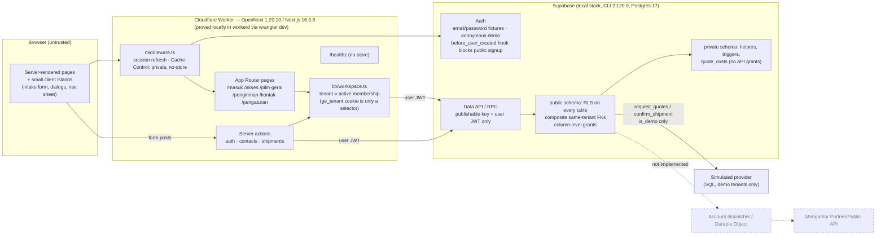
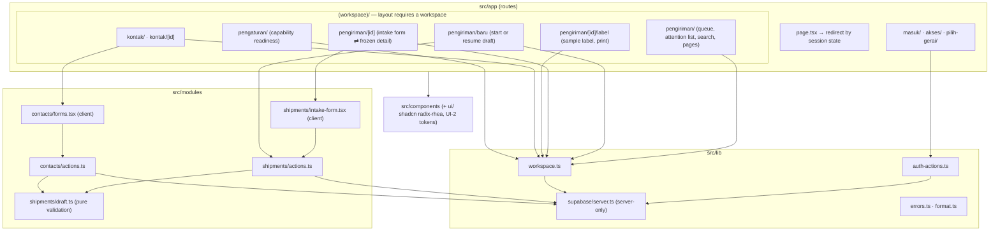
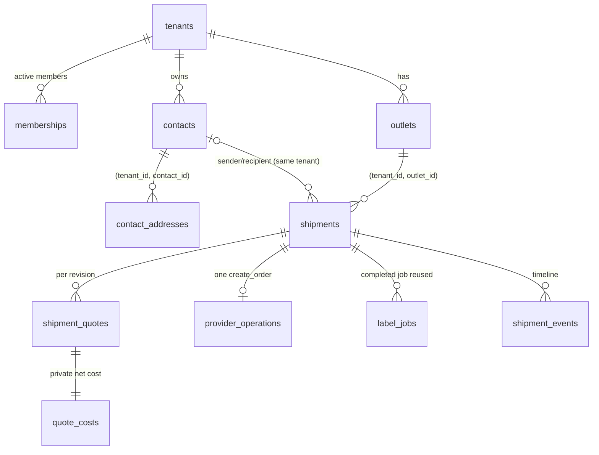
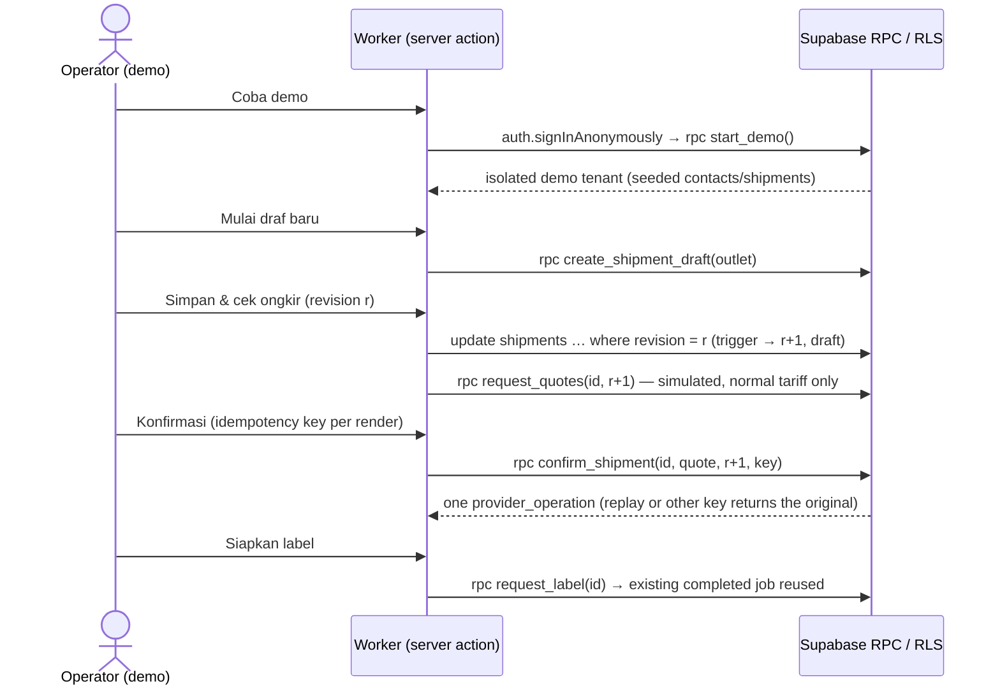

# GeraiExpress — Current Architecture Record

Updated: 2026-10-14
State: local foundation and synthetic demo preview implemented and verified locally (DEL-1
stages 1–2). No cloud resource, deployment, live provider call or real customer data exists.

## Canonical design

The target architecture lives in [04-SYSTEM-ARCHITECTURE.md](docs/spec/04-SYSTEM-ARCHITECTURE.md)
(ARCH-1 system, ARCH-2 Partner egress, ARCH-3 Auth/email, ARCH-4 module/deployment ownership).
This file records only what the code on disk does and which checks proved it. Where they
differ, this record states the actual behavior and the design keeps the target.

## System map

The diagrams below describe implemented, locally executed components only. Dashed edges are
target components from ARCH-1/ARCH-4 that do not exist yet.

### Runtime and trust boundaries (implemented)

No service-role or secret key exists in the application: every server read and write runs with
the signed-in user's JWT, so the Worker and a hostile browser calling the Data API directly hit
the same RLS and RPC checks (TEN-1). Provider dispatch, credential storage and webhooks are
absent; the only "provider" is a deterministic SQL simulation that refuses non-demo tenants.

### Code map (`src/`)

### Data map (implemented tables)

`quote_costs` lives in the `private` schema with RLS enabled and no API-role grants. Every
child table carries `tenant_id` and references its parent through a composite
`(tenant_id, id)` foreign key, so cross-tenant reparenting fails in the database.

### Primary flow — demo counter issuance

## Present on disk

| Component | Actual state | Evidence |
|---|---|---|
| Runtime | Next.js 16.3.8 App Router on `@opennextjs/cloudflare` 1.20.10, Wrangler 4.149.0, React 19.3.0, TypeScript 6.0.3; exact pins; pnpm `minimumReleaseAge` policy respected | `pnpm build`, `pnpm cf:build`; e2e against `wrangler dev` (workerd) |
| Adapter decision | Next.js 16.4.0 failed in workerd (`Unexpected loadManifest(/.next/server/preview-props.json)`, HTTP 500) with OpenNext 1.20.10; pinned 16.3.8, which passes. vinext (Cloudflare-recommended, beta) not used; OpenNext 1.x accepted as DEC-005 | BUILD-LOG 2026-10-14; `scripts/worker-smoke.sh` |
| Session handling | `src/middleware.ts` refreshes Supabase cookies and sets `Cache-Control: private, no-store` on every non-static response; Node middleware not used (OpenNext does not support it) | Reviewer curl of Worker responses; e2e |
| Identity | Supabase Auth email/password (seeded local fixtures only) and anonymous demo sessions; public signup refused by `private.before_user_created`; email confirmations on so an anonymous user cannot attach an unverified email | `tests/db/isolation.test.ts` registration gate |
| Tenancy | `memberships` + `private.member_role()`; anonymous identities count only in demo tenants; `ge_tenant` cookie validated against own memberships; multiple memberships require `/pilih-gerai` | DB isolation suite; e2e forged-cookie and two-membership tests |
| Contacts | Tenant-owned contacts and addresses, optimistic revision on edit, address archive keeps one primary | `tests/e2e/contacts.spec.ts` |
| Shipments | Draft → simulated quote (per revision, 30 min expiry) → explicit confirmation → one `create_order` operation → simulated AWB `SIM…`; content frozen after submission; unknown outcome reconciles the original operation | `tests/db/shipment-flow.test.ts`; `tests/e2e/shipping.spec.ts` |
| Pricing | Customer charge = simulated normal tariff; synthetic net cost stored only in `private.quote_costs` | DB grant assertions; reviewer RSC/payload inspection |
| Labels | Watermarked sample label page for simulated shipments only; completed job reused; print hides app shell | e2e label tests |
| Readiness | `/pengaturan` shows per-capability state; for real tenants every provider capability is "Belum tersedia" or "Belum diverifikasi" (only the outlet pickup address can be "Siap") | e2e settings tests |
| Quote reuse | `request_quotes` returns the unexpired set of the current revision instead of inserting another (migration `20261014090000`) | `tests/db/shipment-flow.test.ts` |
| Presentation | shadcn/ui (radix base, rhea style) remapped to UI-2 tokens; system font; Tailwind names `text-base/sm/xs/xl/3xl` carry the UI-2 sizes so `cn()` merges correctly; ≥44px targets | e2e touch-target, overflow and keyboard checks at 390/768/1280 |

## Not implemented (gated)

| Component | Gate |
|---|---|
| Real registration, invitations, account recovery (PR-29–PR-33) | CTX-34 policy + ARCH-3 mail proof |
| Mengantar seller onboarding/BYOK, credentials, live quote/order/label, webhooks (PR-17–PR-20, PR-3–PR-6 live) | CTX-9 ownership, Partner access, ARCH-2 egress, sandbox credentials |
| Account dispatcher / Durable Object / queues (TD-3) | Needed only when a real provider call exists |
| Super Admin workspace (PR-15, PR-23–PR-28) | Bootstrap identity, 2FA and capability policy |
| CSV, export, overview, finance | Later accepted requirements |
| Remote Supabase project, Cloudflare deployment | Explicit provisioning/deploy approval |

## Open production gates found during implementation

- Supabase per-IP Auth rate limits will see the Worker's egress address rather than each
  visitor; decide forwarding/limits before any shared preview.
- A person who controls a real inbox can still verify an email on an anonymous demo identity
  (the `before_user_created` hook does not run for that update). Harmless today (no
  email-matched invitations); must be closed before invite-by-email (PR-31).
- `next dev` rewrites `AGENTS.md` when it detects an AI-agent environment
  (`node_modules/next/dist/server/lib/generate-agent-files.js`); agents must start it with the
  agent environment variables unset or revert the injected block.
