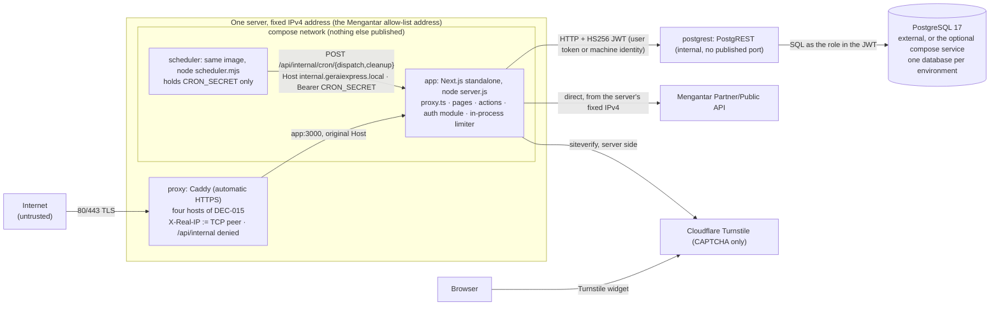
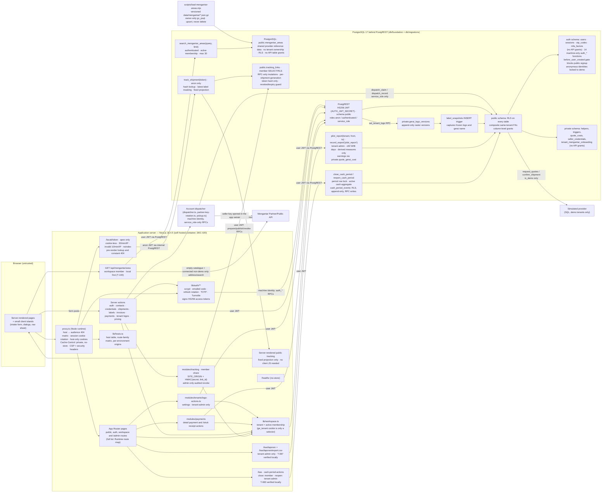
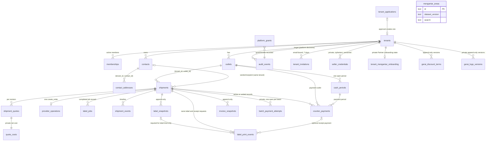
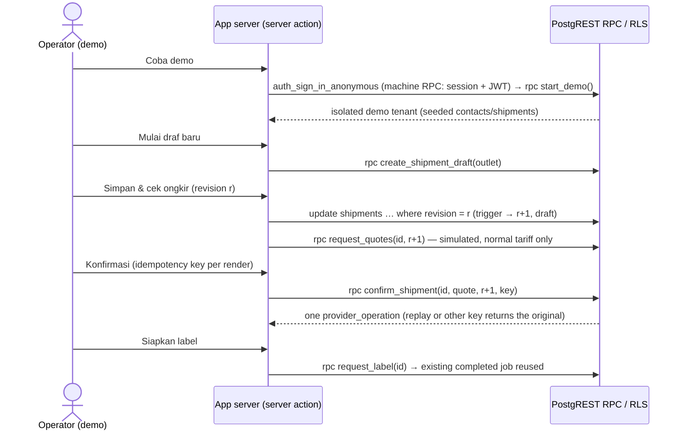

# GeraiExpress — Current Architecture Record

Updated: 2026-11-03
State: local foundation, synthetic demo preview, public marketing surfaces, Mengantar Partner
sandbox seller onboarding, live quotes/issuance, two-pass COD pricing and batch `pay-unpaid`
recovery are implemented and were verified locally (DEL-1 stages 1–3; T-001 through T-031).
The review fixes and features through wave E (T-050 environment/key-ring work and T-053 shipment UI)
and wave F (security and pickup/UI fixes) are merged into the local working tree, uncommitted.
T-041 and T-051's code integration gaps are closed; the pre-DEC-020 final-build Worker e2e on desktop-1280, mobile-390 and tablet-768 (142 passed / 2 skipped each) is recorded in BUILD-LOG.md as history.
T-062 (DEC-020, 2026-10-29) replaced the Cloudflare Workers runtime with a self-hosted Node.js container; see
"Self-hosted container runtime" below. Where older sections in this file still say "Worker", they describe
the verified pre-DEC-020 history or mean "the application server"; the container section is current.
T-066 (DEC-021, ADR-0002, 2026-10-29) replaced Supabase in the code with plain PostgreSQL 17 behind PostgREST and an
application-owned auth module; see "Data path and auth" under "Self-hosted container runtime". Supabase, GoTrue, the
Send Email Hook and the Supabase CLI are not part of the current implementation; where a historical passage below
still names them it is marked as history, and `docs/spec/**` is updated in a separate pass (T-067).
T-043 is reopened only for the supervised sandbox capture in T-048 item (6). T-037 (release
record) and T-045 (webhook/cancel/tracking) remain open; T-040 was design only and T-052 (egress
gateway) is cancelled by DEC-020. Batch payment, Partner key regeneration and pickup have no
supervised sandbox capture, so their response shapes remain unverified. Final merged counts and
final-build container e2e are recorded by the lead in STATUS.md.
Target design (webhook and provisioned environment separation) lives in docs/spec; its hybrid-hosting
part is superseded by DEC-020.

## Current backend audit and hosting amendment (T-068, DEC-022)

The current hosting direction is **Vultr + Coolify**, superseding the hosting exclusion in
DEC-020. `compose.coolify.yaml` inherits the Node app, scheduler, PostgREST and optional
same-host PostgreSQL service. Coolify owns TLS/public ports; the Caddy gateway listens on
8080 internally and trusts only the explicitly verified edge `/32` or `/128`, parsing
X-Forwarded-For right-to-left. All four domains route to that gateway. The app, data API and
SQL port remain unpublished. Standalone `compose.yaml --profile prod` is an alternate
single-edge deployment, not the Coolify start command.

The app receives an explicit environment allowlist: database owner and authenticator
credentials are not copied into it. PostgREST has a 10-connection pool and a 5-second pool
acquisition deadline. `/healthz` performs an anonymous SQL-backed readiness probe with a
2-second timeout and answers 503 without upstream details on failure.

Migration `20261029130000_backend_audit.sql` serializes first-password initialization at the
user row, checks the kept session under lock, removes obsolete GoTrue-role grants and API
role sequence grants/defaults. The signup gate itself remains because owned auth calls it.
The historical migration role name and standalone `@supabase/postgrest-js` library are
compatibility artifacts, not a Supabase service dependency.

The migration runner holds one PostgreSQL advisory lock across bootstrap, complete manifest
validation and per-file transactions. Missing, renamed or modified applied migrations are
refused before any new file runs. Each body and its ledger row still commit atomically.
Local dotenv values are parsed as data and explicit process values win; operator
`DATABASE_URL` never imports another local stack's credentials.

Executed evidence and remaining release gates are recorded in STATUS.md and RELEASE.md.
Older sections below preserve implementation history; this amendment governs the current
hosting, readiness, environment delivery and migration behavior.

## Non-COD cargo transport (T-080, 2026-11-03)

The Public API adapter supports non-COD cargo in the shipment workflow.
`estimate(..., includeCargo: true)` is a local parse opt-in, never a provider query flag;
the adapter default remains regular-only, while the non-COD workflow opts into cargo. Known cargo
response keys map to base couriers plus service class. Cargo tariff/net/discount/ETA come
only from cargo-specific fields, with a positive integer-gram route minimum. Missing or
inconsistent fields are dropped. Cargo COD is excluded during parsing and refused locally
at creation pending verified seller fee semantics; the observed Rp1 discrepancy is not
normalized away.

Weight groups and supplied-estimator two-pass COD use courier plus service class as identity.
A cargo response minimum must match the supplied verified rule before a grouped quote is
returned. This is not route-minimum discovery, billing-floor policy or a new DB snapshot.
Explicit cargo creation sends the base courier and `orders[].cargo: true`, requires a true
Boolean echo and a readable/non-contradictory selected-service price, and retains UNKNOWN
on uncertainty without retry. Read-back preserves a Boolean mode when supplied; absent or
malformed mode stays unknown rather than becoming false. The original transport allowlist,
redirect refusal, time/size bounds and secret-safe failures remain unchanged.

Non-COD JNE, SiCepat and iDexpress cargo are wired through quoting, confirmation and dispatch
under the sourced rules added by `20261103100000_cargo_noncod.sql`. Cargo COD and SAP cargo
remain excluded. Full T-080 remains open for the outstanding authenticated provider/route/order
evidence; local implementation is not proof of provider acceptance or release readiness. Existing
Partner signing, onboarding, BYOK and API-key rotation are reused rather than reimplemented;
callback-secret persistence/webhook readiness remain outside this slice (T-045/PR-19).

## Public tracking and resi sharing (T-085, 2026-11-05)

`src/modules/tracking` implements UX-18 / DATA-12 / SEC-8. An issued, non-simulated
shipment's result banner includes the detail share controls: WhatsApp opens a prefilled
`wa.me` message on the operator's device (never server sending), missing/invalid sender
phone offers **Salin pesan**, and **Salin tautan** has an explicit manual-copy fallback.
The display records that a link was prepared for sharing, not proof that a customer received it.
A tenant administrator can confirm **Cabut tautan** from that same detail.

The member-authorized prepare RPC locks the shipment and allocates one opaque `link_id`
per sharing generation. The server derives `base64url(HMAC-SHA256(TRACKING_TOKEN_SECRET,
link_id))` using `node:crypto`; only SHA-256 of the token is published. Repeated sharing
returns the same link; revoke + re-share creates a new `link_id`, never reactivating the
old token. Prepare/publish use separate calls, but publication names the exact generation,
so a late publication after revocation fails closed. Creation, first publication and
admin-only revocation are audited without token/hash/message/personal data. RLS permits
member SELECT only; anon has no table privilege, and all API roles including service_role
lack direct writes. `TRACKING_TOKEN_SECRET` is required at the sharing boundary (32+ bytes,
no development default) through `src/lib/config.ts`; examples are blank placeholders.
Compose passes it only to the app; local environment generation preserves its generated
value, and the isolated test runner generates its own root. It is in both bundle-scan
name/value lists and the per-environment required-secret/isolation gate. Root rotation is
not a revocation mechanism: old hash-based lookups remain valid until explicitly revoked;
a changed root cannot silently republish over an existing active hash.

**Public trust boundary.** `/lacak/*` is a dedicated public audience family, 404 on app,
owner, hooks and internal hosts (local shared mode is an explicit development exception).
The proxy removes any visitor-supplied `x-gx-public-tracking`, never resolves a session,
strips cookies before forwarding, and uses only the anonymous `track_shipment(token)` RPC.
It resolves before rendering so malformed, unknown, expired and revoked links return an
identical non-streamed Bahasa 404 with no token echo. Valid data is reconstructed from an
explicit TypeScript allowlist, then forwarded to the server-rendered page in a proxy-owned
request header; the page reconstructs that allowlist again. It never reads a session or
raw shipment row. No personal/money/provider fields or arbitrary event JSON cross this edge.
The public PostgREST service is not internet-exposed, so this is the only public data path.
The ordinary CSP remains; tracking always sends `X-Robots-Tag: noindex, nofollow` and private,
no-store, metadata noindex, and `/robots.txt` disallows `/lacak` even on the indexable apex.

The visitor address is only `clientAddress` from the verified proxy header. Tracking fails
closed without it in **all** environments. One in-process visitor budget permits 30 reads
per 60 seconds; invalid lookups also spend a separate 10-per-60-second budget. Exhaustion
answers 429 with `Retry-After: 60`, no cookie and no data. IPv6 uses the existing /56 grouping.
This inherits the one-instance/restart limitations of the existing limiter; shared storage
is still required before horizontal scaling. Tokens are never limiter keys or log fields.

The projection includes full AWB (UX-18), courier/service, dates in WIB, catalogue city only,
initials and the permitted gerai label. No free-text address/area is used as a city fallback.
The latest label snapshot alone controls masking and printed-sender initials; no snapshot
hides both gerai and sender initials. A masked latest snapshot always hides the gerai identity.
There are no live tracking events yet: the only status is **Status belum tersedia**, with an
empty timeline and a static courier tracking URL when known (no AWB in outbound tracking URLs).
T-045 must provide reviewed event mapping, structured hub city and delivered/returned expiry;
no fake status or expiry is inferred here. The public page is readable without JavaScript at
390 px. Tests authored: `tests/unit/tracking-*.test.ts`, host/robots/proxy/environment guards,
`tests/db/tracking-links.test.ts` plus the signature privilege allowlist, and
`tests/e2e/tracking.spec.ts` (390 px anonymous no-JS privacy, latest masking, revoke/reshare,
missing phone and `testInfo.outputPath` screenshots). Execution is pending the parent-run gates;
this section is an implementation record, not a release-readiness claim.

## Canonical design

The target architecture lives in [04-SYSTEM-ARCHITECTURE.md](docs/spec/04-SYSTEM-ARCHITECTURE.md)
(ARCH-1 system, ARCH-2 Partner egress, ARCH-3 Auth/email, ARCH-4 module/deployment ownership,
ARCH-5 hybrid hosting, ARCH-6 host topology and environments).
This file records only what the code on disk does and which checks proved it. Where they
differ, this record states the actual behavior and the design keeps the target.

## Self-hosted container runtime (T-062, DEC-020)

What the code, `Dockerfile`, `compose.yaml` and `infra/` do; locally executed only, nothing is provisioned.

- **Image.** `next.config.ts` sets `output: "standalone"` with the tracing root pinned to the repository.
  The multi-stage `Dockerfile` (Node 24 pinned by tag and digest, pnpm through corepack from
  `packageManager`, `--frozen-lockfile`) builds with the required `APP_ORIGIN` build argument (static
  marketing links bake it, so an image belongs to one environment), runs `scripts/check-client-bundle.mjs`
  inside the build, and the runtime stage is a non-root `node` user running `node server.js` with a
  `HEALTHCHECK` on `/healthz`. Root owns the executable code and dependencies; only `.next/cache` is
  owned by the app user (the Compose tmpfs is uid 1000). The build context includes no env file or tests.
  Next.js inlines only `NEXT_PUBLIC_*`, and `check:bundle` fails if any secret VALUE from a local env file appears in
  `.next/static`, `.next/server` or the standalone output (verified against a build made with a populated
  `.env.local`).
- **One configuration reader** (`src/lib/config.ts`, replacing `worker-secret.ts`): `config(name)` returns
  `process.env[name]` at call time, empty or whitespace-only = unset, so callers fail closed;
  `server-only` keeps it out of client code. `hosts.ts` keeps its injectable environment object
  (origins, `HOST_SHARED_MODE`) for unit tests; `src/lib/db/server.ts` and `src/lib/auth/instance.ts` read through `config`.
- **Client address and proxy trust** (`src/lib/client-address.ts`). The app reads the address ONLY from
  `X-Real-IP`, and only while `TRUSTED_PROXY` is exactly `1` (set by `compose.yaml` for the app, whose
  port is not published). If the header holds several comma-separated values the LAST is used; anything
  that is not a plain IPv4/IPv6 address is "unknown". `X-Forwarded-For`, `CF-Connecting-IP` and every
  other header are never read. Production Caddy (`infra/proxy/Caddyfile`) has no `trusted_proxies`: it
  REPLACES `X-Real-IP` and `X-Forwarded-For` with the TCP peer (`header_up ... {remote_host}`) and drops
  `Forwarded`, `CF-Connecting-IP`, `True-Client-IP` and `X-Client-IP`, so a client-supplied address never
  reaches the app (config test by inspection in `tests/unit/check-environments.test.ts`; reader tests in
  `tests/unit/client-address.test.ts`; proven end to end against a real Caddy in the BUILD-LOG entry).
  Without `TRUSTED_PROXY` the address is unknown and the visitor limiters REFUSE in production (the
  pre-existing behavior for a missing address, kept: fail closed, no shared sentinel bucket); only a
  non-production build proceeds unlimited. The local profile (`Caddyfile.local`, plain HTTP on
  `127.0.0.1`) trusts ONLY `172.30.62.1/32`, the gateway pinned in `compose.local.yaml`, to supply
  `X-Forwarded-For`; sibling containers are untrusted. The e2e suite cycles TEST-NET addresses.
  Production publishes explicitly on IPv4 `0.0.0.0`, never dual stack, and must have **no AAAA records**:
  Docker's IPv6-to-IPv4 userland proxy otherwise collapses IPv6 visitors to a bridge gateway. The app
  does not reject private addresses: that cannot recover a lost source and would break valid LAN users.
- **Hosts.** The four hosts of DEC-015 route to the app with their original `Host` (the app maps Host to
  an audience as before; `X-Forwarded-Host` is never read). A fifth name, `internal.geraiexpress.local`,
  is served by no proxy: it exists for the scheduler and the container health check and serves only
  `/healthz` and `/api/internal/cron/*` (`internal` scope in `src/lib/hosts.ts`; the shared loopback
  scope never includes the cron routes). `*.workers.dev` hosts are no longer served. Cookies stay host-only;
  the app sees plain HTTP behind the proxy, so HSTS is set by Caddy and `Secure` follows `NODE_ENV`.
- **Rate limits** (`src/lib/limiter.ts`). The eight Workers rate-limit bindings (`SIGN_IN_LIMITER` 10,
  `DEMO_LIMITER` 5, `MFA_LIMITER` 10, `OTP_LIMITER` 3, `SIGN_IN_ACCOUNT_LIMITER`, `OTP_ACCOUNT_LIMITER`,
  `MFA_ACCOUNT_LIMITER` and `REFRESH_LIMITER` 10 per 60 s) are in-process fixed windows with the same names,
  keys (IPv4 address or IPv6 /56; SHA-256 email digest; `mfa:<user>`) and `limit({ key }) -> { success }`
  contract, held on `globalThis`. Bounded memory: expired windows are evicted first; at the cap
  (10 000 keys per visitor limiter, 100 000 per account limiter) the oldest non-exhausted live window
  may be evicted, but an exhausted window is NEVER evicted. A table containing only exhausted windows
  refuses new keys. Saturation emits `rate_limiter_saturated` at most once per minute per table,
  with its limiter name, capacity and eviction/refusal action only. The clock is injectable.
  **Ceiling:** correct for ONE app instance; under saturation an unexhausted key can restart its
  budget if evicted (availability trade-off), while exhausted budgets cannot be reset by a fresh-key flood.
  A second instance multiplies every budget, a restart forgets every window, and a shared store is
  required before a second replica (`// lazy:` in the module). **Runtime:** `src/proxy.ts` (the former
  `middleware.ts`, renamed by T-066) runs on the Node.js runtime, like routes and Server Actions, and the limiter
  tables are held on `globalThis`, so `REFRESH_LIMITER` (spent in the proxy when a session refresh is needed) and the
  sign-in, demo, OTP, MFA and account limiters (spent in Server Actions) are meant to share one process-wide table
  per limiter; the former Edge-runtime split, and the doubled refresh budget it allowed with Auth IP forwarding
  on, no longer apply (that forwarding is gone). This is by construction and has not been measured; the header
  comment of `src/lib/limiter.ts` still describes the Edge split.
- **Scheduler.** `POST /api/internal/cron/dispatch` (every 5 minutes: the former `*/5` sweep) and
  `POST /api/internal/cron/cleanup` (hourly: the former aligned-hour cleanup), implemented in
  `src/lib/cron.ts` over `src/lib/mengantar/scheduled.ts`, which ports the former `scheduled` handler's
  logic and `dispatch_sweep` / `demo_cleanup` log lines unchanged. Gates in order: the Host must be
  `internal.geraiexpress.local` (else 404), `CRON_SECRET` unset = route disabled (404), `Authorization:
  Bearer <CRON_SECRET>` compared on equal-length SHA-256 digests with `timingSafeEqual` (else 401), known
  task (else 404), an in-process lock per task (409 `in_flight` plus a `cron_skipped` log; the database's
  one-in-flight-per-tenant rule stays the real serialization) and a 270 s execution deadline (504):
  it aborts ALL scheduled PostgREST/provider fetches and expires the task's lock, so a hung request cannot
  disable the job until restart. Later steps refuse an aborted signal, and an old run's finally block
  cannot release a newer lock. Provider calls retain their own shorter 10-15 s timeouts and the sweep
  handles at most 20 operations. The proxy answers 404 for `/api/internal` on every host and does not
  serve the internal name, and the app refuses the path on every other host, so a public host reaches
  neither. `infra/scheduler/scheduler.mjs` (Node built-ins only, run from the app image) fires on
  wall-clock minutes (UTC minute divisible by 5; minute 0 also cleans up), never stacks a task on its own
  running call, times a call out after 285 s and holds `CRON_SECRET` only.
- **Egress and the Mengantar allow-list.** Production Partner and Public API calls leave directly from the
  container host, so the **server's fixed IPv4 address is the address registered with Mengantar**; there
  is no gateway (DEC-020 cancels T-052; the safety ideas of ADR-0001 stay valid for any future separate
  egress component). The owner provisions the server; nothing is provisioned here.
- **Data path and auth (T-066, DEC-021, ADR-0002).** The app reaches PostgreSQL only through PostgREST over HTTP with
  a bearer JWT: `src/lib/db/client.ts` builds a `@supabase/postgrest-js` `PostgrestClient` (the stand-alone query
  builder package, no dependency on any Supabase service), `src/lib/db/server.ts` supplies `dbServer()` (the signed-in
  user's verified access token, else the `anon` role), `machineClient()` (the static `service_role` JWT minted from
  `AUTH_JWT_SECRET`, DEC-010) and `currentUser()` (access token verified locally AND the session checked against
  the database on each request). PostgREST verifies the same HS256 secret (`PGRST_JWT_SECRET` is `AUTH_JWT_SECRET`),
  serves schema `public` as role `anon` for audience `authenticated`, and connects as the `authenticator` role.
  Authentication is `src/lib/auth/**` (service, jwt, password, otp, totp, turnstile, crypto, store, instance): scrypt
  passwords; an emailed 6-digit code (HMAC-hashed with a key derived from `AUTH_SECRET`, valid 10 minutes, 5 wrong
  guesses per code, 20 per address per hour, one code per 30 seconds); 10-minute HS256 access tokens
  (`gx_at`) plus rotating refresh tokens (`gx_rt`, stored only as hashes) with reuse detection and a 10-second
  grace for parallel requests (`recent_reuse`: the caller leaves its refresh cookie alone); sessions enforced by the
  server (`auth.sessions`: 7 days, 12 hours for an identity holding a platform grant) and revoked together when an
  account is deactivated; TOTP for the Super Admin with sealed secrets and a replay guard (a code step must be
  newer than the last accepted one); Turnstile verified by the app before password sign-in, demo entry, code
  request AND code verification, failing closed. The state lives in migration
  `db/migrations/20261029100000_auth_core.sql` and 14 machine-only `public.auth_*` functions (service_role only; they
  see hashes and sealed text, never a password, code, refresh token or TOTP secret in plaintext). Tables `auth.users`
  and `auth.mfa_factors` come from `db/foundation` (plain PostgreSQL has no `auth` schema); the legacy
  `supabase_auth_admin` role exists only because older migrations grant to it, and no daemon uses it. The session
  cookies are written by Server Actions (`src/lib/db/session.ts`) and rotated by `src/proxy.ts`
  (`src/lib/db/refresh.ts`): a missing, expired or soon-to-expire access token with a refresh token triggers one
  rotation, budgeted by `REFRESH_LIMITER`; a definitive failure clears both cookies; a refused budget or a database
  that cannot answer yields 503 + `Retry-After: 60` and keeps the cookies. `compose.yaml` runs `postgrest`
  (profile `prod`, internal network only, health check `postgrest --ready`) and an optional `postgres`
  (profile `db`, no published port, volume `postgres_data`); the local `compose.db.yaml` (project `gxdb`) runs
  PostgreSQL, PostgREST and Mailpit on loopback ports for development and tests. Production database hosting (same server
  or managed PostgreSQL), backups and point-in-time recovery are owner decisions and gates (T-067).
- **Mail.** The one-time code is rendered by `renderCodeMail` (`src/lib/auth-mail.ts`, Bahasa Indonesia, code-only)
  and sent by `src/lib/mail-transport.ts` straight from the app after SQL has decided that a code may exist
  (registration gate, anonymous requester, throttles). The Send Email Hook route, `SEND_EMAIL_HOOK_SECRET`,
  `AUTH_FORWARD_CLIENT_IP` and the hook relay no longer exist. The only transport is Mailpit (loopback, the Docker
  host alias `host.docker.internal`, or the local database stack's container name `gxdb-mailpit-1`); any other
  `MAIL_TRANSPORT` or none fails closed (`MailNotConfigured`, logged as `auth_mail_failed`). No production provider
  is chosen (T-063 is owner-gated); no Cloudflare binding path ever existed in code.
- **Cloudflare that remains:** Turnstile only (the widget script and the CSP allowance for
  `challenges.cloudflare.com`; its siteverify is done by the app, `src/lib/auth/turnstile.ts`, 5-second timeout,
  anything but HTTP 200 with `success: true` fails closed).
- **Accepted protection gaps.** Removing the Cloudflare runtime also removes its network DDoS, WAF and bot
  protection; Turnstile is not a replacement for those controls. The official Caddy image has no built-in
  request-rate limiter plugin. Both profiles cap bodies at 1 MB (`request_body max_size`, aligned with
  Next's Server Action limit); request-rate and upstream
  network-abuse protection remain operator gates. There is no external Auth service: the per-visitor limits are the
  app's own in-process limiters keyed by the trusted proxy's `X-Real-IP`. All Compose services use bounded Docker `local` logs (10 MB × 3)
  and read-only root filesystems. The production proxy mounts only the production Caddyfile; local
  e2e trust is never used in production (enforced by `check:environments`).

## System map

The diagrams below describe implemented components; executed evidence is recorded in STATUS.md.
Dashed edges are target components from ARCH-1/ARCH-4 that do not exist yet.

### Runtime and trust boundaries (implemented)

Every user-driven read and write runs with the signed-in user's JWT, so every statement meets the same RLS and
RPC checks whichever caller issues it (TEN-1); PostgREST is not published, so a browser cannot reach it directly.
Public tracking is a separate bearer-capability exception: the cookie-less proxy uses an anon
JWT for `track_shipment(token)`, never a shipment-table read or machine identity. The dispatcher
is the privileged-write exception (DEC-010, T-022): it records Mengantar results through `dispatch_*`
RPCs that only `service_role` may execute, so no user can forge a resi. Since T-023 the same
machine identity (a static `service_role` JWT the app signs with the container environment secret `AUTH_JWT_SECRET`, never in the client bundle)
serves `machine_seller_key` (the sealed key, opened only on the server) and
`record_live_quotes` (live Mengantar estimates; net cost to `private.quote_costs`). Connected
real gerai quote live; demo gerai keep the SQL simulation. T-100 (owner request
2026-11-05) changes T-023 recipient area search to local-first: the member's
`GET /api/mengantar/area` calls `search_mengantar_areas` through the user's DB client,
reading `public.mengantar_areas` before opening any seller key. The owner-run
`scripts/load-mengantar-areas.mjs` loads the unchanged 99ribu read-only 2026-10-30
Mengantar harvest (79,391 rows), with validation, versioned upserts and no deletion.
Exact postal code ranks first, then kelurahan/kecamatan/kota prefix; contains and
multiword search use normalized text. Bounds are 3–60 query characters and 1–30
results. Only a catalogue miss for a connected non-demo gerai falls back to
Mengantar `GET /address/search`; DB errors fail closed, not through to the provider.
There are no direct API-role table grants. The route/RPC also accepts demo members,
but the demo intake deliberately retains its existing free-text area UI (no second
picker/control); SQL simulation does not require any specific provider area id.
Live quotes/orders send a chosen provider id unchanged; Mengantar remains the authority.
Harvest gaps/caps and refresh-by-owner-approval are recorded in `data/mengantar/README.md`.
Loading is an explicit operation, not part of migration or seed execution. Without `MENGANTAR_ENV` and the auth/PostgREST values (`POSTGREST_URL`, `AUTH_JWT_SECRET`, `AUTH_SECRET`) live features fail
closed with an explanatory message.

T-080's owner-approved regular-service slice adds sourced, append-only
`private.billable_weight_rules`, read through the member-checked
`billable_weight_rules(tenant)` RPC and changed only through the audited aal2
`platform_set_billable_weight_rule` RPC (`integration_operations`). New quotes keep actual,
volumetric and billable grams plus the rule version; legacy rows remain NULL. The pure
`src/lib/billable-weight.ts` calculation is mirrored in SQL for simulation and machine quote
validation. Live quoting groups regular couriers by distinct billable grams and filters each
response before the two-pass COD calculation. Confirmation freezes the selected quote's
weights and measured dimensions in `shipments.weight_snapshot`; dispatch uses the frozen
billable weight, with actual-weight fallback only for legacy NULL computed weights.

DATA-14's explicit fallback retains exact actual grams and NULL volume when dimensions or
formula are missing. Complete dimensions apply the sourced tolerance to the heavier raw
weight; below 1 kg, positive raw grams are retained at integer-gram precision without a
provider-wide minimum or half-fare. Only fictional demo tariff pricing retains its existing
whole-kg pricing minimum. The original cargo ranges are dated evidence; the forward
`20261103100000_cargo_noncod.sql` migration adds the sourced executable rules for non-COD
JNE, SiCepat and iDexpress cargo. Quoting, confirmation and dispatch use those rules; cargo COD
and SAP cargo stay excluded, and authenticated provider/route/order evidence remains T-080.
Intake shows all three weights,
admin source/date and the reweigh/seller-balance warning. Nullable provider reweigh storage
and presentation do not implement T-045 ingestion. Current verification and independent
review are recorded in STATUS.md and the T-080 review report; full task/release acceptance
is not implied.

T-024 wires issuance: `confirm_shipment` creates a real queued operation for a connected gerai
and the confirming server action runs `dispatchOperation` at once (pickup re-checked at
Mengantar, one order, judged result). A definite refusal (400/403/local, pickup gone) can be
reopened and confirmed again; any failure that may still become an order blocks a second
operation (partial unique index). Admins reconcile unknown outcomes through the dispatcher, and
anyone checks an unpaid order's payment. The scheduled sweep is `POST /api/internal/cron/dispatch`
(called every 5 minutes by the scheduler container; formerly the Worker `scheduled` handler):
`sweep()` over `dispatch_due()` — queued
operations nobody sent, stale in-flight/unknown ones, unpaid orders — throttled by
`last_checked_at` and skipping claims that would certainly be refused. Real labels come from
the Mengantar app until Mengantar whitelists label generation. Per seller, at
most one real operation is in flight (a partial unique index); a stale in-flight or unknown
operation is reconciled by its reference, never resent.

T-025 and T-026 add COD shipments (`is_cod`, `cod_amount_idr`, `cod_fee_idr`, `cod_supported`)
with two-pass live COD fee pricing (`estimate(COD = goodsValue + pass1Tariff)`), provider
refusal detail persistence (`provider_error_detail`), and tenant-admin batch `pay-unpaid`
recovery (`review_unpaid_batch`, `dispatch_begin_batch_payment`, `dispatch_release_batch_payment`,
`dispatch_record_payment`, and `payUnpaidBatch(batch, courier)` verified against `batch_digest` before spending balance).
T-027 adds Mengantar Partner API sandbox seller onboarding (`private.tenant_mengantar_onboarding`
with `partner_onboarding_status`, `begin_partner_seller_onboarding`, `complete_partner_seller_onboarding`,
`record_partner_seller_onboarding_outcome`, immutable `external_user_id = 'geraiexpress:tenant:' || tenant_id`, owner disclosure +
Terms/Privacy consent, 503 partial-provisioning recovery, and 409 existing-account BYOK routing).
T-028, T-029, and T-030 add contact archiving (`archive_contact` with row-lock `tenant_admin`
re-check), public marketing pages (`/`, `/fitur`, `/simulasi`, `/cara-kerja`, `/hubungi-kami`),
security response headers, `cleanup_expired_demos`, and the staging environment definition (now `infra/env/staging.env.example`, T-062).

### Merged 2026-10-28 (waves A–F through T-053, uncommitted): what the code does

Each item names its file; "unverified" marks behavior that depends on a provider answer nobody has
observed. Counts and executed checks are under "Verified counts and gates".

- **Host topology and sessions (T-042, T-038).** `src/lib/hosts.ts` holds the host table and the
  route-family matrix; `src/proxy.ts` (the former `src/middleware.ts`) answers a path outside the host's audience, and any
  unknown host, with a plain 404 ("Halaman tidak ditemukan", no redirect, no hint of another
  host). Hosts: apex (public), `app.` (gerai), `owner.` (Super Admin), `hooks.` (the reserved `/api/webhooks` prefix,
  cookie-less; the Send Email Hook route no longer exists and no route is served there today) and the same four with single-level
  staging names (`staging.`, `app-staging.`, `owner-staging.`, `hooks-staging.`). A shared
  all-audiences mode exists only on bare loopback names in a non-production build, or where
  `HOST_SHARED_MODE=1` (local `dev-env.sh` writes it for the container only; never staging/production). `*.workers.dev` hosts are no longer served (T-062); `internal.geraiexpress.local` is the fifth, internal-only name.
  `originFor` maps all four `*_ORIGIN` names and validates only the requested audience.
  Link callers read `APP_ORIGIN`: invitations through `appOrigin`, marketing through
  `appHref`; tracking links read per-environment `SITE_ORIGIN` through `originFor("public")`.
  `OWNER_ORIGIN` and `HOOKS_ORIGIN` have no current application caller;
  the marketing `SITE_ORIGIN` constant is a fixed apex URL, not the environment variable.
  Missing `APP_ORIGIN` throws when a production-build link is built, including static marketing.
  The session cookies `gx_at` (access JWT) and `gx_rt` (refresh token) are written by `src/lib/db/session.ts` and rotated by
  `src/proxy.ts` with the attributes of `src/lib/db/cookies.ts` (host-only, `HttpOnly`, `SameSite=Lax`, `Secure` on HTTPS
  or production; the 7-day gerai and 12-hour owner cookie bounds mirror the server-enforced session lifetime, which is authoritative). The proxy config
  (`infra/proxy/Caddyfile`) routes the four hosts; nothing deploys here. Not proven: the Server Actions
  origin check across two tenant-facing hosts; a production-host (TLS) run of the host spec.
- **CSP, Auth ingress (T-038, T-066).** Enforced CSP: `frame-ancestors 'none'; object-src 'none';
  base-uri 'none'; form-action 'self'` plus `Permissions-Policy`. The nonce `script-src` with
  `strict-dynamic` and the Turnstile host is Report-Only, because Next.js router code (re-checked
  on 16.4.5: `node_modules/next/dist/server/lib/router-utils/resolve-routes.js:463-466`) copies proxy (the former middleware)
  response headers onto the request headers, so the enforced base policy replaces the
  nonce-carrying request policy and Next finds no nonce (effect inside the standalone server not
  verified, and not re-checked after the rename to `src/proxy.ts`). A server-level enforced nonce CSP is T-055. Rate limits (in-process fixed windows since T-062, see "Self-hosted container runtime"): per-visitor limiters
  (`SIGN_IN_LIMITER`, `DEMO_LIMITER`, `MFA_LIMITER`, `OTP_LIMITER`, IPv6 grouped at /56), account
  bindings keyed by the SHA-256 of the lowercased email or the MFA user id
  (`SIGN_IN_ACCOUNT_LIMITER`, `OTP_ACCOUNT_LIMITER`, `MFA_ACCOUNT_LIMITER`, 10 per 60 s) and
  `REFRESH_LIMITER` (limits session refreshes per visitor); a missing visitor address or key fails closed
  in production. Password sign-in checks account-plus-visitor before the auth call, spends the password account-wide
  budget only after the Turnstile step, and revokes a successful result beyond that budget (no cookie is set).
  Code requests spend no address-wide budget before Turnstile; code verification checks Turnstile in the
  app, but its email is still client-held state (T-058). A refused local refresh returns 503 with
  `Retry-After: 60`, not a session-dropping 429, and `src/proxy.ts` answers that 503 itself instead of continuing with expired cookies (the browser keeps them);
  so does a refresh the database could not answer, and demo entry refuses a retryable identity failure. There is no Auth IP
  forwarding (`AUTH_FORWARD_CLIENT_IP` and `Sb-Forwarded-For` are gone): the app limits by the trusted proxy's address
  and passes it to Turnstile as `remoteip`.
  `auth_rate_limited` logs bounded route/status for local refusals (routes `/masuk`, `/daftar`, `/verifikasi-2fa`,
  `/refresh`); `auth_unavailable` and `session_resolution_failed` log store and configuration failures (OBSERVABILITY.md).
- **Partner seller binding and key lifecycle (T-032, T-034, T-039).** The outcome writers and
  `complete_partner_seller_onboarding` are `service_role`-only and run through the machine client
  after the user-session admin check and `begin_partner_seller_onboarding`; `partner_seller_id`
  is unique where not null and write-once; before any `sellers/api-key` call the Worker requires
  `sellers/list` (page 1, size 2, total 1) to return the same seller id and `externalUserId`.
  `complete_partner_seller_onboarding` takes `p_expected_version` (stale or NULL: SQLSTATE
  55000). `begin_partner_seller_key_recovery` creates nothing and needs a consent record; owner
  and consent fields are frozen once a seller id exists. Terms and Privacy versions and URLs come
  from the bindings `PARTNER_TERMS_VERSION`, `PARTNER_PRIVACY_VERSION`, `PARTNER_TERMS_URL` and
  `PARTNER_PRIVACY_URL` (unset: `configuration_blocked`, submit disabled; browser-posted versions
  ignored). Key regeneration (`begin_partner_key_rotation`, `fence_partner_key_rotation`,
  `record_partner_key_rotation_outcome`, `store_partner_seller_key`) supersedes the active
  Partner key before the regenerate call, records `rotation_unknown` on a lost response and
  recovers through `sellers/api-key` (get); `API_KEY_DISABLED` and `SELLER_DEACTIVATED` set
  `provider_restricted` without retry; a BYOK key is never touched; `callbackSecret` is ignored.
  Unverified: every Partner response shape beyond the recorded sandbox fixtures. Open: bindings
  written before T-032 are not re-verified. T-054 preserves durable Partner stops/retry windows
  and fences onboarding outcomes during `rotation_unknown`.
  F1's `private.operation_credential` lets original operations reconcile after regeneration using
  the active same-tenant, same-environment Partner key; superseded BYOK keys and mode changes
  never cross versions. Begin and complete onboarding refuse `rotation_unknown` (55000).
- **Environment scope and key ring (T-050, F1).** Migration
  `20261028230000_environment_scope_key_ring.sql` adds `provider_env` to credentials and onboarding
  (`sandbox`/`production`, default sandbox; backfill assumes no production rows), one active
  credential per tenant/environment and seller-id uniqueness per environment. Machine key reads
  and claims take the environment; reconcile payloads derive it from the operation and the Worker
  checks the caller environment; T-057 also enforces SQL `p_env`. `CREDENTIAL_KEYS` JSON and
  `CREDENTIAL_KEY_CURRENT` select the sealing key; opening uses stored `key_version`; single
  `CREDENTIAL_KEY` remains v1. `reencryptCredentials`, `listTenantIds` and machine-only
  `rewrap_seller_credential` exist, fenced/audited without changing credential identity or
  active/superseded state; F1 permits only increasing key versions. The hourly
  `/api/internal/cron/cleanup` invokes environment-scoped rewrap (T-057), emitting
  `credential_rewrap` counts or disabled/failure state; retain old keys until completion is verified.
  `pnpm check:environments` refuses secret values shared between environments, a production
  provider in non-production and Turnstile disabled outside local; it checks the committed templates
  by default and the real files when given. The deploy scripts of the Worker era are gone (T-062); a separate
  staging environment (own database and secrets) remains owner-gated.
- **Quote origin (T-034).** `record_live_quotes` takes mandatory `p_origin_area_id` and
  `p_origin_address_id` (old overload dropped); a pickup change expires unconfirmed quotes;
  `confirm_shipment` freezes the provider pickup address id and area id in `pickup_snapshot` and
  `private.dispatch_payload` reads the snapshot; shipments confirmed before the migration have no
  provider ids and dispatch refuses them (`INPUT_INCOMPLETE`). Live recipient limits (name 100,
  address 300, provider phone rule) are Bahasa field errors at quote and confirm.
- **Batch payment (T-033).** The batch code and the 24-hex batch object id are separate typed
  fields (`provider_operations.provider_batch_id`); `POST /order/pay-unpaid` sends the object id
  and reads and compares the documented count in `data`. `private.batch_payment_attempts`
  (claimed, sent, unknown, paid, rejected, released; one open attempt per batch) is written `sent`
  before the POST and fenced to the attempt id; `authorize_batch_payment` (tenant admin, audit
  `shipment.batch_pay`, single use, five minutes, re-checks a demoted admin) feeds the machine
  claim; a 400/403 or readable zero-count answer is read back per order: all paid → paid,
  complete and none paid → rejected (`payment_not_applied` for zero), otherwise unknown.
  Count mismatches are audited; `private.payment_busy` treats sent/unknown as busy for two
  minutes. Lock order: operations, shipments, membership, tenant, attempt (T-104 applies the same
  shipment → membership order to `void_counter_payment`, `revoke_tracking_link` and `reconcile_shipment`). T-053 shows sent/unknown
  attempts as reconcile-only and hides payment; an admin close is still missing (T-056).
- **Pickup (T-043).** `shipments.handover` (`dropoff` or `pickup`) with date, start hour, volume
  class and note is frozen at confirmation. Pickup runs `GET /time`, a stored `reserving` phase,
  one `POST /time`, `reserved`, `creating`, then `POST /order` with `scheduledPickup`, `time_id`
  and volume (`src/lib/mengantar/pickup.ts`, `dispatcher.ts`; `dispatch_pickup_*` RPCs are
  machine-only). Lost reservation read-back excludes ids held by the tenant's other operations
  through `dispatch_pickup_known_time_ids(uuid)` and accepts exactly one match; several matches are `reservation_ambiguous` and none records `not_created` after the usual waiting period;
  one date per row is used (UTC date if its UTC clock equals `time`,
  otherwise WIB). Lost creates reconcile by reference; started reservation/create is never resent.
  Final operation states take precedence over pickup phases in detail copy. Distinct
  `pickup_reservation_not_recorded`/`pickup_create_not_recorded` reasons describe write-ahead failures.
  An oversized `GET /time` body proves reachability for the pre-check only; read-back fails closed.
  Local rules: start 09–18, 90-minute lead, 14-day horizon. Unknown until capture: response shapes,
  ids, shipment ownership of a matched slot, time zone/one-hour assumption, release and Pos pinpoint.
  F2 adds pickup-intake browser coverage and the pure `couriersForHandover` filter test.
- **Masked label, invoice, export (T-044, T-047).** `tenants.contact_whatsapp` (CHECK
  `^0[2-9][0-9]{7,11}$`, set at approval, changed by `set_tenant_contact_whatsapp`),
  `masking_allowed` (`platform_set_masking_allowed`, `tenant_governance`, `aal2`;
  T-053 screen `/admin/tenant/[id]` with `platform_tenant_masking`, reason and confirmation),
  append-only `label_snapshots` and `label_print_events`, `create_label_snapshot`,
  `record_label_print(uuid, boolean)`. T-084 (`20261105150000_masking_acceptance.sql`, PR-46):
  `private.masking_acceptance` per courier (missing row or NULL courier = `unverified`), member read
  `masking_acceptance_for`, platform read/write `platform_masking_acceptance` /
  `platform_set_masking_acceptance` (`integration_operations`, `aal2`, reason, evidence, 55000 stale
  guard, audit `masking_acceptance.set`, screen on `/admin/integrasi`). The old
  `record_label_print(uuid)` is dropped; the acknowledgement has no default, a masked print of a
  not-verified courier without it is refused (`masking_acknowledgement_required`, 55000), and masked
  label events store `acceptance_state`/`acknowledged` (NULL for unmasked labels and receipts).
  Label, batch (one acknowledgement listing the couriers) and invoice views share
  `src/modules/labels/masking-acceptance.tsx`; the screen-only return note comes from the pure
  `src/modules/labels/return-destination.ts` with provinces from `label_return_routes(uuid[])`.
  The label layout is unchanged. The label page renders a 100x100 mm parcel in either format: `10x15`
  (default) adds a detachable 100x50 mm customer slip below the cut line on one 100x150 mm page;
  `10x10` is parcel only. The slip has frozen gerai logo/name and courier/service on one row,
  then Code128 AWB bars and the AWB number, with no sender/recipient contacts or gerai WhatsApp.
  `20261105120000_resi_format_lock.sql` replaces the latest seven-argument `create_label_snapshot`
  body: under `lock_member_shipment`'s FOR UPDATE lock, a different size from the first snapshot
  is refused with `label_format_locked` (55000); same-size reuse and masking/sender changes remain.
  Existing snapshots are unchanged, including historical mixed-size versions; their first version
  determines future format. Individual controls show the locked size disabled; batch previews exclude
  other-format shipments with a Bahasa reason, and racing RPC refusals are reported per reference.
  Code128 uses sets B/C (`src/lib/label-code128.ts`); no provider call, no net cost,
  no pickup name as sender; the unsaved preview does not print. `invoice_snapshots` (append-only,
  `<PREFIX>-INV-<yymmdd>-<seq>` from `private.invoice_counters`), `create_invoice_snapshot(uuid)`,
  route `/pengiriman/[id]/invoice` (stored label read-only, then an A4 invoice; not proof of
  payment). CSV export `/pengiriman/export.csv`: tenant admin only through the user's own session
  and RLS, 10000-row cap with `X-Export-*` headers, 15 sender-facing columns, formula-injection
  guard, BOM, `no-store` and audit before bytes. F2 uses keyset paging `(created_at,id)` rather
  than offsets, Bahasa not-found text, audit labels/filters for `invoice.snapshot` and
  `export.shipments`, and hides invoice snapshots from the default audit list (explicit filter
  still returns them). Invoice COD copy says goods value plus customer shipping charge, including
  the COD fee. Only Chromium print-to-PDF exists; courier acceptance remains unproven.
- **Cash periods and day close (T-083, verified locally; not deployed).**
  Tenant-host `/kas` lists every outlet's open period, active payment totals by method and
  `recorded_by` identity (stored label "Petugas", never an inferred staff name), expected cash and
  the last 20 closed periods. Rupiah/WIB formatters are shared with shipment payments; all demo
  amounts carry "contoh". Reads page through payment rows rather than silently accepting the Data
  API row cap; failed or unsafe-money reads withhold the forms. Confirmation dialogs preview
  counted cash and signed variance; the server recomputes expected cash at commit. Pending disables
  submit and unknown outcomes require reload, never automatic replay.
  `20261105130000_cash_period_close.sql` adds member-readable `cash_period_events`, same-tenant
  composite FK, immutable-history guard and RPC-only writes (no anon/service-role grants).
  `close_cash_period(uuid,bigint)` permits operators and tenant admins per IAM-1's counter rows;
  only `reopen_cash_period(uuid,text)` is admin-only, with `private.require_reason` and an audit.
  Close stores active-cash expected/count/variance plus actor/time atomically and appends a close
  event; reopen clears the close fields and appends a reasoned reopen event without erasing history.
  A competing close gets `period_closed` (55000). Reopening with another open period is refused
  as `period_open_exists` (55000); the admin must close the current period first, never merge.
  Both commands lock only the period and read payments without row locks, compatible with
  record/void's shipment -> payment -> period order. Periods span midnight; the next payment after
  close opens a new period. A bounded three-attempt lookup handles competing openers or a close
  while waiting for the period lock; it never retries a payment operation or emits SQLSTATE 40001.
  DB/unit/e2e coverage is added in source-named cash-period tests, including a deterministic blocked
  payment/close race and 390/1280 screenshots. Executed and independently reviewed; results are
  recorded in STATUS.md. PR-45 pilot reporting is not part of this slice.
- **Pilot report and earnings view (T-087, verified locally).**
  `20261105160000_pilot_report.sql` extracts the unchanged per-quote body of
  `gerai_cost_for_quote` into `private.quote_gerai_cost(uuid,uuid)` (no API grant);
  `gerai_cost_for_quote` keeps its signature, ACL and admin check as a thin wrapper.
  `public.pilot_report(uuid,date,date)` (security definer; member check, then `admin_required`
  42501 for operators; `report_range_invalid` 22023 for a missing, reversed or over-92-day range)
  returns one row per outlet and WIB day plus per-outlet and grand totals from one GROUPING SETS
  aggregate, so total medians are exact. Measures: issued shipments by `issued_at` WIB day (real
  gerai: non-simulated only; demo gerai: its simulated sample only, never mixed); median minutes
  `created_at` → `issued_at`; active counter payments by method by `recorded_at` WIB day; shipments
  with a label and those whose latest snapshot is masked; earnings = selected quote
  `normal_tariff_idr` − `private.quote_gerai_cost` (terms at `quoted_at`), excluding COD fee and
  insurance, NULL when any contributing cost is unknown (with an unknown count), always NULL for
  demo. No net cost, assigned/observed percentage or discount column is returned.
  `record_export` is recreated from its latest body with the same signature and ACL and also
  accepts kind `pilot_report` (filters `from`/`to` only; audit `export.pilot_report`).
  Tenant-host `/kas/laporan` (tenant admin only; operators get the workspace not-found page and no
  nav item) renders record cards below 1024 px and the table from `lg`, with definitions, period and data timestamp, unknown as
  "Belum diketahui" and demo amounts "contoh". `/kas/laporan/export.csv` (tenant admin of a real
  gerai, `no-store`, audited before any byte, formula guard from `src/lib/csv.ts`) mirrors the
  shipment export contract. Responses at the 1000-row Data API cap fail closed. Tests:
  `tests/db/pilot-report.test.ts`, `tests/unit/pilot-report.test.ts`, `tests/e2e/pilot-report.spec.ts`.
- **Return and claim cases (T-086, manual flow before T-045; verified locally).**
  `20261105170000_return_claim_cases.sql` adds `private.claim_window_rules` (no API-role grant;
  seeded from Mengantar help 8140017, updated 2026-09-18, with URL and date, unit `working_days`,
  `days` or `hours`, anchor `last_status`, `delivered` or `rts`, optional JNE region), member-readable
  `shipment_cases` and append-only `shipment_case_events` (immutable-history guard, same-tenant
  composite FKs, RPC-only writes). Anchors are seeded only where the source states them
  (SiCepat, iDexpress, AnterAja, Pos from the last status; SPX from RTS); JNE 45/60 working days,
  SAP 60 days, J&T/Lion 30 days and the iDexpress/J&T 3x24 h lost-claim window have no stated anchor,
  so their `deadline_at` stays NULL ("Tenggat tidak diketahui"); the 7–15 day dispute range is not
  seeded. Before T-045 no provider status exists, so staff may enter the anchor instant (WIB) read
  from the Mengantar app; it is stored with `anchor_entered_by/at` and shown "dimasukkan petugas".
  `open_shipment_case` (member, issued shipments only) and `update_shipment_case` (member, revision
  fence) compute `rule_id`/`deadline_at` in SQL every time (`private.claim_deadline`, mirrored by
  `src/modules/cases/deadline.ts` for display and unit tests; working days skip Saturday/Sunday on
  the WIB calendar, holidays are not excluded and the screen says so). A partial unique index keeps
  one non-closed case per shipment (as amended in DATA-15: one counter conversation per
  parcel); a race loser gets `case_open_exists` (55000). `close_shipment_case` is
  tenant-admin only, requires an outcome, and requires amount plus deciding party (`courier` or
  `mengantar`) only for `compensated`. Every transition appends an event and `private.audit`; open
  and close also add a shipment timeline event. Errors are 55000/22023/P0002/42501, never 40001.
  `/kasus` (open/closed filter) and `/kasus/[id]` are tenant routes in the host matrix, nav (with a
  count from `case_attention`), crumbs and robots; the shipment detail shows "Retur dan kasus" with
  the return-destination rule, the list rows a "Retur"/"Kasus terbuka" badge and the dashboard a
  "Retur dan kasus" region. "Retur" derives from `delivery_state = 'returned'` (never set before
  T-045) or a non-closed return case. The 14-day processing ceiling (help 5207011) and exclusions
  (help 6046101) are information copy; `tests/unit/cases-copy.test.ts` proves no promise wording and
  no rupiah amount in case copy. Deferred to T-045: the Lost-status case suggestion (no status
  source exists) and return events; the 3x24 h window computation is unit-tested.
- **Counter payments and receipts (T-082, verified locally).**
  `20261104120000_counter_payments.sql` adds member-readable, RPC-only `counter_payments` and
  `cash_periods`. Payment reads are column-scoped: members receive payment/receipt facts, not stored
  `expected_idr`, `difference_reason` or `void_reason`. Only `counter_payment_admin_details(uuid)`
  returns those administrative fields, after checking current shipment-tenant membership and admin
  role (including demo admins); the detail page calls it only for administrators. Possible inference
  from the shared shipment tariff is not authorization to read the stored reasons (IAM-1).
  Recording locks the shipment, requires a confirmed known charge, derives its
  outlet and open period (auto-opens one), and keeps one active record through a partial unique
  index. All COD records are refused with `cod_collected_by_courier`, even with a difference reason:
  DATA-11 excludes extra COD counter charges. Non-COD differences require a reason; admin-only void
  keeps actor/time/reason and refuses closed periods. Reopening a shipment requires voiding first.
  The detail keeps counter Lunas separate from the Mengantar payment state, including an unpaid
  provider state; an active record remains visible for voiding after provider failure.
  `/pengiriman/[id]/struk` renders 58/80 mm browser-print and prefilled WhatsApp content without
  private pricing or tax wording. Each application print action calls `record_receipt_print`, adding
  `kind='receipt'` to the existing append-only `label_print_events`; original label rows default to
  `kind='label'` and retain their snapshot/size constraints. Receipt events bind a matching active
  payment, or NULL only through the confirmed-COD RPC branch. Label history filters its kind before
  limiting rows. Print history records a request, not paper output; browser-native print outside the
  application action cannot be proven by that history. `/struk` is covered by the existing tenant
  `/pengiriman` host prefix. No provider/payment processing is added; cash closing is described below.
  **Receipt identity/content accepted by the owner on 2026-11-05 (DEC-026).** Non-COD gerai name/WhatsApp stay frozen at *payment time* in the payment record,
  not at confirmation. COD has no payment: its first application print freezes current tenant name and
  nullable WhatsApp in `label_print_events.receipt_gerai_name/receipt_gerai_whatsapp`; later receipt
  events copy that frozen identity. Before the first print, `/struk` previews current tenant identity;
  afterwards it reads the earliest COD receipt event, never live settings. The single five-argument
  `record_receipt_print(uuid,uuid,text,text,text)` accepts preview name/WhatsApp (last two default NULL
  for non-COD callers). With the shipment locked, first COD print SHARE-locks the tenant and compares
  the preview to current settings; reprints compare to the frozen event. A mismatch raises
  `receipt_identity_changed`: the action returns a Bahasa reload instruction and does not invoke
  `window.print`. The RPC remains membership-checked, authenticated-only; event writes remain RPC-only
  and append-only, and strict kind constraints exclude identity columns from label/non-COD rows.
  Customer receipt/WhatsApp content omits staff entirely; internal `recorded_by`, audit and collecting
  staff in the void summary remain unchanged. Non-COD receipts show `No. pembayaran: PAY-` plus the first
  eight uppercase UUID hex characters. The header adds `Outlet <name>` from frozen
  `shipments.pickup_snapshot.outlet` only when present and different from the gerai name. Both print
  widths and WhatsApp use the same content builder. PostgreSQL keeps unrestricted bigint rupiah. The current JS presentation path
  supports exact integers only through `Number.MAX_SAFE_INTEGER`; larger fetched values withhold payment
  amounts/receipt/WhatsApp output rather than round. A recorded payment remains identified as recorded,
  with safe admin void available. The void confirmation includes reference, method, collecting staff,
  reason input and the amount (demo-labelled), or explicit unsupported-value wording without rounding.
  Full-bigint presentation is a residual read-path gap, not a DATA-11 cap. Authored e2e coverage includes
  forwarding a real Server Action once, discarding its committed response, then reloading without replay.
  Executed (final gates, RUN-20261104T132645Z-49fd8a7a): 1,046 unit, 492 DB and 51 browser tests at
  390/768/1280; window printing is stubbed, so no physical-printer output is proved.
- **Gerai logo on labels (T-096).** Settings `/pengaturan#logo-gerai` (tenant admin) uploads,
  replaces or removes the logo through `set_tenant_logo` (magic-byte PNG/JPEG/WebP, at most
  204800 bytes, mandatory revision, audited); bytes live in append-only
  `private.gerai_logo_versions`, never behind a public URL. Individual and batch label pages read
  `tenant_logo` for the unsaved preview; printing uses the snapshot, whose `gerai_logo` and
  `gerai_logo_revision` are frozen on INSERT by `private.capture_label_logo` and included in the
  digest. `GeraiIdentity` renders a size-bounded image or the gerai name, and falls back to the name
  when an image fails, including a failure finished before hydration (`complete && naturalWidth === 0`).
  Owner decision 2026-11-05: masked parcels show the same branding; masked content still excludes
  the gerai WhatsApp/contact. T-095 reuses this frozen identity on the 10x5 slip.
- **Gerai discount terms (T-041).** Append-only `public.gerai_discount_terms` per tenant (basis
  points, effective date, source reference, status `owner_stated`, `provider_observed` or
  `provider_verified`, audit), a platform default template (prefill only), Super Admin screens
  `/admin/diskon` and `/admin/diskon/[tenant]` (capability `integration_operations`, `aal2`). The
  observed discount prefers nullable `private.quote_costs.provider_discount_bps` from
  `discountPercent` (whole hundredths of a percent; absent/invalid → NULL, present zero → 0);
  otherwise it uses the ceil-derived amount observation. `discountExtraPercent` is not read.
  Assignment ceiling is the latest real batch maximum, `provider_observed` must equal it, and
  effective per-quote discount is the lesser of assigned/observed using terms in force at quote time.
  `gerai_cost_for_quote` now renders "Biaya gerai (estimasi)" on estimated/frozen real-shipment
  detail for non-demo tenant admins only; NULL is "belum diketahui". `tenant_gerai_discount`
  renders assigned value/status/effective date in `/pengaturan`, not provider percent/remainder.
  Operators, labels, invoices and CSV receive neither cost nor discount. Terms have no environment
  column; written provider confirmation is still required for verified terms.
- **Slug, prefix, reference (T-049).** `tenants.slug` (immutable, unique, format and 14 reserved
  names) and `tenants.shipment_prefix` (3 to 5 letters from the slug, never the blocked keyword or
  `DEMO`, unique across non-demo tenants, demo tenants share `DEMO`) are assigned by the
  `tenants_identity` trigger at insert (so at approval). The reference is
  `<PREFIX>-<yymmdd>-<seq>` from `private.reference_counters` under a row lock (WIB date, widening
  past 999). Demo references repeat across tenants. Slug and prefix authorize nothing.
- **Demo quotas and cleanup (T-051).** BEFORE INSERT triggers cap a demo tenant at 100 shipments,
  100 contacts, 300 addresses and 300 quotes (`demo_limit`, SQLSTATE 55000); `start_demo` takes an
  advisory lock per user; `cleanup_expired_demos(p_max_age_hours, p_batch)` (batch default 200)
  returns `has_more`; a guarded pg_cron job `demo-cleanup` runs hourly inside the database only where the `pg_cron` extension exists (the plain PostgreSQL 17 image has none); the
  scheduler container also runs cleanup through `POST /api/internal/cron/cleanup` once an hour and
  needs only `POSTGREST_URL` and `AUTH_JWT_SECRET` (the sweep needs the full machine bindings).
- **Privilege guards (T-035).** A default-privilege revoke of EXECUTE from PUBLIC for role
  `postgres`; `tests/db/privileges.test.ts` compares full function signatures against allowlists
  (anon: `registration_open()` only; authenticated: user-callable functions; machine-only
  RPCs: `service_role`), rejects overloads, sweeps relations (RLS, no anon, views need
  `security_invoker`) and function bodies (`'40001'`, `serialization_failure`), and pins the
  column-scoped writes.
- **Database hardening (T-104, `20261105180000_db_hardening.sql`).** `service_role` keeps exactly
  one direct table privilege, SELECT on `public.tenants` (the credential rewrap's `listTenantIds`);
  every other table privilege the foundation default ACL had granted it is revoked, so label history,
  shipments and memberships are written only through SECURITY DEFINER RPCs (pinned in
  `tests/db/privileges.test.ts`). `private.lock_member_shipment` rechecks `require_member` after its
  `FOR UPDATE`, so a member deactivated while waiting is refused with `not_found` (P0002) and writes
  nothing (payments, receipts, tracking, cases, labels). Every RPC that locks a shipment and
  memberships locks the shipment first: `void_counter_payment` (memberships FOR UPDATE),
  `revoke_tracking_link` (cheap admin check, shipment, then `require_tenant_admin_locked`),
  `reconcile_shipment`, `close_ambiguous_pickup_reservation`, `close_unknown_batch_payment` and
  `authorize_batch_payment` (own membership FOR SHARE). `pilot_report` inlines its scope CTE (`NOT
  MATERIALIZED`) so the date predicates reach `shipments_issued_at_idx` (tenant, issued_at) and
  `counter_payments_active_recorded_idx` (tenant, recorded_at, active rows). `auth_issue_otp` no longer
  deletes other addresses' expired codes; `auth_purge_expired(p_limit)` purges in bounded,
  lock-skipping batches (`otp_codes_created_idx`, `sessions_purge_idx`) and the hourly cleanup loops at
  most 10 batches.
  Tests: `tests/db/db-hardening.test.ts`, `auth-core`, `masking-acceptance`, `privileges`, `tests/unit/cron.test.ts`. `db/seed.sql` refuses to run unless the database name starts with `gx` and the
  marker `app.gx_local=on` (set only by `compose.db.yaml`) is present.
- **Marketing (T-036).** No numeric commission, fee, payout or partnership copy; `/simulasi` is a
  neutral "Model layanan" page; couriers derive from `OFFERED_COURIERS` minus
  `DROP_OFF_UNSUPPORTED` through the single `COURIER_NAME` table; non-apex hosts send
  `X-Robots-Tag: noindex, nofollow` and a disallow-all `robots.txt`; `/fitur`, `/simulasi`,
  `/cara-kerja`, `/hubungi-kami` are static (`/` stays dynamic). Because those pages are built
  statically, `APP_ORIGIN` must be set in the build environment of the apex deployment. The public copy makes no label claim: `/` and `/fitur` say the version serves drop-off, with the resi recorded on the shipment page (courier acceptance of a local label is unproven, DEC-017).
- **Error pages (T-051).** `not-found.tsx`, `(workspace)/not-found.tsx`, `error.tsx` and
  `global-error.tsx` render Bahasa text; dialogs and sheets close with "Tutup".
- **Shipment UX and review polish (T-053, F1/F2).** Shipment-detail money/provider forms use
  `SubmitButton` pending labels and immediate duplicate-click guards; batch payment and key removal
  have confirmations. Browser-invalid forms no longer lock the button. Registration code errors
  follow their original email; a server-held verify binding is still missing. Workspace layout
  reuses `activeMembershipCount`; contact search preserves ordinary punctuation, strips only
  filter/wildcard/control characters, normalizes phone input and retains an unsaved selected contact.

### Code map (`src/`)

```mermaid
flowchart TB
    subgraph app["src/app (routes)"]
        entry["page.tsx → apex marketing · tenant dashboard after account/workspace checks"]
        masuk["masuk/ · akses/ · pilih-gerai/"]
        subgraph ws["(workspace)/ — layout requires a workspace"]
            q["pengiriman/ (queue, attention list, search, pages)"]
            baru["pengiriman/baru (start or resume draft)"]
            det["pengiriman/[id] (intake form ⇄ frozen detail)"]
            lab["pengiriman/[id]/label (stored snapshot, masked label, print)"]
            invc["pengiriman/[id]/invoice · pengiriman/export.csv"]
            receipt["pengiriman/[id]/struk · receipt print and WhatsApp"]
            batch["pengiriman/cetak · batch label workbench"]
            kon["kontak/ · kontak/[id]"]
            set["pengaturan/ (capability readiness)"]
            ang["anggota/ (tenant admin: members, invitations)"]
        end
        subgraph adm["admin/ — layout requires grant + aal2 + recent TOTP"]
            adt["admin (tenant directory, lifecycle)"]
            adk["admin/akses (platform grants)"]
            ada["admin/audit (append-only history)"]
        end
        mfa["verifikasi-2fa/ (TOTP enrol / challenge)"]
        reg["daftar/ (email code) · daftar/kata-sandi · daftar/gerai (application)"]
        inv["undangan/ (accept invitations)"]
        adp["admin/pengajuan (review queue)"]
        adi["admin/integrasi (Partner ID, secret readiness, seller bindings)"]
        add["admin/diskon · admin/diskon/[tenant] (gerai discount terms)"]
    end
    subgraph modules["src/modules"]
        shipA["shipments/actions.ts"]
        shipD["shipments/draft.ts (pure validation)"]
        shipF["shipments/intake-form.tsx (client)"]
        conA["contacts/actions.ts"]
        conF["contacts/forms.tsx (client)"]
        labM["labels/ · invoices/ · exports/ · pricing/ (actions, forms, content)"]
        credR["credentials/rotation-actions.ts · partner-deps.ts · partner-config.ts"]
        payM["payments/ · payment record, void and receipt actions"]
        logoM["tenants/logo-actions.ts · tenant-admin versioned logo"]
    end
    subgraph lib["src/lib"]
        authA["auth-actions.ts"]
        wsL["workspace.ts"]
        plat["platform.ts · platform-actions.ts"]
        regA["registration-actions.ts"]
        rl["rate-limit.ts · visitor-key.ts"]
        sb["db/server.ts (server-only: dbServer · machineClient · currentUser)"]
        err["errors.ts · format.ts"]
        hostsL["hosts.ts · csp.ts · auth-errors.ts · db/cookies.ts · db/session.ts · db/refresh.ts"]
        authM["auth/ (service · jwt · password · otp · totp · turnstile · store · instance)"]
        logoRead["gerai-logo-server.ts · tenant_logo RPC for new previews"]
        mn["mengantar/: dispatcher · public-api · partner-api · partner-onboarding · partner-key-rotation · pickup"]
    end
    ui["src/components (+ ui/ shadcn radix-rhea, UI-2 tokens)"]

    masuk --> authA
    authA & plat --> rl
    adt & adk & ada & mfa --> plat --> sb
    reg & adp --> regA --> sb
    ang & inv --> memA["modules/members/actions.ts"] --> sb
    set & adi --> credA["modules/credentials/actions.ts<br/>credential-crypto.ts (AES-GCM) · config.ts"] --> sb
    authA & regA & sb --> authM
    q & baru & det & lab & kon & set --> wsL
    det --> shipF --> shipA
    baru --> shipA
    kon --> conF --> conA
    shipA & conA --> shipD
    shipA & conA & authA & wsL --> sb
    lab & batch & invc --> labM --> sb
    det & receipt --> payM --> sb
    set --> logoM --> sb
    lab & batch --> logoRead --> sb
    area["api/mengantar/area/route.ts"] --> areaRPC["PostgREST · search_mengantar_areas · member JWT"]
    areaRPC --> catalogue["public.mengantar_areas · shared reference data"]
    area -->|empty local result only| mn
    areaLoad["scripts/load-mengantar-areas.mjs · owner-approved load"] --> catalogue
    logoStore["private.gerai_logo_versions"] --> capture["label_snapshots INSERT capture"] --> snapshots["public.label_snapshots · frozen logo/name"]
    sb -->|set_tenant_logo RPC| logoStore
    set & adi --> credR --> sb
    shipA --> mn
    app --> hostsL
    app --> ui
```

### Data map (implemented tables)

`platform_grants` (capabilities per identity) and `audit_events` are platform-only: no PostgREST
writes, reads need the capability and an `aal2` session with recent TOTP, and audit rows cannot be updated,
deleted or truncated.

`quote_costs`, `seller_credentials`, `tenant_mengantar_onboarding`, `batch_payment_attempts`,
`batch_payment_authorizations`, `reference_counters`, `invoice_counters` and `gerai_logo_versions`
live in the `private` schema with RLS enabled and no API-role grants. Every
child table carries `tenant_id` and references its parent through a composite
`(tenant_id, id)` foreign key, so cross-tenant reparenting fails in the database.

`mengantar_areas` is shared provider reference data, without tenant ownership; only the
member-checked search RPC exposes it, and its owner-approved load is separate from migrations.
`label_print_events.snapshot_id` is optional overall and required only for `kind = 'label'`;
receipt events require it to be NULL. `receipt_payment_id` is optional for receipts (NULL for COD)
and NULL for label events. Each event belongs to a shipment and proves an application print
request, not paper output. Snapshot INSERT captures the current private logo version and gerai
name; later logo edits never rewrite stored labels. The separate 10x5 customer slip is part of the
`10x15` page (T-095); `/kas` is not built.

### Primary flow — demo counter issuance

## Runtime route map (implemented, from `src/app`)

Observed: one container serves every host. `src/lib/hosts.ts` maps the Host header to an audience and
`src/proxy.ts` (the former `src/middleware.ts`, Node runtime) answers 404 (plain Bahasa text, no redirect) for a path outside that audience
and for an unknown host; a shared all-audiences scope exists only as described under "Merged
2026-10-28". Mutations are Server Actions (POST to the page); the route handlers are listed under
API.

| Audience (host) | Routes served | Access |
|---|---|---|
| Public (apex `geraiexpress.com`, `staging.`) | `/lacak/[token]` (non-marketing, anonymous fixed projection, noindex), `/` (marketing, without session resolution), `/fitur`, `/simulasi`, `/cara-kerja`, `/hubungi-kami`, `/robots.txt`, `/sitemap.xml`, `/healthz` | No session; the proxy resolves no session on this host |
| Gerai application (`app.`, `app-staging.`) | `/` (gerai dashboard after account/workspace checks), `/masuk`, `/daftar`, `/daftar/kata-sandi`, `/daftar/gerai`, `/undangan`, `/akses`, `/pilih-gerai`, `/api/mengantar/area`, `/robots.txt`, `/healthz`, and the workspace: `/pengiriman`, `/pengiriman/baru`, `/pengiriman/cetak`, `/pengiriman/[id]`, `/pengiriman/[id]/label`, `/pengiriman/[id]/invoice`, `/pengiriman/[id]/struk`, `/pengiriman/export.csv`, `/kas`, `/kasus`, `/kasus/[id]`, `/kas/laporan`, `/kas/laporan/export.csv`, `/kontak`, `/kontak/[id]`, `/pengaturan`, `/anggota` | Workspace group: verified active membership; tenant from the `ge_tenant` selector validated against memberships; `/anggota`, the CSV exports and `/kas/laporan` are tenant admin only |
| Super Admin (`owner.`, `owner-staging.`) | `/`, `/masuk` (demo and registration hidden), `/verifikasi-2fa`, `/admin` (tenant directory with slug), `/admin/tenant/[id]` (masking control), `/admin/pengajuan`, `/admin/konfigurasi`, `/admin/pantau-pengajuan`, `/admin/pelanggan`, `/admin/pelanggan/[tenant]`, `/admin/integrasi`, `/admin/akses`, `/admin/audit`, `/admin/diskon`, `/admin/diskon/[tenant]`, `/robots.txt`, `/healthz` | Platform grant plus capability plus `aal2` with recent TOTP (`requirePlatform`) |
| Hooks (`hooks.`, `hooks-staging.`) | the reserved prefix `/api/webhooks` (no route exists), `/healthz` | None today; cookies are stripped and none is set (the Send Email Hook route `/api/auth/send-email` was removed by T-066) |
| Shared (loopback in a non-production build, or `HOST_SHARED_MODE=1`, e.g. the local container behind the local proxy profile) | Every route above on one origin (not the internal cron routes) | As the route's own audience |
| Internal (`internal.geraiexpress.local`, never routed by the proxy) | `POST /api/internal/cron/dispatch`, `POST /api/internal/cron/cleanup`, `/healthz` | `CRON_SECRET` bearer (constant-time compare); 404 while the secret is unset; no cookie reaches the route |
| API route handlers | `GET /api/mengantar/area` (member-only local catalogue search, including demo; 401 without a workspace; live fallback only on a connected non-demo catalogue miss), `GET /pengiriman/export.csv` (tenant-admin CSV; 403 operator and demo, 404 anonymous), `GET /healthz` (anonymous SQL-backed readiness, not provider/mail readiness), and the internal `POST /api/internal/cron/*` routes above | Workspace, tenant admin, none, `CRON_SECRET` respectively |
| Not present | any webhook, cancel or tracking route; responsibility acceptance at activation; admin close for unknown payment or ambiguous pickup reservation | |

`src/app/robots.ts` reads the request host: the production apex allows only the five public pages
and disallows `/api`, `/admin` and `/masuk`; every other host answers a disallow-all `robots.txt`.
Error pages: `not-found.tsx`, `(workspace)/not-found.tsx`, `error.tsx` and `global-error.tsx` are
Bahasa Indonesia.

## Implemented versus target

| Topic | Implemented (Observed, with file pointer) | Target (Decision or Proposal; owner document) |
|---|---|---|
| Hosts | Built (T-042, T-062, T-066): `src/lib/hosts.ts` and `src/proxy.ts` enforce apex, app, owner and hooks audiences with 404 and no redirect; `infra/proxy/Caddyfile` routes the four hosts (automatic HTTPS) and never `/api/internal`; the local proxy profile serves every audience from one loopback origin with `HOST_SHARED_MODE=1`; the invitation link comes from `APP_ORIGIN` (`src/app/(workspace)/anggota/page.tsx`) | Decision (DEC-015): the hosts go live when the owner provisions the server and DNS; Server Actions origin check across two hosts to be proven; ARCH-6, TD-14 |
| Hosting | Self-hosted Node container (Next.js standalone, `Dockerfile`, `compose.yaml`: app, scheduler, PostgREST, Caddy proxy, optional PostgreSQL) with the dispatcher sweep and demo cleanup run by the scheduler container through internal cron routes; the data store is plain PostgreSQL 17 behind PostgREST (a local `gxdb` Compose stack here, nothing hosted is used by this build); the app calls Mengantar directly from the server's fixed IPv4 address, no gateway exists | Decision (DEC-020): the owner provisions a server with a fixed IPv4 address, the Mengantar allow-list address; provider, region and DNS are open; ARCH-2, T-062 (built), T-052 cancelled |
| Database and auth | PostgreSQL 17 + PostgREST (HS256 JWT) + application-owned auth module (`src/lib/auth/**`, `src/lib/db/**`, `db/migrations/20261029100000_auth_core.sql`); migrations and seed in `db/`; local stack `compose.db.yaml` | Decision (DEC-021, ADR-0002): production database hosting (same server or managed), backups and point-in-time recovery are owner decisions and gates (T-067) |
| Environments | Env templates `infra/env/{staging,production}.env.example` and the local `.env.local`/`.env.container`; `pnpm check:environments` validates env files, the Compose model and the proxy config (no secret value shared between environments, no production value in staging, Turnstile never disabled outside local); the committed templates pass, a separate staging environment (own database and secrets) is still the owner's to create | Owner creates the staging and production environments and env files; no deployment implied; ARCH-6, DEL-2 |
| Seller binding and encryption | Built T-032/T-034/T-050/F1: machine writers, write-once seller id unique per provider environment, scoped credentials, key ring and same-environment Partner reconciliation across regeneration | T-054/T-057 locally enforce SQL consent versions, caller environment, rotation-outcome fencing and hourly rewrap; deployment verification remains a release gate; DATA-4, SEC-7 |
| Pricing | Normal tariff plus COD fee once; private cost/nullable provider percentage stored; terms and ceiling built; cost/assigned terms rendered to tenant admins only; no platform fee or ledger | Written commercial confirmation/courier gates remain; terms have no provider-environment column; DATA-9, BILL-3, T-048 |
| Shipment reference | `<PREFIX>-<yymmdd>-<seq>` from `private.reference_counters` (WIB date, row lock, widening past 999); old `GX<yymmdd>-<6 chars>` references stay valid; demo references repeat across tenants (`db/migrations/20261028120000_tenant_slug_reference.sql`) | Built per CTX-41 item 12; DATA-8, PR-37 |
| Tenant slug | `tenants.slug` immutable and unique, `tenants.shipment_prefix` immutable (unique across non-demo tenants), both set by the `tenants_identity` trigger at insert | Built per CTX-41 item 11; DATA-8, PR-37 |
| Handover | Drop-off or pickup per shipment frozen at confirmation; pickup reserves a provider time slot before create (`src/lib/mengantar/pickup.ts`); response shapes unverified, no live call | Supervised sandbox capture (T-048); TD-12, TASKS T-043 |
| Label | Local masked label from an immutable snapshot, 10x15 cm and 10x10 cm, Code128 AWB barcode, masking switch, print history (`src/modules/labels`, `src/components/label`); Mengantar app label stays a fallback; courier acceptance unproven | Decision (DEC-017): courier test and counsel wording before masking is announced; TD-13, DATA-10, TASKS T-044, T-048 |
| Webhook and cancel | None; no webhook route; no cancel call | Signed webhook on its own host and order cancel; SEC-6, TASKS T-045 |

## Verified counts and gates (2026-10-28)

Observed on disk: wave E migrations `20261028230000_environment_scope_key_ring.sql` and
`20261028240000_discount_recording_and_ui.sql`, followed by F1
`20261028250000_reconcile_across_key_regeneration.sql` and F2
`20261028260000_pickup_known_time_ids.sql`, then the auth core `20261029100000_auth_core.sql` (T-066). The package pin was Next.js 16.4.3 at that point (OpenNext was removed by T-062; current pins in the stack table).
Counts are recorded by the lead in STATUS.md after the final run. This documentation pass ran
no build, test, server or environment guard.

The tables below are history from the Cloudflare Worker and Supabase-stack era (before DEC-020 and DEC-021); they belong to individual worktrees, not the final merged build:

| Worker/task | Unit | Full DB suite | Other exercised checks (worker-reported) |
|---|---|---|---|
| T-050 | 429 | 330 of 332 before allowlist update | typecheck, build, cf:build, bundle PASS; environment guard failed as expected on shared staging/preview; no e2e |
| T-053 | 416 | 323 of 325 before allowlist update | typecheck, build, cf:build, bundle PASS; discount DB 7/7; 76/76 e2e on 390/1280 |
| F1 security | 458 | 349/349 once; flaked in two other full runs | typecheck, build, cf:build, bundle PASS; regeneration DB 10/10; auth-demo desktop 20 passed/1 skipped, mobile 21 passed; new change-email e2e not run |
| F2 pickup/UI | 456 | 340 of 341 before allowlist update | typecheck/build/cf:build/bundle PASS before final small edits, typecheck again afterwards; e2e 77 passed/1 skipped/2 failed, corrected pickup-intake/detail rerun passed on 390/1280 |

Observed runtime reported by the lead on the **pre-wave-F, Worker-era build** (historical), not evidence for the final tree:

- `pnpm smoke:worker` initially returned 404 on loopback. A production build needs
  `HOST_SHARED_MODE=1`; `dev-env.sh` now writes it and `worker-smoke.sh` passes it explicitly.
  Smoke then passed (`/healthz` 200, `/masuk` 200). `/anggota` also exposed the production origin
  guard when link configuration was unset; local `dev-env.sh` now writes all four Worker origins.
- Full desktop-1280 e2e against `wrangler dev`, with `E2E_PRODUCTION_BUILD=1`: **137 passed,
  2 skipped, 3 failed** (members). Two causes were observed: local workerd Server Actions took
  2.6–6.4 seconds and exceeded the default five-second expect timeout; the email-hook relay
  targeted stale Node `:3110`, not the Worker. With a 20-second expect timeout and
  `AUTH_HOOK_TARGET=http://127.0.0.1:8787`, members/registration/auth-demo reran at
  **29 passed, 1 skipped**; the revoke case passed with that timeout.
- Final-build Worker e2e is **recorded by the lead in STATUS.md**. Do not treat the pre-F run,
  a passing smoke, or these worker counts as final merged/all-viewport evidence.

Independent read-only waves C/D/E reviews found no Critical/High. Security approved with fixes
for T-034/T-038/T-039/T-050 and approved T-053, FixA/FixB and the lead's zero-count branch.
General review approved pickup, invoices/export, demo UX and shipment integration with fixes;
scripts were approved. F1 fixed limiter ordering, refresh-session loss, reconciliation across
regeneration, rotation guards, rewrap downgrade and stale-check ordering. F2 fixed pickup
status/read-back, added intake coverage and audit/export/validation/contact fixes. Documentation
and task-state drift are corrected here. Remaining findings are explicitly below and in
T-056 to T-059. The earlier T-041 ceiling/repricing rejection was reworked; T-053 closes its
provider-percentage and UI gaps. Final independent reviews of wave F found no Critical/High; the lead fixed the middleware 503 answer and the neutral marketing copy. Open items: T-056 (pickup copy contradictions, fresh-reservation slot window), T-060 (Auth ingress follow-ups) and T-061 (origin validation per deployable environment).

Still unproved: supervised provider payment/regeneration/pickup captures (T-048), migrations on
the deployed preview, db lint after all new migrations, full release/ledger/production gates,
and any final-build runtime result not recorded in STATUS.md. DEC-005 landing is owned by the
lead's matching smoke/Worker-e2e record, not inferred from the pins.

## Known defects and residuals

Closed in the working tree (see "Merged 2026-10-28"): P0-1 seller binding (T-032), P0-2 and P0-3
batch payment (T-033), P0-4 marketing claims (T-036), P1-2 privilege catalog (T-035), P1-3 and P1-4
quote origin and credential fence (T-034), P1-1 and P1-9 to P1-11 Auth ingress, cookies and CSP
base policy (T-038, T-042; Partner retry-after subsequently fixed by T-054), P1-15
demo quotas and the `demo_limit`/cleanup path (T-051) and the P2 Bahasa error pages and gerai
switcher (T-051). The table records what still exists and is wrong or unproven; it is not a
target. Implemented locally by T-054/T-057: durable Partner stops/retry windows, platform TOTP
recency, SQL-enforced consent versions, environment-bound reconciliation/payment claims and
rotation-outcome fencing. The hourly cleanup task also performs credential rewrap and auth expiry
purge (`credential_rewrap`, `auth_purge`; OBSERVABILITY.md). Deployment verification remains a
separate release gate.

| Residual | What exists today | Task |
|---|---|---|
| Pre-existing Partner bindings | Bindings and active Partner credentials written before T-032 are not re-verified; before any shared environment migrates, list every non-null `partner_seller_id` and active Partner credential and check each with `sellers/list` | Operator step (T-032 Result) |
| Script CSP | Report-Only only (nonce limitation above) | T-055 |
| Runtime/release gate | The pre-DEC-020 Workers smoke and e2e are history; the container gate (image build, `smoke:container`, container e2e) replaced them under T-062 and is recorded in BUILD-LOG and by the lead in STATUS.md | T-037, T-055 |
| Stuck payment or ambiguous reservation | Sent/unknown payment is reconcile-only and readable zero-count answers use per-order reads; no admin close for persistent unknown payment or `reservation_ambiguous` | T-056 |
| Unpaid-batch lock note | `compute_unpaid_batch` shipment locking versus authorization key-share locking may deadlock; inference, not reproduced, and not a proven explanation of the DB flake | T-054 |
| Staging isolation | Environment scope/key ring are built and `check:environments` passes on the committed templates, but no separate staging environment (own database and secrets) exists yet; the real env files are checked at release (RELEASE.md) | Owner gate in T-050 |
| OTP verify state and lockout | Verify email is client-held/unbound (T-058). Turnstile is now checked at code verification, wrong guesses are bounded in SQL (5 per code, 20 per address per hour across codes, `auth_issue_otp` answers `throttled` beyond that), so exhausting one address's verification budget costs a solved challenge per attempt; a stranger who can solve them could still keep one address's code sign-in throttled for up to an hour (read from the SQL, not exercised) | T-058 |
| Full DB-suite flake | Worker F1 saw `account_busy` failures in cod-and-payment/issuance on two full runs and 349/349 once; cause Unknown, suspected shared-state timing unproven | T-059 |
| Container e2e timing | Workers-era Server Actions were slow under local workerd (20-second expect timeout then); the container behind the local proxy is measured under T-062 (BUILD-LOG) | T-059 |
| Sign-in budget | One visitor can spend the account-wide password budget with ten CAPTCHA-solved misses per minute (the budget follows the Turnstile step). Beyond the budget a correct password is revoked again, no cookie is set and the reply is the same throttle message as for any other attempt (`src/lib/auth-actions.ts`); a timing difference between those attempts is not measured. The Supabase-client items once listed under T-060 (`authClient()`, `onRefusal`, Auth IP forwarding, skipped CAPTCHA for secret-key requests) no longer exist in the code | T-060 |
| Environment origins | `appHref` throws at request time when a deployed environment's `APP_ORIGIN` is empty; `check:environments` now requires four https origins in the staging and production env files and refuses production hosts in staging, but the app itself still validates only at link time | T-061 |
| Pickup copy and fresh-reservation window | Copy contradicts itself when `pickup_phase` is `reserved` with `PICKUP_TIME_INVALID`, `PICKUP_NOT_FOUND`, `QUOTE_STALE` or `CLOSED_NOT_CREATED`; the fresh-reservation path can adopt another shipment's slot when that operation has not stored its id yet | T-056 |
| Discount environment | Provider percentage and gerai/admin UI are built; discount terms themselves remain tenant-scoped without a provider-environment column | Owner/design gate, DATA-9 |
| Sequences | `shipment_events_id_seq` and `audit_events_id_seq` are granted to API roles (PostgREST does not expose sequences) | Deferred |
| Demo references | Demo references repeat across tenants; any support lookup by reference must be scoped by tenant | T-049 Result |
| Wilayah | Local Mengantar area catalogue built (T-100: `mengantar_areas`, `search_mengantar_areas`, `npm run db:areas`); coverage is the 2026-10-30 harvest (~435 Kepmendagri districts unmatched), so live search stays the fallback. Loading into a retained or production database and any refresh need owner approval | T-100 (owner request 2026-11-05) |
| Provider shapes | `POST /order/pay-unpaid` success, Partner regenerate, `POST /time` and `GET /time` shapes are documentation-derived fixtures, not captures; courier acceptance of the local label is unproven | T-048 |
| Release record | STATUS.md now holds the final counts; the release record (ledger gates, `.env.example` audit, rollback artifact) is still not updated | T-037 |

## Client JavaScript baseline and budget (T-074, measured 2026-10-29)

Measured with `node scripts/size-report.mjs` after `pnpm build` (gzip, summed over the shared bootstrap chunks, the route's layouts and its page; error, not-found, global-error and loading boundaries excluded because they load only when rendered). Turbopack's build output prints no per-route sizes, so this script is the source.

| Route family | gzip KB | Notes |
|---|---|---|
| Framework floor (`/_global-error`) | 168 | react-dom, Next runtime and the polyfill chunk; every route pays it |
| Marketing (`/`, `/fitur`, `/simulasi`, `/cara-kerja`, `/hubungi-kami`) | 176 | about 7 KB over the floor |
| Account entry (`/masuk`, `/daftar*`, `/verifikasi-2fa`, `/pilih-gerai`, `/akses`) | 189 to 202 | InputOTP, Field, Turnstile wrapper |
| Gerai lists and forms (`/pengiriman`, `/kontak`, `/anggota`, `/pengaturan`) | 208 to 216 | table, dialog, sheet, select |
| Super Admin | 205 to 214 | |
| Print (`/pengiriman/[id]/label`, `/invoice`) | 221 to 223 | label and invoice sheets, Code128 |
| Detail and intake (`/pengiriman/[id]`) | 249 | largest: intake form, area combobox, dialogs and sheet in one route |

Budget (first load, gzip): marketing and account entry at most 205 KB; gerai and admin routes at most 230 KB; the detail and intake route at most 260 KB. A route over its budget needs a recorded reason or a split (lazy-load the confirm dialog, the summary sheet or the area combobox). The comparison with the pre-redesign commit (`5f85d86`) was not obtainable: its dependency set (Supabase clients, OpenNext) no longer matches `node_modules`, so a throwaway worktree build cannot run without reinstalling; the numbers above are the baseline from now on. Not measured: runtime performance (LCP, INP); that needs `web-perf` on a production build in the container.

## Present on disk

| Component | Actual state | Evidence |
|---|---|---|
| Runtime | Next.js 16.4.5 App Router (standalone output in a Node 24 container, DEC-020), React 19.3.1, TypeScript 7.0.2 (Next type-checks through the `tsc` CLI, `experimental.useTypeScriptCli`; no compiler-API consumer), Tailwind CSS 4.3.4 and Vitest 5.1.0 are pinned exactly (T-102; lucide-react held at 1.67.0 by the 24 h `minimumReleaseAge` policy); OpenNext and Wrangler were removed by T-062 | `pnpm typecheck`, `pnpm build`, `pnpm check:bundle`, `docker build`, `pnpm smoke:container` (BUILD-LOG); final counts recorded by the lead in STATUS.md |
| Adapter decision | Earlier Next 16.4.0/OpenNext 1.20.10 failed in workerd; DEC-005 raised to 16.4.3/1.20.13 (history). DEC-020 removed the adapter: Next.js (now 16.4.5, T-102) runs as `node server.js` from `output: "standalone"` | BUILD-LOG; `Dockerfile`; `scripts/container-smoke.sh` |
| Session handling, hosts & headers | `src/proxy.ts` (Node runtime; the former `src/middleware.ts`) maps the Host header to an audience (`src/lib/hosts.ts`) and answers 404 for a path outside it, then rotates the `gx_at`/`gx_rt` session cookies (`src/lib/db/refresh.ts`: a valid access token that does not expire within 60 s needs nothing on GET/HEAD, other methods also check the session row, an absent or soon-to-expire token with a refresh token triggers one rotation budgeted by `REFRESH_LIMITER`, a definitive failure clears both cookies, a refused budget or an unreachable database answers 503 + `Retry-After: 60` and keeps the cookies), sets `Cache-Control: private, no-store` on every non-static response and attaches `X-Frame-Options: DENY`, the enforced CSP `frame-ancestors 'none'; object-src 'none'; base-uri 'none'; form-action 'self'`, a nonce `script-src` with `strict-dynamic` and the Turnstile host as Report-Only (nonce limitation under "Merged 2026-10-28"), `Permissions-Policy`, `X-Content-Type-Options: nosniff`, `Referrer-Policy: strict-origin-when-cross-origin`, HTTPS `Strict-Transport-Security`, and `X-Robots-Tag: noindex, nofollow` on every host except the production apex. `src/lib/db/cookies.ts` sets the attributes of both session cookies: no `Domain`, `HttpOnly`, `SameSite=Lax`, `Secure` on HTTPS or production builds, path `/`, a 7-day (gerai) or 12-hour (owner) cap that mirrors the server-enforced session lifetime. The `ge_tenant` selector cookie is `httpOnly`, `sameSite: lax`, `secure` in production | `tests/unit/proxy.test.ts`, `tests/unit/db-refresh.test.ts`, `tests/unit/hosts.test.ts`, `tests/unit/csp.test.ts`, `tests/e2e/hosts.spec.ts` (desktop-1280, next dev) |
| Identity | Application-owned auth (`src/lib/auth/**`): scrypt password sign-in (seeded local fixtures only), emailed 6-digit code sign-in/registration, and anonymous demo sessions (`auth_sign_in_anonymous`); public signup refused by `private.before_user_created`, which `auth_issue_otp` and `auth_verify_otp` call before any account or code exists; email confirmation is the verified code; trigger `private.lock_anonymous_identity` on `auth.users` refuses, for anonymous identities, any email/phone/password change request and any clearing of `is_anonymous`; there is no OAuth or identity-linking path, so a demo session cannot become a real account (PR-31) | `tests/db/isolation.test.ts` registration gate, mutation-checked; `tests/db/auth-core.test.ts` |
| Auth core (T-065, T-066) | `auth.sessions` (hashed rotating refresh tokens, reuse detection with a 10-second `recent_reuse` grace, absolute 7 days or 12 hours for a platform-grant holder, idle bound, revocation on deactivation), `auth.otp_codes` (HMAC-hashed, 10 minutes, 5 guesses per code, 20 per address per hour, one code per 30 seconds), `auth.mfa_factors` (sealed TOTP secret, replay guard); 14 machine-only `public.auth_*` functions in `20261029100000_auth_core.sql`; HS256 access tokens (10 minutes) verified by PostgREST and by `dbServer()`/`currentUser()` | `tests/db/auth-core.test.ts`, `tests/db/captcha.test.ts`, `tests/unit/auth-service.test.ts`, `auth-jwt`, `auth-password`, `auth-otp`, `auth-totp`, `auth-turnstile` unit tests |
| Tenancy | `memberships` + `private.member_role()`; anonymous identities count only in demo tenants; `ge_tenant` cookie validated against own memberships; multiple memberships require `/pilih-gerai` | DB isolation suite; e2e forged-cookie and two-membership tests |
| Contacts | Tenant-owned contacts and addresses, optimistic revision on edit, address archive keeps one primary; whole-contact archiving runs via `archive_contact` RPC with row-lock `tenant_admin` re-check (`archived_at` revoked from direct column update) | `tests/db/contact-archive-and-demo-cleanup.test.ts`; `tests/e2e/contacts.spec.ts` |
| Shipments & COD | Draft → quote (simulated for demo, live two-pass COD or non-COD Mengantar estimate for connected real gerai, origin-bound) → explicit confirmation (freezes pickup identity and handover) → one `create_order` operation (drop-off, or pickup with a reserved provider time slot) → AWB or `awaiting_payment`; provider refusal messages stored in `provider_error_detail`; unpaid batches reviewed (`review_unpaid_batch`), authorized (`authorize_batch_payment`) and paid by `tenant_admin` through `batch_payment_attempts` bound to `batch_digest` | `tests/unit/mengantar-orders.test.ts`, `tests/unit/mengantar-dispatcher.test.ts`, `tests/unit/mengantar-pickup.test.ts`, `tests/db/cod-and-payment.test.ts`, `tests/db/batch-payment-fixes.test.ts`, `tests/db/quote-origin.test.ts`, `tests/db/pickup-orders.test.ts`, `tests/e2e/shipping.spec.ts` |
| Pricing | Normal customer tariff plus COD fee once; nullable private provider-discount basis points and net shipping; versioned ceiling-capped gerai terms; tenant-admin-only cost/detail/settings projections, never operator/print/export cost | `tests/db/discount-recording.test.ts`, `tests/db/gerai-discount.test.ts`, `tests/e2e/gerai-discount.spec.ts` (worker-reported) |
| Labels, invoices, export | Immutable local label and invoice, masking admin control, Code128-B, 10000-row audited CSV with `(created_at,id)` keyset paging; invoice COD includes shipping; default audit hides label/invoice snapshots but explicit filters return them | masked-label/invoice-export/discount-recording DB; code128/csv/shipments-export-paging unit; label/invoice-export/masking-admin e2e (worker-reported) |
| Roles | DEC-008: `tenant_admin` and `operator`; `reconcile_shipment`, `review_unpaid_batch`, and `archive_contact` require `tenant_admin` with row-lock role re-checks; operators see an escalation notice; a demo visitor is `tenant_admin` of their own sample gerai | `tests/db/shipment-flow.test.ts`, `tests/db/cod-and-payment.test.ts`, `tests/db/contact-archive-and-demo-cleanup.test.ts` |
| Super Admin | `/admin` with `platform_grants` capabilities, TOTP `aal2` (app-side TOTP: sealed secret, replay guard) checked in `private.platform_capable` on every call, tenant directory + suspend/reactivate with reason, grant/revoke with stale-revision and final-governor guard, append-only `audit_events` with a filtered projection (actor, target, change, reason) | `tests/db/platform.test.ts` (mutation-checked: aal2 check, final-governor guard, lock-before-check concurrency); `tests/e2e/platform.spec.ts` |
| Registration | `/daftar` email code (app-issued, HMAC-hashed, Bahasa Indonesia mail from `renderCodeMail`, generic reply), password set only after verification, one open `tenant_applications` row per identity (revisioned, partial drafts), Super Admin approve / request changes / reject with reason; approval creates one active tenant, outlet and `tenant_admin` membership and no seller. Public account creation is closed unless a governor opens it (`private.settings`, audited); local seed opens it. A password set before an email's first confirmation is discarded at confirmation (pre-registration takeover; trigger `private.discard_pre_verification_password`) | `tests/db/registration.test.ts`, `tests/db/isolation.test.ts` (mutation-checked: password discard, review authority); `tests/e2e/registration.spec.ts` |
| Staff and roles | `tenant_invitations` (one pending per tenant+email, 7 days, revocable, RPC-only reads); accept only by the verified invited email while the issuer is still an active admin, once (concurrent accepts converge); an invited email may create its account while public registration is closed; `set_member_role` / `deactivate_member` lock the tenant's memberships, re-check the caller, keep one active `tenant_admin`; `reconcile_shipment` re-checks the role after a share lock; demo tenants cannot invite | `tests/db/invitations.test.ts` (mutation-checked: issuer check, last-admin guard, role re-check after lock); `tests/e2e/members.spec.ts` |
| Mengantar credentials & Partner onboarding | Machine-only seller binding/completion, write-once seller id per provider environment, list verification, consent/version fence, recovery and key regeneration; AES-GCM key ring uses stored encryption version and tenant/credential-version AAD. Partner operations can reconcile with the active same-environment Partner key after regeneration. BYOK never crosses versions; T-054/T-057 add durable stops, rotation-outcome fencing, SQL consent versions, caller `p_env` enforcement and hourly environment-scoped rewrap; deployment verification remains a release gate | `20261028230000_environment_scope_key_ring.sql`, `20261028250000_reconcile_across_key_regeneration.sql`; credential/key-ring/environment/regeneration tests (worker-reported) |
| Public marketing | `/`, `/fitur`, `/simulasi`, `/cara-kerja`, `/hubungi-kami` render under the GeraiExpress brand (zero legacy brand references or redirects) and publish only approved, implemented claims (no numeric commission, fee, payout or partnership copy; `/simulasi` is a neutral page); signed-in `/` routing (`PR-32`) is preserved; the four marketing pages other than `/` build statically | `tests/unit/marketing-rebrand.test.ts`, `tests/e2e/marketing.spec.ts` (desktop-1280 and mobile-390) |
| Demo cleanup, quotas & staging | Bounded demo cleanup through the scheduler container's hourly `POST /api/internal/cron/cleanup` (and a pg_cron job only where that extension exists); demo caps by triggers; the staging environment is the template `infra/env/staging.env.example`, whose own database and signing secrets must differ from production and local (`check:environments`) | demo-quota/cleanup DB, `tests/unit/cron.test.ts`, `tests/unit/check-environments.test.ts` |
| CAPTCHA | Turnstile is verified by the app (`src/lib/auth/turnstile.ts`) before password sign-in, demo entry, code request and code verification, failing closed; account-plus-visitor limits precede the auth call, password account-wide limits follow its CAPTCHA step. Code verification still has no server-bound email state | `tests/unit/auth-turnstile.test.ts`, captcha/auth-account-lockout tests; T-058 |
| Auth email | The code mail is rendered by `renderCodeMail` (`src/lib/auth-mail.ts`) and sent by `src/lib/mail-transport.ts` after SQL decided a code may exist (registration gate, anonymous requester refused, throttles, 30-second spacing); only the local Mailpit transport exists, fail-closed otherwise (`auth_mail_failed`); the Send Email Hook route and its secret were removed by T-066 (DEC-021) | `tests/unit/auth-mail.test.ts`; `tests/e2e/auth-mail.spec.ts` |
| Preview | Withdrawn as the deployment target by DEC-020; the old Worker and its Supabase project still exist remotely (the OLD deployment) until the owner deletes them and rotates their secrets (RELEASE.md); the archived Supabase preview settings file was removed from the repository | `pnpm smoke:preview` requires an explicitly named `PREVIEW_URL` |
| Abuse limits | Per-visitor sign-in/demo/MFA/OTP and account-plus-visitor limits; password account-wide budget after CAPTCHA, OTP account-wide budget at verification; 10/60 s account/refresh limits in an in-process fixed-window limiter (one instance; see "Self-hosted container runtime"). Local refresh refusal is 503 + Retry-After 60 and retains session; there is no Auth IP forwarding | `tests/unit/auth-account-lockout.test.ts`, `rate-limit.test.ts`, `limiter.test.ts`, `client-address.test.ts`, `proxy.test.ts`, `db-refresh.test.ts`, `auth-errors.test.ts` |
| Readiness | `/pengaturan` shows per-capability state and Partner/BYOK connection status | e2e settings tests |
| Quote reuse | `request_quotes` returns the unexpired set of the current revision instead of inserting another (migration `20261014090000`) | `tests/db/shipment-flow.test.ts` |
| Presentation | shadcn/ui (radix base, rhea style) remapped to UI-2 tokens; system font; Tailwind names `text-base/sm/xs/xl/3xl` carry the UI-2 sizes so `cn()` merges correctly; ≥44px targets | e2e touch-target, overflow and keyboard checks at 390/768/1280 |
| Identity of tenants and references | Tenant slug and shipment prefix immutable by trigger; references from per-tenant per-day counters; a slug authorizes nothing | `tests/db/tenant-slug-reference.test.ts` (parallel drafts, isolation) |
| Privilege catalog | Signature-based EXECUTE allowlists, table and relation sweeps, `'40001'` sweep, seed marker | `tests/db/privileges.test.ts` (run with `pnpm exec vitest run tests/db/privileges.test.ts` after a `pnpm db:reset`; also part of `pnpm test:db`) |

## Not implemented (gated)

| Component | Gate |
|---|---|
| Invitation email and account recovery (PR-32, PR-33) | Invitations work without app-sent mail (admin shares the sign-in link; the invitee verifies by code); invitation mail and password recovery need ARCH-3 mail proof |
| Opening public registration on a real environment | Proved production code-mail delivery (T-063, PR-33), Terms/Privacy (PRIV-3), a real Turnstile widget and secret (T-016) |
| Mengantar production Partner API egress, real courier labels, webhooks | Sandbox Partner onboarding, key regeneration, live quotes, COD, batch payment and pickup are wired locally (T-019–T-043) but never run against the live provider for payment, regeneration or pickup; production needs the self-hosted server's fixed IPv4 address registered with Mengantar (DEC-020; the owner provisions the server, nothing is provisioned), legal Terms/Privacy versions (PR-20, the four `PARTNER_*` values) and the supervised calls (T-048); the provider PDF label is deferred (DEC-017 makes the label local) |
| Durable Object / queues for the dispatcher (TD-3) | Deferred by DEC-010 until volume requires them; the 5-minute scheduler call (`dispatch_due` through `POST /api/internal/cron/dispatch`, T-024, T-062) handles stale operations today |
| Pricing monitoring and cross-tenant recovery (PR-25, PR-27) | Not implemented; discount terms, tenant-admin cost/settings views and the masking admin page are built (T-041/T-053), not platform health or cross-tenant recovery |
| Production Super Admin bootstrap | Owner runs the first grant on the production database (explicit write approval) and enrols TOTP; a second recovery governor follows (DEC-008). Never via `seed.sql`, which holds local-only working admin credentials |
| Overview, finance | Later accepted requirements; CSV export and invoices are built (T-047); the local wilayah catalogue is built locally by T-100, its load into a retained or production database awaits owner approval |
| Production database and server deployment | Explicit release approval and the owner's server (provider, region, fixed IPv4, DNS); where the database runs (same server or managed PostgreSQL), backups and point-in-time recovery are owner decisions and gates (T-067); nothing is provisioned |
| Host split in production (owner., app., apex, hooks) | Built in code (T-042) and in `infra/proxy/Caddyfile` (T-062); live only after the owner provisions the server and DNS and sets the `*_ORIGIN` values (TD-14); the hooks host serves no route until a provider webhook exists |
| Order cancel and signed webhook | TASKS T-045; pickup (T-043) and the masked label (T-044) are built, the label announcement waits for the courier test (T-048) |
| Hybrid hosting (Vultr gateway under Coolify) | The separate egress gateway was withdrawn by DEC-020 (T-052 cancelled); DEC-022 later re-selected Vultr + Coolify to run the application itself (`compose.coolify.yaml`), not a gateway |

## Open production gates found during implementation

- Abuse limits (T-038, T-060, T-066): there is no external Auth service whose per-IP limits see a shared egress
  address; sign-in, demo entry, the code flow and MFA are limited by the app's own in-process fixed-window
  limiters keyed by the trusted proxy's
  `X-Real-IP` (IPv4 per address, IPv6 per /56) in front of sign-in, demo entry, MFA and OTP
  (`SIGN_IN_LIMITER` 10, `DEMO_LIMITER` 5, `MFA_LIMITER` 10, `OTP_LIMITER` 3 per 60 s), account budgets
  (10 per 60 s per email hash or MFA user) and a refresh budget, failing closed in production when the
  address or key is missing. Accepted residuals: counters are per process, exact for one instance and
  reset by a restart, so a second instance multiplies every budget (a shared store is required first); one person behind a
  shared address (carrier-grade NAT is common on Indonesian mobile networks) can block that
  address's sign-in/demo entry for up to a minute; password account-wide exhaustion requires
  passing the Turnstile step, and code verification now checks Turnstile too, but its email is client-held
  (T-058). The SQL-side bounds (5 guesses per code, 20 per address per hour, 30 seconds between codes) are
  per database and survive a restart. Network DDoS, WAF and bot protection are not provided (see "Accepted
  protection gaps").
- Super Admin second factor (T-012 residuals, reworked by T-066):
  - TOTP is verified only by the app's verify action (`auth_mfa_verify` is machine-only), so there is no
    separately reachable MFA endpoint for an aal1 token to hammer. `MFA_LIMITER` (10/60 s per visitor) and
    `MFA_ACCOUNT_LIMITER` (10/60 s per user) bound that action, in process and per instance. Password + TOTP brute
    force across many visitors and restarts is the residual, not only code replay.
  - The same TOTP code is refused twice: a code step must be newer than the factor's last accepted step
    (`last_used_step`, answer `replay`).
  - Enrolment is trust-on-first-use: a grant holder without a factor can be taken over with the
    password alone (the attacker enrols first). Grant sensitive capabilities only after the
    holder shows "Autentikator terpasang", or grant minimal ones until then.
  - The final-governor guard runs inside the grant RPCs only, and deleting an `auth.users` row removes their grant
    without an audit event. Keep two governors (DEC-008) and treat deleting a user as a governed action. The
    app has no factor-removal function (the auth core exposes enrol, read and verify only).
  - `db/seed.sql` contains working Super Admin password fixtures (known password) and verified TOTP factor rows
    whose `secret_sealed` value is a placeholder, marked in the seed as not usable secrets. The seed refuses to
    run outside a `gx`-prefixed database with `app.gx_local=on`; never run it against a shared or production database.
- Local review fixture (Observed 2026-10-28): `db/review-fixture.sql` creates one synthetic, non-demo gerai "Gerai Demo Review (contoh)" with a tenant administrator and an operator in the local database only. It is applied by hand (`docker exec -i gxdb-postgres-1 psql ...`, see README.md), is never part of `seed.sql`, and refuses to run outside the gx-prefixed local database; it must not be applied to staging or production; its shipments are simulated, so no provider call can be made for them. Its tenant insert gets a slug and a shipment prefix from the `tenants_identity` trigger (T-049); a discount-terms row and a `contact_whatsapp` value are not in the fixture yet.
- Registration (T-013, T-066): email codes double as passwordless sign-in for any existing, active account
  whose inbox the caller controls (`auth_verify_otp` signs an existing user in); Super Admin access still needs TOTP.
  The SQL gate decides before any code exists, so mail is never sent for a refused address.
  - The code mail is rendered and sent by the app (`renderCodeMail`, `mail-transport.ts`), not by an external template.
  - `/daftar` answers identically whether a code was sent, refused or throttled (only a failed Turnstile
    check is reported truthfully), and no separately reachable Auth API exists, so account existence is not
    learnable from a different endpoint. A delivery failure is shown only while registration is open, because
    while it is closed only existing or invited addresses reach delivery (`src/lib/registration-actions.ts`).
  - Email codes are 6 digits valid for 10 minutes (HMAC-hashed at rest); guessing is bounded per code (5), per
    address (20 per hour) and per visitor by the in-process limiters.
  - The first confirmation discards any earlier password, including one an operator might set
    on an unconfirmed user: confirm first, then set (applies to invitations and bootstrap).
  - Signups cannot carry self-asserted `user_metadata`: the SQL gate is called with an empty object.
  - A Super Admin cannot decide their own application (`own_application`).
- Credentials (T-015): a stored BYOK key is only the owner's declaration until a verification
  call proves it (gated on sandbox). Losing `CREDENTIAL_KEY` makes stored keys unrecoverable
  (admins re-enter them); rotating it needs a re-seal step (key_version is stored for that).
  The database cannot check the AES-GCM binding, so a tenant admin calling the RPC directly can
  store junk for their own gerai: the future dispatcher must treat a failed decrypt or unknown
  key_version as "re-enter the key", and readiness stays unverified until a provider check.
  Replaced or removed keys keep only version metadata (ciphertext cleared). The hint (last 4
  characters, last 2 for keys under 24) is visible to members and in audit detail.
- Secrets come only from the container environment, read at run time through `src/lib/config.ts`
  (T-062): Next.js inlines only `NEXT_PUBLIC_*` values, the Docker build context never contains an env
  file, and `pnpm check:bundle` fails if a secret name appears in the client bundle or any secret VALUE
  from a local env file appears in `.next/static`, `.next/server` or `.next/standalone` (verified against
  a build made with a populated `.env.local`). Production secrets live in a 0600 env file outside the repository.
- CAPTCHA (T-016, T-066) bounds automated sessions and code mail. The abuse path of a solved
  challenge yielding an anonymous session that could make the system email any address is closed in SQL:
  `auth_issue_otp` refuses any request made by an anonymous identity before a code exists, so no mail is
  sent (DEC-009 intent, now enforced without a hook). Real environment: create a Turnstile
  widget, put its secret in `TURNSTILE_SECRET_KEY` and its site key in the
  `TURNSTILE_SITE_KEY` environment value (the app verifies tokens itself and refuses to start the auth module
  with neither the secret nor `AUTH_CAPTCHA_DISABLED=true`). The Report-Only
  CSP already allows `challenges.cloudflare.com` for Turnstile.
- Code mail (T-017 superseded by T-066): there is no Send Email Hook, hook secret or relay any more.
  Production needs a transport: only the local Mailpit transport exists; with any other
  `MAIL_TRANSPORT` delivery fails closed (`auth_mail_failed` with `configured: false`), so no code is
  delivered until the owner selects a sending domain and provider (T-063; Cloudflare Email Sending needs a Worker binding and is
  not used on the self-hosted runtime). Locally the app posts to the Mailpit of the `gxdb` stack
  (`MAILPIT_URL`, UI on `127.0.0.1:58025`).
- Invitations (T-014): while registration is closed, an address holding a pending invitation can request a
  code and any other new address cannot; the app's generic reply hides which case applied, but anyone
  can make the system mail a code to an invited address (bounded by the 30-second spacing, the per-address
  guess budget, the in-process limiters and Turnstile) and a 20-pending-invitation
  cap per gerai. Share links are built from `APP_ORIGIN` (T-042); set it
  to the app host when the production environment exists.
- Authority checks in platform write RPCs run after taking the grant lock, so a governor revoked
  while their call waits is refused (`tests/db/platform.test.ts` concurrency test).
- `private.lock_anonymous_identity` is a trigger on `auth.users`, a table that `db/foundation` creates and the
  migration role owns, so a later migration can alter it. There is no OAuth or identity-linking path in the
  application, and the auth core offers no email change to an anonymous identity.
- `next dev` rewrites `AGENTS.md` when it detects an AI-agent environment
  (`node_modules/next/dist/server/lib/generate-agent-files.js`); agents must start it with the
  agent environment variables unset or revert the injected block.
