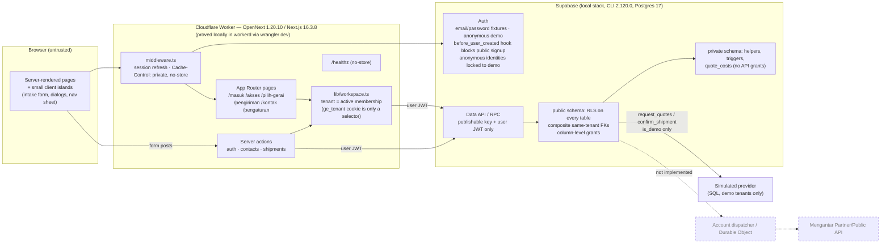
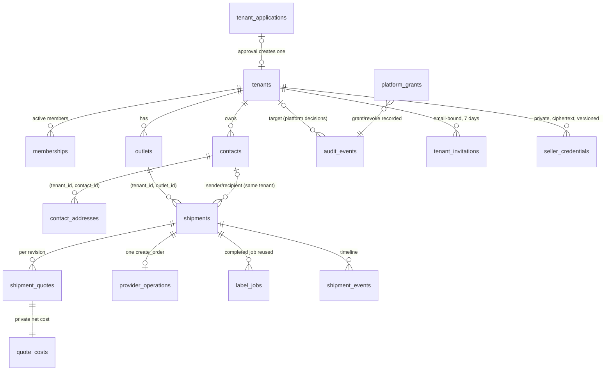
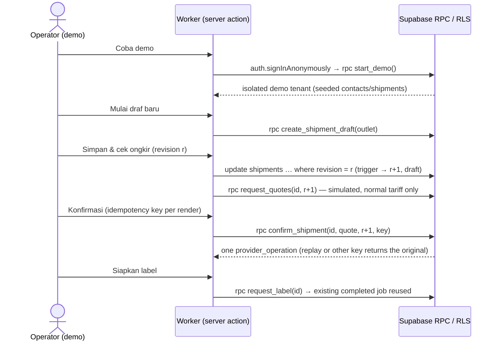

# GeraiExpress — Current Architecture Record

Updated: 2026-10-14
State: local foundation and synthetic demo preview implemented and verified locally (DEL-1
stages 1–2). No cloud resource, deployment, live provider call or real customer data exists.

## Canonical design

The target architecture lives in [04-SYSTEM-ARCHITECTURE.md](docs/spec/04-SYSTEM-ARCHITECTURE.md)
(ARCH-1 system, ARCH-2 Partner egress, ARCH-3 Auth/email, ARCH-4 module/deployment ownership).
This file records only what the code on disk does and which checks proved it. Where they
differ, this record states the actual behavior and the design keeps the target.

## System map

The diagrams below describe implemented, locally executed components only. Dashed edges are
target components from ARCH-1/ARCH-4 that do not exist yet.

### Runtime and trust boundaries (implemented)

No service-role or secret key exists in the application: every server read and write runs with
the signed-in user's JWT, so the Worker and a hostile browser calling the Data API directly hit
the same RLS and RPC checks (TEN-1). Provider dispatch, credential storage and webhooks are
absent; the only "provider" is a deterministic SQL simulation that refuses non-demo tenants.

### Code map (`src/`)

```mermaid
flowchart TB
    subgraph app["src/app (routes)"]
        entry["page.tsx → redirect by session state"]
        masuk["masuk/ · akses/ · pilih-gerai/"]
        subgraph ws["(workspace)/ — layout requires a workspace"]
            q["pengiriman/ (queue, attention list, search, pages)"]
            baru["pengiriman/baru (start or resume draft)"]
            det["pengiriman/[id] (intake form ⇄ frozen detail)"]
            lab["pengiriman/[id]/label (sample label, print)"]
            kon["kontak/ · kontak/[id]"]
            set["pengaturan/ (capability readiness)"]
            ang["anggota/ (tenant admin: members, invitations)"]
        end
        subgraph adm["admin/ — layout requires grant + aal2"]
            adt["admin (tenant directory, lifecycle)"]
            adk["admin/akses (platform grants)"]
            ada["admin/audit (append-only history)"]
        end
        mfa["verifikasi-2fa/ (TOTP enrol / challenge)"]
        reg["daftar/ (email code) · daftar/kata-sandi · daftar/gerai (application)"]
        inv["undangan/ (accept invitations)"]
        adp["admin/pengajuan (review queue)"]
        adi["admin/integrasi (Partner ID, secret readiness, seller bindings)"]
    end
    subgraph modules["src/modules"]
        shipA["shipments/actions.ts"]
        shipD["shipments/draft.ts (pure validation)"]
        shipF["shipments/intake-form.tsx (client)"]
        conA["contacts/actions.ts"]
        conF["contacts/forms.tsx (client)"]
    end
    subgraph lib["src/lib"]
        authA["auth-actions.ts"]
        wsL["workspace.ts"]
        plat["platform.ts · platform-actions.ts"]
        regA["registration-actions.ts"]
        rl["rate-limit.ts · visitor-key.ts"]
        sb["supabase/server.ts (server-only)"]
        err["errors.ts · format.ts"]
    end
    ui["src/components (+ ui/ shadcn radix-rhea, UI-2 tokens)"]

    masuk --> authA
    authA & plat --> rl
    adt & adk & ada & mfa --> plat --> sb
    reg & adp --> regA --> sb
    ang & inv --> memA["modules/members/actions.ts"] --> sb
    set & adi --> credA["modules/credentials/actions.ts<br/>credential-crypto.ts (AES-GCM) · worker-secret.ts"] --> sb
    q & baru & det & lab & kon & set --> wsL
    det --> shipF --> shipA
    baru --> shipA
    kon --> conF --> conA
    shipA & conA --> shipD
    shipA & conA & authA & wsL --> sb
    app --> ui
```

### Data map (implemented tables)

`platform_grants` (capabilities per identity) and `audit_events` are platform-only: no Data API
writes, reads need the capability and an `aal2` session, and audit rows cannot be updated,
deleted or truncated.

`quote_costs` lives in the `private` schema with RLS enabled and no API-role grants. Every
child table carries `tenant_id` and references its parent through a composite
`(tenant_id, id)` foreign key, so cross-tenant reparenting fails in the database.

### Primary flow — demo counter issuance

## Present on disk

| Component | Actual state | Evidence |
|---|---|---|
| Runtime | Next.js 16.3.8 App Router on `@opennextjs/cloudflare` 1.20.10, Wrangler 4.149.0, React 19.3.0, TypeScript 6.0.3; exact pins; pnpm `minimumReleaseAge` policy respected | `pnpm build`, `pnpm cf:build`; e2e against `wrangler dev` (workerd) |
| Adapter decision | Next.js 16.4.0 failed in workerd (`Unexpected loadManifest(/.next/server/preview-props.json)`, HTTP 500) with OpenNext 1.20.10; pinned 16.3.8, which passes. vinext (Cloudflare-recommended, beta) not used; OpenNext 1.x accepted as DEC-005 | BUILD-LOG 2026-10-14; `scripts/worker-smoke.sh` |
| Session handling | `src/middleware.ts` refreshes Supabase cookies and sets `Cache-Control: private, no-store` on every non-static response; Node middleware not used (OpenNext does not support it) | Reviewer curl of Worker responses; e2e |
| Identity | Supabase Auth email/password (seeded local fixtures only) and anonymous demo sessions; public signup refused by `private.before_user_created`; email confirmations on; trigger `private.lock_anonymous_identity` on `auth.users` refuses, for anonymous identities, any email/phone/password change request and any clearing of `is_anonymous`; OAuth linking is additionally off (`enable_manual_linking = false`), so a demo session cannot become a real account (PR-31) | `tests/db/isolation.test.ts` registration gate, mutation-checked |
| Tenancy | `memberships` + `private.member_role()`; anonymous identities count only in demo tenants; `ge_tenant` cookie validated against own memberships; multiple memberships require `/pilih-gerai` | DB isolation suite; e2e forged-cookie and two-membership tests |
| Contacts | Tenant-owned contacts and addresses, optimistic revision on edit, address archive keeps one primary | `tests/e2e/contacts.spec.ts` |
| Shipments | Draft → simulated quote (per revision, 30 min expiry) → explicit confirmation → one `create_order` operation → simulated AWB `SIM…`; content frozen after submission; unknown outcome reconciles the original operation | `tests/db/shipment-flow.test.ts`; `tests/e2e/shipping.spec.ts` |
| Pricing | Customer charge = simulated normal tariff; synthetic net cost stored only in `private.quote_costs` | DB grant assertions; reviewer RSC/payload inspection |
| Labels | Watermarked sample label page for simulated shipments only; completed job reused; print hides app shell | e2e label tests |
| Roles | DEC-008: `tenant_admin` and `operator`; `reconcile_shipment` (unknown outcome) requires `tenant_admin`, operators see an escalation notice; a demo visitor is `tenant_admin` of their own sample gerai | `tests/db/shipment-flow.test.ts` operator denial; e2e operator escalation |
| Super Admin | `/admin` with `platform_grants` capabilities, TOTP `aal2` (Supabase MFA) checked in `private.platform_capable` on every call, tenant directory + suspend/reactivate with reason, grant/revoke with stale-revision and final-governor guard, append-only `audit_events` with a filtered projection (actor, target, change, reason) | `tests/db/platform.test.ts` (mutation-checked: aal2 check, final-governor guard, lock-before-check concurrency); `tests/e2e/platform.spec.ts` |
| Registration | `/daftar` email code (Supabase OTP, Bahasa Indonesia template, generic reply), password set only after verification, one open `tenant_applications` row per identity (revisioned, partial drafts), Super Admin approve / request changes / reject with reason; approval creates one active tenant, outlet and `tenant_admin` membership and no seller. Public account creation is closed unless a governor opens it (`private.settings`, audited); local seed opens it. A password set before an email's first confirmation is discarded at confirmation (pre-registration takeover) | `tests/db/registration.test.ts`, `tests/db/isolation.test.ts` (mutation-checked: password discard, review authority); `tests/e2e/registration.spec.ts` |
| Staff and roles | `tenant_invitations` (one pending per tenant+email, 7 days, revocable, RPC-only reads); accept only by the verified invited email while the issuer is still an active admin, once (concurrent accepts converge); an invited email may create its account while public registration is closed; `set_member_role` / `deactivate_member` lock the tenant's memberships, re-check the caller, keep one active `tenant_admin`; `reconcile_shipment` re-checks the role after a share lock; demo tenants cannot invite | `tests/db/invitations.test.ts` (mutation-checked: issuer check, last-admin guard, role re-check after lock); `tests/e2e/members.spec.ts` |
| Mengantar credentials | Tenant admins of real gerai store their own seller API key (BYOK, DEC-006, owner declaration): the Worker seals it with AES-256-GCM under the `CREDENTIAL_KEY` Worker secret, AAD = tenant + version; `private.seller_credentials` holds ciphertext only (one active, monotonic versions, no API role access, no readback RPC); members see configured/hint/version; readiness stays "Belum diverifikasi". Super Admin `integration_operations` sets the Partner ID (not secret) and sees whether `MENGANTAR_PARTNER_SECRET` and `CREDENTIAL_KEY` bindings exist, never values | `tests/unit/credential-crypto.test.ts`; `tests/db/credentials.test.ts` (mutation-checked: store authority); `tests/e2e/credentials.spec.ts` |
| CAPTCHA | Supabase Auth captcha (Turnstile) on password sign-in, anonymous demo sign-in, OTP, signup, recovery and resend (secret via `env()` from gitignored `supabase/.env`; never `supabase config push` this config — the local value is Cloudflare's always-pass test secret); the Worker renders Turnstile explicitly (`appearance: interaction-only`, Indonesian), below each submit button so a verifying frame can never cover it; submit stays focusable (`aria-disabled`) until a token exists; site key read at runtime from the `TURNSTILE_SITE_KEY` binding; local uses Cloudflare's documented test keys | `tests/db/captcha.test.ts` (each entry point refused without a token); auth/registration e2e |
| Auth email | Supabase Send Email Hook → `POST /api/auth/send-email` on the Worker: Standard Webhooks signature (HMAC-SHA256, ±5 min), refuses anonymous identities and unused action types, renders Bahasa Indonesia code mail, delivers via the `MAIL_TRANSPORT` binding (local Mailpit only; fails closed otherwise); decisions return 200 + error object (what Auth reads, no retries); replay inside the 5-minute window is an accepted ceiling until an id store exists; logs outcome without addresses or codes (DEC-009) | `tests/unit/auth-mail.test.ts` (mutation-checked: anonymous refusal); `tests/e2e/auth-mail.spec.ts` on both runtimes; anonymous email change produces no mail (`tests/db/isolation.test.ts`) |
| Preview | Worker `geraiexpress-preview` (workers.dev) + Supabase `geraiexpress-preview` (ap-southeast-1); remote Auth settings in `infra/supabase-preview/supabase/config.toml`; Auth email and CAPTCHA intentionally off (see RELEASE.md) | `pnpm smoke:preview`; remote probes in BUILD-LOG |
| Abuse limits | `src/lib/rate-limit.ts` + `ratelimits` in `wrangler.jsonc`: per-visitor (IPv4 address, IPv6 /64) sign-in and demo-entry limits before Supabase Auth (RATE-1 native Auth ingress) | `tests/unit/visitor-key.test.ts`; e2e RATE-1 tests on Worker and next dev, mutation-checked |
| Readiness | `/pengaturan` shows per-capability state; for real tenants every provider capability is "Belum tersedia" or "Belum diverifikasi" (only the outlet pickup address can be "Siap") | e2e settings tests |
| Quote reuse | `request_quotes` returns the unexpired set of the current revision instead of inserting another (migration `20261014090000`) | `tests/db/shipment-flow.test.ts` |
| Presentation | shadcn/ui (radix base, rhea style) remapped to UI-2 tokens; system font; Tailwind names `text-base/sm/xs/xl/3xl` carry the UI-2 sizes so `cn()` merges correctly; ≥44px targets | e2e touch-target, overflow and keyboard checks at 390/768/1280 |

## Not implemented (gated)

| Component | Gate |
|---|---|
| Invitation email and account recovery (PR-32, PR-33) | Invitations work without app-sent mail (admin shares the sign-in link; the invitee verifies by code); invitation mail and password recovery need ARCH-3 mail proof |
| Opening public registration on a real project | Proved custom SMTP delivery (PR-33), the OTP templates applied to the remote project, Terms/Privacy (PRIV-3), CAPTCHA (T-016) |
| Mengantar Partner seller creation, key verification against Mengantar, rotation, live quote/order/label, webhooks (PR-17, PR-19, PR-20, PR-3–PR-6 live) | Sandbox credentials, Partner access, ARCH-2 egress, Terms/Privacy versions (PR-20); a decrypting dispatcher (TD-3) |
| Account dispatcher / Durable Object / queues (TD-3) | Needed only when a real provider call exists |
| Super Admin pricing, monitoring, integrations and recovery (PR-23, PR-25–PR-27) | Built on T-012's grants as each capability gets a page; integrations in T-015 |
| Production Super Admin bootstrap | Owner runs the first grant on the remote project (remote write approval) and enrols TOTP; a second recovery governor follows (DEC-008). Never via `seed.sql`, which holds local-only working admin credentials |
| CSV, export, overview, finance | Later accepted requirements |
| Production Supabase project and Cloudflare deployment | Explicit release approval; the preview (RELEASE.md) is synthetic-data only |

## Open production gates found during implementation

- Supabase per-IP Auth rate limits see the Worker's shared egress address, not each visitor.
  Forwarding the visitor IP (`Sb-Forwarded-For`) is documented by Supabase only with a secret
  API key, which this app deliberately does not hold. Implemented instead (T-011): Workers Rate
  Limiting bindings keyed by `CF-Connecting-IP` (IPv4 per address, IPv6 per /64) in front of
  sign-in (10/60 s) and demo entry (5/60 s), failing closed in the deployed Worker when the
  binding or IP is missing. Accepted residuals: counters are per Cloudflare location and
  eventually consistent, so a distributed attacker gets roughly the limit per location; one
  person behind a shared address (carrier-grade NAT is common on Indonesian mobile networks)
  can block that address's sign-in and demo entry for up to a minute; token refresh in middleware and demo
  reset have no per-visitor limit. Direct calls to Supabase Auth with the publishable key meet
  Supabase's own per-IP limits with the visitor's real address. Still open for the remote
  project: size its Auth limits (sign-in, anonymous sign-ins, token refresh) for aggregate
  traffic from Worker egress, and pick unique `namespace_id`s for the account.
- Super Admin second factor (T-012 residuals):
  - `MFA_LIMITER` (10/60 s per visitor) bounds only the Worker's verify action. Anyone holding a
    password-derived aal1 token can call Supabase Auth's MFA challenge/verify directly, which
    was not throttled locally (40 wrong codes in a row). Before the remote project: confirm or
    size Supabase's MFA verification limits, or use the MFA verification attempt hook if the
    plan offers it. Password + TOTP brute force is the residual, not only code replay.
  - Supabase accepts the same TOTP code twice inside its 30-second window.
  - Enrolment is trust-on-first-use: a grant holder without a factor can be taken over with the
    password alone (the attacker enrols first). Grant sensitive capabilities only after the
    holder shows "Autentikator terpasang", or grant minimal ones until then.
  - The final-governor guard runs inside the grant RPCs only. A governor can still unenrol their
    own verified factor through Auth, and deleting an Auth user removes their grant, without an
    audit event. Keep two governors (DEC-008) and treat Auth user deletion as a governed action.
  - `supabase/seed.sql` contains working Super Admin fixtures (known password and TOTP secrets).
    Never run the seed against a remote project (`db push --include-seed`, `db reset --linked`).
- Registration (T-013): email codes double as passwordless sign-in for any existing account whose
  inbox the caller controls (native Supabase behaviour); Super Admin access still needs TOTP.
  Auth sends mail before the database can refuse a change (see the T-016 residual below). The remote project must keep `secure_password_change`, `[auth.sms] enable_signup =
  false` and the email templates aligned with `supabase/config.toml`.
  - Code mail comes from the Worker hook (DEC-009), not Supabase templates.
  - `/daftar` replies identically whether a code was sent, refused or throttled, but while
    registration is closed the Supabase Auth API itself still answers 403 for unknown emails
    and 200/429 for existing ones, so account existence is learnable there (residual).
  - Email codes are 6 digits valid for 1 hour; guessing is bounded per visitor by the Worker and
    by Supabase's own limits; revisit with T-016 and the remote limits.
  - The first confirmation discards any earlier password, including one an operator might set
    on an unconfirmed user: confirm first, then set (applies to invitations and bootstrap).
  - Signups carrying self-asserted `user_metadata` are refused by the Auth hook.
  - A Super Admin cannot decide their own application (`own_application`).
- Credentials (T-015): a stored BYOK key is only the owner's declaration until a verification
  call proves it (gated on sandbox). Losing `CREDENTIAL_KEY` makes stored keys unrecoverable
  (admins re-enter them); rotating it needs a re-seal step (key_version is stored for that).
  The database cannot check the AES-GCM binding, so a tenant admin calling the RPC directly can
  store junk for their own gerai: the future dispatcher must treat a failed decrypt or unknown
  key_version as "re-enter the key", and readiness stays unverified until a provider check.
  Replaced or removed keys keep only version metadata (ciphertext cleared). The hint (last 4
  characters, last 2 for keys under 24) is visible to members and in audit detail.
- Worker secrets come only from bindings: OpenNext bakes `.env*` values into the Worker script,
  so `CREDENTIAL_KEY` lives only in `.dev.vars` locally, `workerSecret()` has no `process.env`
  fallback, and `pnpm check:bundle` fails if a secret name appears in
  `.open-next/cloudflare/next-env.mjs` (proved against the earlier build).
- CAPTCHA (T-016) bounds automated sessions and code mail. The remaining abuse path (a solved
  challenge yields an anonymous session that could make Auth email any address) is closed by
  DEC-009 / T-017: Auth email goes through the Worker's Send Email Hook, which refuses every
  message for anonymous identities before anything is sent. Real project: create a Turnstile
  widget, put its secret in the Supabase Auth settings and its site key in the
  `TURNSTILE_SITE_KEY` Worker variable. Do not align the remote project by `supabase config
  push` (it would carry local test values); apply the listed settings deliberately. A future
  CSP must allow `challenges.cloudflare.com`.
- Send Email Hook (T-017): production needs the hook URI set to the deployed Worker over HTTPS,
  a project-specific hook secret (Worker secret `SEND_EMAIL_HOOK_SECRET` and Supabase hook
  setting), and a production transport. Only the local Mailpit transport exists; with any other
  `MAIL_TRANSPORT` the hook fails closed, so no Auth email (codes) is delivered until Cloudflare
  Email Sending is verified and wired (ARCH-3 prerequisites). Locally the hook reaches `next dev`
  through `pnpm dev:hook-relay` (docker0 address only); Worker-runtime e2e still sends Auth mail
  via `next dev`, and the hook route itself is tested on both runtimes.
- Invitations (T-014): while registration is closed, the Supabase Auth API answers 200 for an
  email holding a pending invitation and 403 otherwise, so invitation existence (not the
  business) is learnable there, as account existence already was; and anyone can make Auth mail
  a code to an invited address. Both are bounded by native limits and a 20-pending-invitation
  cap per gerai; T-016 CAPTCHA covers them. Share links use the request host; set a configured
  site origin when the remote project exists.
- Authority checks in platform write RPCs run after taking the grant lock, so a governor revoked
  while their call waits is refused (`tests/db/platform.test.ts` concurrency test).
- `private.lock_anonymous_identity` is a trigger on `auth.users`. Locally the `postgres` role
  can create it but cannot alter or drop it (not the table owner); confirm the same on the remote
  project before relying on a later migration to change it. The remote project must also keep
  manual identity linking disabled. A refused email change surfaces from Auth as HTTP 500
  ("Error sending email change email"); the app offers no email change to demo sessions.
- `next dev` rewrites `AGENTS.md` when it detects an AI-agent environment
  (`node_modules/next/dist/server/lib/generate-agent-files.js`); agents must start it with the
  agent environment variables unset or revert the injected block.
