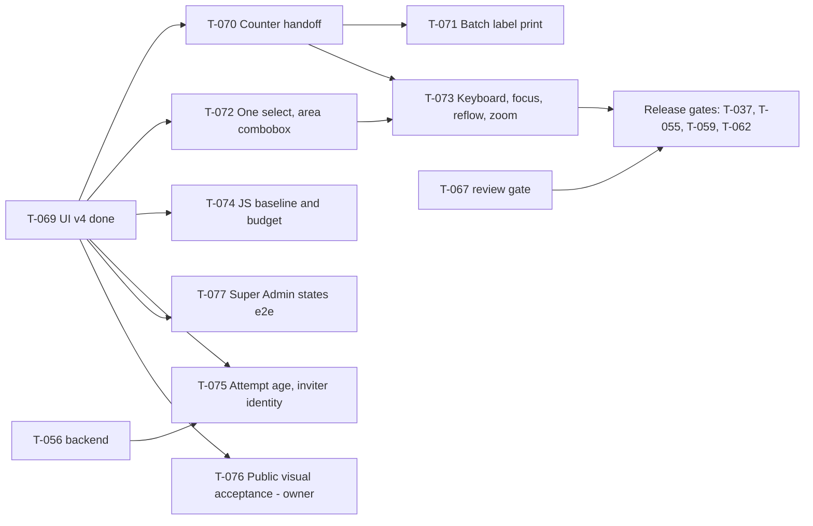

# Next-work breakdown — 2026-10-29

Status: working view only. `TASKS.md` is the sole execution queue and `docs/spec/` the accepted contracts;
where this note and those differ, they win. It exists to show order, ownership and the owner's decisions in
one place after T-068 (backend hardening) and T-069 (UI v4).

## Where the product stands

| Area | State (evidence: TASKS.md, STATUS.md, BUILD-LOG.md) |
|---|---|
| Counter flow: draft, quote, confirm, issue, label, invoice | Built and redesigned (T-069); simulated end to end, real path proven only against the Mengantar sandbox |
| Gerai administration: members, settings, discount view | Built (T-014, T-041, T-053, T-069) |

| Update (same day, after waves 1 and 2) | T-070, T-071 (approved by the owner, built and independently reviewed to APPROVE), T-072, T-073, T-074, T-075, T-056 and T-077 are done and recorded in TASKS.md; the full serial Playwright run passed 167 tests per viewport with 0 failures on all three viewports, and `label.spec.ts` (9/9) + `a11y.spec.ts` passed on all three after T-071. Still open from this note: T-076 (left UNVERIFIED by owner decision), the release gates (T-037, T-055, T-059, T-062) and everything in TASKS.md Deferred |
| Super Admin | Built (T-012, T-041, T-069); decisions and edge states not yet e2e-covered (T-077) |
| Backend and database | Hardened (T-068); T-054, T-056 backend, T-057, T-067 coded and DB-tested, waiting for independent review before they are checked |
| Hosting | Vultr + Coolify direction (DEC-022); nothing provisioned; owner gates in TASKS.md Deferred |
| Public site | Redesigned; independent visual review REVISE on one owner decision (T-076) |

## Workstreams and order

| Wave | Tasks | Why this order | Owner of the work |
|---|---|---|---|
| 1 (parallel, disjoint files) | T-070 then T-071 (detail and list), T-072 (intake controls), T-077 (admin tests), T-075 backend half | None shares a file; T-071 builds on T-070's result banner and print actions | UI agents; backend session for T-075 migrations |
| 2 | T-073, T-074 | The quality pass and the size report must run on the final markup, after waves 1 changes; both need exclusive use of the dev server and `.next` | UI agent; measurement by the lead |
| 3 | T-075 UI half, container final-image gate (T-055, T-059), T-037 release record | Needs the migrations applied and a built image with the final UI | Lead |
| Owner | T-076, T-048, T-063 and the Deferred owner gates | Cannot be decided or proven by code | Paduka Ongki |

## Decisions the owner must make

1. **Public photo (T-076):** provide a real counter photo (brief: counter with laptop and scale, 4:3, customer handing over a parcel) or accept the pages without one and allow one more independent review round.
2. **Batch label print (T-071):** approve the scope (select-on-page only, at most 50 labels, one masking choice per queue). It adds a new print route, so it is R3 and waits for this approval before it is built.
3. **Production prerequisites already in Deferred:** server and fixed IPv4 for the Mengantar allow-list, DNS and TLS, production mail provider (T-063), off-host backup policy and restore drill (RELEASE.md gates 11 to 17), counsel advice, the pilot with real couriers (T-048).

## Risks carried forward

- The five mobile-390 failures in the earlier container run are still unexplained; the later serial run on `next dev` passed everything. The cause (a slow run with parallel agents is the leading guess, not proven) stays open under T-058 and T-060 until a clean container run on the final image.
- The delivery-ledger boundary for T-068 failed because of concurrent UI edits; the ledger needs a fresh run over the final tree before any release record (T-037).
- Local verification is `next dev` only. No production build of the new UI has run in the container, and no printer has printed a label.

## Definition of done for each wave

Typecheck and unit tests green; the specs named in the task pass on desktop-1280, mobile-390 and tablet-768, serially; changed routes viewed at the three widths; TASKS.md result written with executed versus not-run items; no claim beyond what ran.
