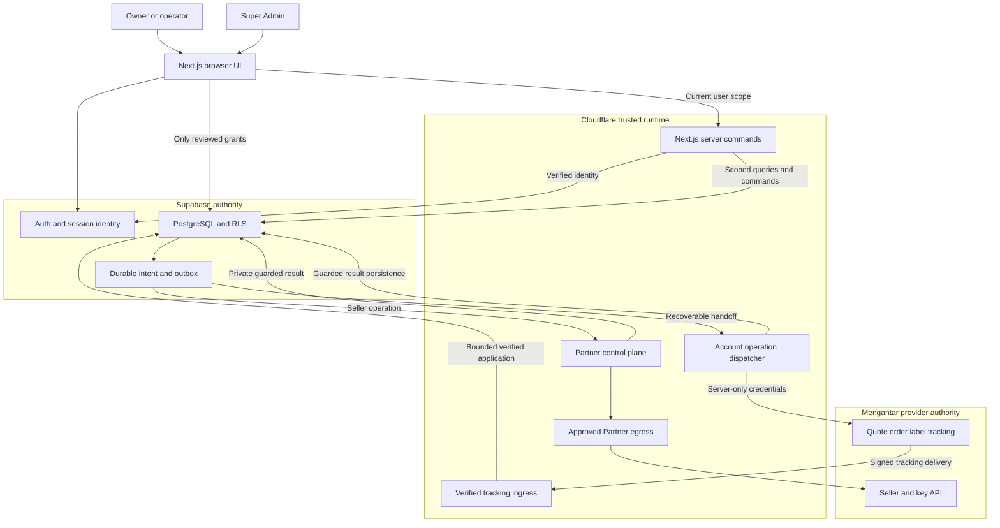

# GeraiExpress — Runtime and Trust Boundaries

- Status: Proposed architecture; provider/account choices remain open.
- Owner: Engineering owner
- Updated: 2026-10-13

## ARCH-1 — Application shape
- Status: Proposed
- Owner: Engineering owner
- Source: CTX-1, CTX-14, CTX-20; vendor references in `sources.json`.
- Statement: The proposed Next.js App Router application shall run on a verified Cloudflare Workers deployment path and use Supabase Auth/PostgreSQL plus trusted Worker provider commands, adapting the reference rather than inheriting its Node server/auth infrastructure.
- Acceptance: A local runtime smoke demonstrates authenticated membership-scoped data access, a denied cross-tenant request, no provider key in the browser build, and a recoverable queued operation before provider enablement.
- Constraints: TEN-1, TEN-2, IAM-1, SEC-1; no scaffold or cloud resource is created by this draft.
- Evidence: Vendor documentation and reference dependency inspection; no GeraiExpress runtime exists yet.

| Component | Responsibility | Trust and data boundary |
|---|---|---|
| Next.js operator application | Tenant/outlet context, contacts, shipment intake, queue/detail, settings; bounded client components for interaction | Browser code/selectors are untrusted. Authenticated server reads/mutations carry user scope; no provider credential or database-admin key enters client code. |
| Supabase Auth | Sign-in, token verification, identity lifecycle | Identity is not tenant permission. Application membership and tenant lifecycle remain database authorities. |
| Supabase PostgreSQL/Data API | Tenant records, constraints, RLS, transactional commands, durable operation history | Direct browser-accessible API must be safe independently of the Worker. Only explicit projections/grants and reviewed RPCs. |
| Cloudflare Worker API | Validate identity/scope, trusted provider transport, safe output | Request-scoped clients; private responses are not shared across users or tenants. |
| Provider account dispatcher | Durable serialized submit/payment/label work where required | Same-tenant outlets/credential versions share actual-account coordination; foreign-tenant bindings are denied under DATA-4. See TD-3. |
| Partner control plane | Seller onboarding, reconciliation and credential operations | Fixed operations and environment; platform secret; durable partner-wide quota; authorized tenant binding; TD-7/TD-8. |
| Super Admin workspace and platform commands | Explicitly authorized tenant/discount/integration governance, restricted monitoring/recovery/audit | Shared application runtime, separate platform capabilities/projections; verified session/current grants; no implicit tenant impersonation or universal RLS bypass; TD-10/TEN-4. |
| Mengantar Public API | Seller-specific quote/order/AWB/label/delivery authority | Validate external responses and map account-owned local records; standard permission does not imply PDF/dropshipper access. |
| Private label/document access | Authorized PDF access and optional persisted artifacts | No public bucket by default. Persist documents only after purpose/retention decisions. |

Core flow: authenticated user → membership/outlet check → validated database
command → durable provider operation → trusted account dispatcher → provider
response → guarded database result → scoped UI refresh/label access.

Routine user-context database operations carry the user's verified identity.
Background/provider-result processing uses an explicitly bounded machine
identity, not a cached browser session or an unrestricted ordinary service-role
client. Its exact SQL grants/RPC boundary must be reviewed before implementation.
Network-origin restrictions cannot replace database membership enforcement.

Keep the app/API same-origin where practical. If cookies authorize mutations,
the selected auth implementation must enforce CSRF/origin protections; if bearer
tokens are used, verify the token before work and constrain allowed origins.
Never select a tenant from an unchecked hostname, header, or body value.

## Infrastructure choices that remain conditional

Next.js on Workers, trusted Worker commands, and Supabase are the recommended
core. CTX-20 supersedes the earlier plain React/Vite proposal. Before choosing
versions, exercise authenticated user-scoped reads, mutations, deep links,
private caching, provider command dispatch, and label streaming in the selected
Workers runtime. The official Next.js guide currently recommends vinext (beta);
verify compatibility and record the installed adapter/version rather than
assuming native Node hosting or copying old adapter commands. Revisit the
proposal if the scoped check fails. No second Astro application is needed now.
Durable Objects have a concrete coordination job if account serialization is
needed. Queues are an optional dispatch transport, not a prerequisite for every
read. R2 versus Supabase Storage, Hyperdrive/direct PostgreSQL, Realtime,
Workflows, a separate marketing app, custom domains, and an independent public
API are not included without a concrete accepted requirement.

Use the Supabase client/Data API with scoped RPCs first for the proposed API-backed
application, including authenticated server renders/actions. If a direct PostgreSQL path is later selected, its SQL identity,
RLS context, pooling behavior, and migration authority need their own verified
design; privileged direct queries must not silently bypass the user model.

No request latency, uptime, hosting cost, allowed processing region, or recovery
objective is promised before cloud plans, region, expected workload, and release
criteria are selected. A hosting change is not evidence that CTX-10 is resolved.

## ARCH-2 — Conditional production Partner egress
- Status: Proposed
- Owner: Engineering owner
- Source: CTX-18; SRC-CF-GATEWAY-WORKERS, SRC-CF-VPC-NETWORK, SRC-CF-DEDICATED-EGRESS in `sources.json`.
- Statement: Production Partner calls shall leave through provider-approved source addresses using a verified Cloudflare route and fail closed if that route is unavailable.
- Acceptance: The actual Worker primary/failover paths are accepted by Mengantar, approved address families are documented, and route failure blocks Partner calls without ordinary-fetch fallback or secret-bearing telemetry.
- Constraints: NFR-5, TD-7, SEC-3. Zero Trust Enterprise dedicated-egress entitlement/cost and provider approval remain unresolved; sandbox success cannot clear this gate.
- Evidence: Current official components and plan requirements inspected; no network configured or tested.

Candidate path: trusted Partner Worker → VPC network `cf1:network` → Gateway
policy → dedicated egress addresses → configured Mengantar Partner origin.
Validate this composition with Cloudflare and Mengantar before enablement.
Ordinary Workers egress and Supabase Edge Functions do not satisfy a dedicated
static-IP assumption. Gateway policy/logging must protect signatures, PII, and
any credential-bearing URLs. Register all selected primary/failover IPv4/IPv6
addresses; do not configure shared-egress failover for this path.

If Enterprise entitlement or an approved route is unavailable, retain the
production Partner enablement gate and seek a provider-approved arrangement.
Do not silently introduce a VPS, waive the provider control, or describe the
requested stack as production-ready. Public API shipping under a verified
existing connection has its own capability/security gates.

## ARCH-3 — In-stack identity and transactional email boundary
- Status: Proposed
- Owner: Engineering owner
- Source: CTX-33, CTX-35; SRC-SUPABASE-AUTH-SMTP, SRC-CF-EMAIL-SENDING, SRC-CF-EMAIL-SMTP in `sources.json`.
- Statement: Authentication shall remain owned by Supabase, with a verified in-stack transactional email channel and separately authorized application onboarding commands; email delivery cannot grant membership or create a seller.
- Acceptance: The actual Supabase SMTP client negotiates Cloudflare implicit TLS, controlled recipients receive all enabled Auth message types, expected failure states remain recoverable and the application stores no Auth password or mail credential in public data.
- Constraints: PR-29 through PR-33, TD-11, SEC-5, PRIV-3; eligibility, sender domain and beta acceptance unresolved.
- Evidence: Individual vendor capabilities retrieved; composed runtime/network/delivery untested.
- Change history: 2026-10-13 — Added in the registration and documentation-completeness review. 2026-10-14 — DEC-009: Auth mail is delivered by a Send Email Hook on the Worker (refuses anonymous identities, app-owned templates); Cloudflare Email Sending becomes that hook's production transport instead of Supabase's SMTP client.

Candidate native path: Supabase Auth custom SMTP → Cloudflare Email Sending
SMTP → applicant inbox. Cloudflare currently documents `smtp.mx.cloudflare.net`
on port `465` with implicit TLS, username `api_token`, and a private account
token with Email Sending permission as password. Store real configuration only
in the appropriate provider secret settings; no credential belongs in this pack.
SMTP composition follows the [Cloudflare SMTP contract](https://developers.cloudflare.com/email-service/api/send-emails/smtp/)
and [Supabase custom SMTP](https://supabase.com/docs/guides/auth/auth-smtp).

Email Sending is currently Beta on Workers Paid. Confirm account eligibility,
onboarded sending domain/email authentication, actual Supabase TLS compatibility,
quota and sender reputation before public signup. Email Routing alone is not
arbitrary-recipient transactional sending. The built-in Supabase testing mailer
has recipient/volume restrictions and is not the production path.

Superseded by DEC-009 (2026-10-14): native SMTP sends before the database can refuse an anonymous identity's email change, so a demo session could drain the mail quota; the Worker hook refuses such messages before any send. The Cloudflare Email Sending prerequisites above still apply to the hook's production transport.
If it fails its compatibility proof, keep public signup gated and revise the
mail design within Cloudflare + Supabase; do not silently add another provider
or disable inbox verification. Local development uses native captured mail;
an initial synthetic demo does not establish real inbox-delivery readiness.

Successful submission to the mail service is distinct from delivery, inbox
control and application activation. Sending, code verification, password update,
application transaction and Mengantar dispatch are five independent boundaries.
Session-bearing/authenticated responses bypass shared CDN caching, including
refreshed Set-Cookie responses and callback/recovery routes.


## ARCH-4 — Project layout and component ownership
- Status: Proposed
- Owner: Engineering owner
- Source: CTX-38; ARCH-1, TD-3, TD-7, TD-9, TD-11.
- Statement: The repository shall organize one operator/platform application, trusted provider orchestration and Supabase-owned data around explicit domain and deployment boundaries, without treating folders as authorization controls.
- Acceptance: Every implemented entry point maps to the ownership table; client dependency checks exclude private credentials/transports, direct DB permissions remain enforceable, and operation replay/concurrency evidence uses the actual-account boundary.
- Constraints: TEN-1 through TEN-5, IAM-7, DATA-4, BILL-2, DEL-1; folder names below are proposals, not installed packages or deployed services.
- Evidence: Repository documentation initialized; application source/configuration has not been generated.

### System and trust diagram

Owner: ARCH-4. Date: 2026-10-13. Diagram state: proposed, text-only;
no rendered diagram or operational topology is claimed.



Web server commands and provider adapters may share a Worker deployment when
supported by the selected runtime. The account dispatcher has its own durable
coordination boundary where required; it is not a second user-facing backend.
Partner signing/quota authority stays separate from each seller's Public API
operations even if code shares a deployment. Queue transport remains optional;
no diagram arrow implies a distributed transaction or exactly-once delivery.
The Partner egress composition remains the independent ARCH-2 production gate.
Auth email is delivered by the Worker's Send Email Hook (DEC-009); it is not a general application mail relay.

### Proposed code organization

One repository is sufficient. Do not introduce workspace tooling, a package per
domain or a separate Astro/marketing application without an actual need. Create
source/configuration files only as their implementation slice starts.

```text
geraiexpress/
├── src/
│   ├── app/                      # Next.js routes and layouts
│   │   ├── (auth)/               # Login, email verification and recovery
│   │   ├── (onboarding)/         # Gerai application and seller setup
│   │   ├── (workspace)/          # Tenant/outlet operational surfaces
│   │   └── platform/             # Separately guarded Super Admin
│   ├── components/
│   │   └── ui/                   # shadcn primitives using UI tokens
│   ├── modules/                  # Domain validation and scoped UI composition
│   │   ├── onboarding/
│   │   ├── tenants/
│   │   ├── contacts/
│   │   ├── shipments/
│   │   ├── pricing/
│   │   ├── labels/
│   │   └── platform/
│   └── server/
│       ├── auth/                 # Verified sessions, current authority and assurance
│       ├── supabase/             # Request-scoped clients and reviewed RPC calls
│       ├── mengantar/            # Fixed Partner/Public adapters, exact-byte signing
│       └── operations/           # Durable intent, fencing and result applicators
├── workers/
│   └── provider-dispatcher/      # Durable account executor when required
├── supabase/
│   ├── migrations/               # Fresh reviewed schema, grants, RLS and RPC history
│   └── seed.sql                  # Synthetic development/demo data only, when added
├── tests/                        # Focused money, scope, recovery and runtime checks
└── docs/                         # Existing spec, research and provenance
```

Route groups do not establish permissions or require those exact public URLs.
The final route set follows UX-7/UX-8 and the installed framework. `server/` is
an intended import boundary that needs framework/bundler enforcement and tests;
its name alone cannot prevent secrets entering a client bundle. The Worker entry
point, bindings and adapter configuration must use verified installed APIs, not
names inferred from this tree.

### Module contracts and allowed dependencies

| Owner | Responsibility / canonical contract | Import and authority limit |
|---|---|---|
| Auth/onboarding | Native identity, account completion, versioned applications/invitations; TD-11/DATA-7 | No Auth identity creates tenant/seller authority automatically; current-session checks apply at Worker and DB/RPC |
| Tenant/outlet | Membership, selected scope, lifecycle/readiness; TEN-1/IAM-1/PR-15 | Selectors are untrusted; initial activation cannot bypass approved application policy |
| Contacts | Reusable tenant-owned sender/recipient identities and addresses; DATA-1/PR-2 | No automatic login/seller creation; edits cannot rewrite submitted snapshots |
| Shipments/operations | Intake, frozen review, original-operation dispatch/recovery; TD-3/DATA-2 | Only explicit valid commands create durable intent; unknown result is not safe to resend |
| Pricing | Retail projection and private account net facts; TD-9/DATA-5/BILL-1 | Browser/operator receives only permitted customer fields; no generic historical fee or discount fallback |
| Labels/tracking | Owned paid-order PDF generation, scoped URL renewal and shared transition application; TD-4 | No raw provider link/body in logs; request/poll/download/print-attempt are separate facts |
| Platform | Capability-scoped review, discounts, safe monitoring/recovery and audit; TD-10/IAM-7 | No universal tenant-data/credential access, impersonation or new spending authority |
| Provider adapter | Exact fixed endpoint/request mapping, validation and private credential references; TD-2/TD-7/TD-8 | Server/machine callers only; no arbitrary URL/path signer or public raw proxy |
| Database | Tenant constraints, current grants, narrow transactional commands and durable history; DATA/TEN contracts | Direct exposed API must deny unauthorized calls independently of route code |

Domain validation and money composition can be reused by trusted entry points;
transport code does not own business permission. UI cannot import the private
provider adapter or privileged machine client. Background processing reloads
its scoped durable operation and current allowed capability; it does not rely
on an initiating browser session or an unrestricted tenant-wide service proxy.

### Component execution paths

1. **Register:** native email proof → trusted account completion → versioned own
   application → selected policy/approval → explicit seller choice/consent.
   Only application submission creates the local initial bundle; provider
   creation is a later durable operation with a stable external ID.
2. **Create resi:** permitted tenant/outlet → contact/pickup snapshots → verified
   account quote and selected service → explicit versioned review → atomic
   operation/outbox → guarded account dispatch → original order/payment/AWB
   result → eligible PDF job/status → authorized download/print attempt.
3. **Recover:** reload original receipt/account/attempt → reconcile verified
   provider state → apply guarded local outcome. Existing unpaid work uses the
   full reviewed original-batch scope; expired PDF links use GET on the same job.
4. **Super Admin:** verify current platform grant and required assurance → narrow
   explicit-scope projection/command → current-version decision → durable audit.
   Recovery permission cannot create an unrelated order or spending authority.

### Deployment and ownership matrix

| Target | What belongs there | Evidence needed before activation |
|---|---|---|
| Cloudflare web Worker | Next.js server/runtime, same-origin commands and permitted UI delivery | Installed adapter compatibility, private caching/auth and browser journeys |
| Cloudflare account executor | Required durable provider coordination, optional queue consumer | Concurrent outlets/keys, restart, fencing, duplicate and timeout recovery |
| Supabase | Native Auth, PostgreSQL constraints/RLS/RPC and application operation history | Fresh migrations, current-session authority and direct tenant/platform negatives |
| Mengantar | Seller ownership, account pricing/debit, AWB/PDF and courier facts | Approved account/environment, current capability/collection proof and output inspection |
| Cloudflare outbound mail | Candidate native SMTP endpoint used by Supabase Auth | Actual eligibility, domain, TLS, controlled inboxes and suppression/quota behavior |
| Private asset storage | Only required logos/documents under a selected purpose/retention model | Storage choice, current tenant grants and download/expiry proof; no bucket assumed |

Environment and capability gates follow DEL-1; money responsibilities follow
BILL-1/BILL-2; limits/signals follow OBS-1/RATE-1; coordinated restore follows
DR-1. Root ARCHITECTURE.md remains the observed implementation record.
