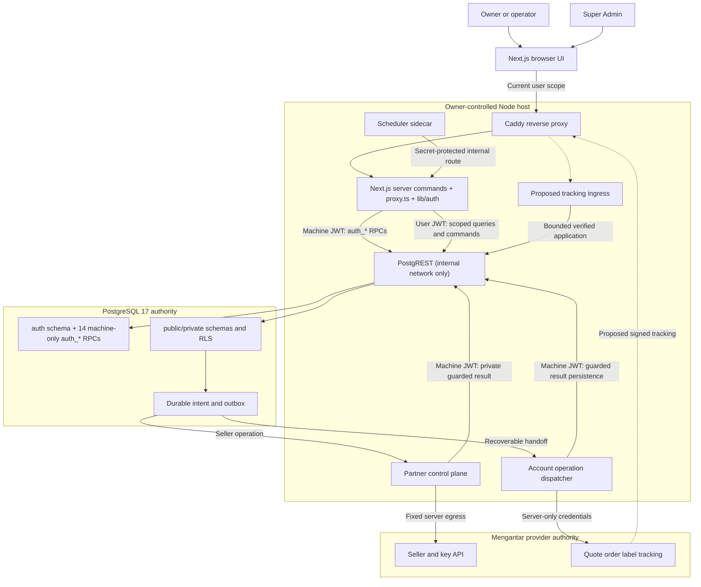

# GeraiExpress — Runtime and Trust Boundaries


> Current hosting amendment (DEC-022, owner, 2026-10-29): Vultr + Coolify runs the Node application and PostgreSQL 17 + PostgREST. `compose.coolify.yaml` is the Coolify entrypoint; public TLS belongs to Coolify, with the internal Caddy gateway on 8080. Same-host PostgreSQL is the initial target; off-host recovery and real production verification remain release gates. This supersedes DEC-020 wording that excluded Vultr/Coolify; Workers and Supabase remain retired from the local runtime.

- Status: Target architecture with Decisions DEC-020 and DEC-021 (ADR-0002, owner) replacing Cloudflare Workers/Vultr/Coolify hosting and Supabase/GoTrue/Send Email Hook; Observed merged Node-container and PostgreSQL 17 + PostgREST + application-owned auth code (T-062, T-064..T-066) is distinguished from unbuilt proposals, open T-067 review/backup gates and unproved production gates.
- Owner: Engineering owner
- Updated: 2026-10-29

## ARCH-1 — Application shape
- Status: Decision (runtime DEC-020, data/auth DEC-021 / ADR-0002, owner); Observed implementation on disk (T-062, T-064..T-066); T-067 security review and production deployment unproved
- Owner: Engineering owner
- Source: CTX-1, CTX-14, CTX-20; DEC-005 (Next.js pins), DEC-020, DEC-021, ADR-0002; `Dockerfile`, `next.config.ts`, `compose.yaml`, `compose.db.yaml`, `db/foundation/20261001000000_pg_foundation.sql`, `db/migrations/20261029100000_auth_core.sql`, `src/lib/db/**`, `src/lib/auth/**`, `src/proxy.ts`.
- Statement: The Next.js App Router application shall run as a self-hosted Node.js container with standalone `next start` semantics, plain PostgreSQL 17 behind PostgREST, an application-owned authentication module and trusted server-side provider commands. Decision (DEC-020, DEC-021, owner): Cloudflare Workers, Vultr, Coolify and Supabase are not used; Cloudflare Turnstile remains the CAPTCHA.
- Acceptance: A local runtime smoke demonstrates authenticated membership-scoped data access, a denied cross-tenant request, no provider key or signing secret in the browser build, and a recoverable queued operation before provider enablement.
- Constraints: TEN-1, TEN-2, IAM-1, SEC-1; this specification authorizes no server provisioning, deployment or provider write.
- Evidence: Observed merged code: `next.config.ts` selects standalone output; `Dockerfile` runs its `server.js` as a non-root Node process and declares a `/healthz` check; `compose.yaml` defines `app`, `scheduler`, `postgrest` (internal network only), `proxy` (Caddy) and optional `postgres` (profile `db`); `compose.db.yaml` runs the local `gxdb` stack (PostgreSQL 17, PostgREST, Mailpit); `src/lib/db/**`, `src/lib/auth/**` and `src/proxy.ts` implement the data client, owned auth and session rotation. This is local source and container evidence, not production runtime proof; T-067 independent security review and PostgreSQL backup/PITR gates remain open.

| Component | Responsibility | Trust and data boundary |
|---|---|---|
| Next.js operator application | Tenant/outlet context, contacts, shipment intake, queue/detail, settings; bounded client components for interaction | Browser code/selectors are untrusted. Authenticated server reads/mutations carry user scope; no provider credential or signing/database secret enters client code. |
| Application-owned Auth (`src/lib/auth/**`, `auth` schema) | Password (`scrypt`), 6-digit email OTP, rotating refresh tokens (`gx_rt`), 10-minute HS256 access JWTs (`gx_at`), Super Admin TOTP (`aal2`), Turnstile verification | Identity is not tenant permission. Auth tables in schema `auth` have no API role grants; all 14 `public.auth_*` RPCs are `service_role`-only. Application membership and tenant lifecycle remain database authorities. |
| PostgreSQL 17 behind PostgREST | Tenant records, constraints, RLS (`auth.uid()`, `auth.jwt()`), transactional commands, durable operation history | PostgREST (`postgrest` service) is on the internal Compose network with no published port; every request still runs under the JWT's database role (`anon`, `authenticated`, `service_role`) with explicit grants, RLS and reviewed RPCs. |
| Self-hosted Node server (`app`, `src/proxy.ts`) | Host routing, session rotation, validate identity/scope, trusted provider transport, safe output | Request-scoped clients (`src/lib/db/server.ts`); `src/lib/config.ts` reads runtime configuration from the container environment; private responses are not shared across users or tenants. |
| Provider account dispatcher | Durable serialized submit/payment/label work where required | Same-tenant outlets/credential versions share actual-account coordination; foreign-tenant bindings are denied under DATA-4. See TD-3. |
| Partner control plane | Seller onboarding, reconciliation and credential operations | Fixed operations and environment; platform secret; durable partner-wide quota; authorized tenant binding; TD-7/TD-8. |
| Super Admin workspace and platform commands | Explicitly authorized tenant/discount/integration governance, restricted monitoring/recovery/audit | Shared application runtime, separate platform capabilities/projections; verified session/current grants; no implicit tenant impersonation or universal RLS bypass; TD-10/TEN-4. |
| Mengantar Public API | Seller-specific quote/order/AWB/label/delivery authority | Validate external responses and map account-owned local records; standard permission does not imply PDF/dropshipper access. |
| Private label/document access | Authorized PDF access and optional persisted artifacts | No public bucket by default. Persist documents only after purpose/retention decisions. |

Core flow: authenticated user → membership/outlet check → validated database
command → durable provider operation → trusted account dispatcher → provider
response → guarded database result → scoped UI refresh/label access.

Routine user-context database operations carry the user's verified identity.
Background/provider-result processing uses an explicitly bounded machine
identity, not a cached browser session or an unrestricted ordinary service-role
client. Its exact SQL grants/RPC boundary must be reviewed before implementation.
Network-origin restrictions cannot replace database membership enforcement.

Keep the app/API same-origin where practical. If cookies authorize mutations,
the selected auth implementation must enforce CSRF/origin protections; if bearer
tokens are used, verify the token before work and constrain allowed origins.
Never select a tenant from an unchecked hostname, header, or body value.

## Infrastructure choices that remain conditional

Decision (DEC-020, owner): the runtime is a self-hosted Node container; DEC-005's
exact Next.js pins remain, but its OpenNext/Workers adapter choice and DEC-011's
hybrid-hosting direction no longer apply. Observed: `package.json` supplies
`docker:build`, `docker:up`, `docker:down` and `smoke:container`; the runtime
configuration reader is `src/lib/config.ts`. Previous Worker checks remain
historical evidence and do not prove the container's authenticated journeys.

Observed: the app uses a single-process fixed-window limiter (`src/lib/limiter.ts`)
and database-backed provider serialization (DEC-010). Proposal (unbuilt): a shared
limiter store is required before a second app instance or overlapping replicas;
restarts otherwise forget the local windows. The T-062 security fixes (limiter
eviction preserving exhausted windows, IPv4-only `0.0.0.0` proxy port binds and
no-AAAA release rule, local proxy gateway-only `172.30.62.1/32` trust, required
`GX_ENV_FILE`, bounded `10m × 3` container logs and read-only root filesystems)
are merged in the working tree.

Proposal (unbuilt): server provider/region, production PostgreSQL hosting (same
server `db` profile or managed PostgreSQL) with backup/PITR proof (T-067),
production DNS and the mail provider (T-063) remain owner choices. Unknown:
production ACME certificate issuance/renewal has not been exercised, and the
owned auth module has not yet undergone its T-067 independent security review.
The former external Supabase Auth per-IP capacity concern behind one server
egress address no longer applies because authentication runs in-process against
PostgreSQL (DEC-021, ADR-0002). No second marketing application, public API,
per-tenant custom domain, optional storage service or alternate database is
selected here.

Use the PostgREST data client (`src/lib/db/**` over stand-alone `@supabase/postgrest-js`)
with scoped RPCs and verified HS256 JWTs for the application, including authenticated
server renders and Server Actions. The Next.js application makes no direct SQL TCP
connection (`DATABASE_URL` is used only by `scripts/db-migrate.sh`, never by the app).

No request latency, uptime, hosting cost, allowed processing region, or recovery
objective is promised before cloud plans, region, expected workload, and release
criteria are selected. A hosting change is not evidence that CTX-10 is resolved.

## ARCH-2 — Production Partner egress through a fixed source address
- Status: Decision (fixed server egress, DEC-020, owner); production allow-list proof remains open
- Owner: Engineering owner
- Source: CTX-18; DEC-020; Partner API "Allowed IP list" as summarized in `docs/research/geraiexpress-mengantar-partner-api.md`; BUILD-LOG.md, 2026-10-29.
- Statement: Production Partner calls shall leave directly through the self-hosted server's provider-approved fixed IPv4 address and fail closed when that approved path is unavailable. Decision (DEC-020, owner): no separate egress gateway is built.
- Acceptance: The server's actual outbound IPv4 is registered with and accepted by Mengantar, route failure blocks Partner calls without unapproved fallback or secret-bearing telemetry, and a possibly dispatched mutation reconciles the original operation rather than resending it (DEC-010).
- Constraints: NFR-5, TD-7, SEC-3, ARCH-5. Sandbox success cannot clear this gate: Mengantar documents that the production allowlist is always enforced and the sandbox may relax it (Evidence: vendor documentation read 2026-10-28; the research note records sandbox calls accepted from a development machine).
- Evidence: Observed source: provider transport remains in `src/lib/mengantar/`; `compose.yaml` places the app on the server's Compose network. No server address or production allow-list acceptance is proved by these files.
- Change history: 2026-10-28 — DEC-011 selected a hybrid gateway design. 2026-10-29 — Decision (DEC-020, owner) withdrew that design and cancelled the gateway task before implementation; the fixed-address requirement remains.

Proposal (unbuilt): the owner selects the server provider/region and reserves the
fixed IPv4, then verifies the address Mengantar actually sees. Any failover or
address change needs provider approval before dispatch resumes; no shared-egress
fallback is implied. Unknown: whether the seller Public API also enforces an
allowed-IP list remains T-048's provider question, but both API transports now run
on the same server rather than a separate gateway.

If Mengantar has not accepted the server address, the production Partner gate
stays closed. Sandbox success and a healthy local container cannot clear it.
Protect signatures, PII and credential-bearing URLs in application, proxy and
server logs (SEC-3, SEC-7); a change of hosting does not prove log redaction.

## ARCH-3 — In-stack identity and transactional email boundary
- Status: Accepted (DEC-009, DEC-020, DEC-021, ADR-0002); built locally in T-065/T-066; T-067 security review and T-063 production mail transport open
- Owner: Engineering owner
- Source: CTX-33, CTX-35; DEC-009, DEC-020, DEC-021, ADR-0002; `src/lib/auth/**`, `src/lib/auth-mail.ts`, `src/lib/mail-transport.ts`, `db/migrations/20261029100000_auth_core.sql`; TASKS T-063, T-065, T-066, T-067.
- Statement: Authentication shall be owned by the application (`src/lib/auth/**` and PostgreSQL schema `auth` behind machine-only `public.auth_*` RPCs, DEC-021, ADR-0002; replacing Supabase Auth), with a verified in-stack transactional email channel sent directly by the application after SQL has enforced the registration gate and refused anonymous identities, and separately authorized application onboarding commands; email delivery cannot grant membership or create a seller.
- Acceptance: Controlled recipients receive the Bahasa Indonesia 6-digit login code mail rendered by the app after `public.auth_issue_otp` passes the signup gate, anonymous identities and closed-registration uninvited addresses cannot trigger a code or send, expected failures remain recoverable, and no password, OTP, refresh token, TOTP secret or mail credential enters public data or logs.
- Constraints: PR-29 through PR-33, TD-11, SEC-5, PRIV-3, DEC-021, ADR-0002; production sending-domain/provider choice (T-063), delivery proof and T-067 security review remain gates.
- Evidence: Observed merged code: `src/lib/auth/service.ts` (`requestEmailCode`) calls `public.auth_issue_otp` (`db/migrations/20261029100000_auth_core.sql:102-186`), which checks `private.before_user_created`, refuses anonymous requesters and enforces per-address throttles before creating a code hash; `src/lib/auth-mail.ts` (`renderCodeMail`) renders the code-only Bahasa message; `src/lib/mail-transport.ts` implements local Mailpit only and fails closed (`MailNotConfigured`) for other transports. The former Send Email Hook route (`/api/auth/send-email`), `SEND_EMAIL_HOOK_SECRET` and hook relay were removed in T-066.
- Change history: 2026-10-14 — DEC-009 replaced the native-SMTP candidate with a Send Email Hook. 2026-10-29 — Decision (DEC-020, owner) moved the runtime to Node; Decision (DEC-021, ADR-0002, owner) replaced Supabase Auth and the Send Email Hook with the application-owned auth module and direct mail delivery (T-065, T-066).

Decision (DEC-020, DEC-021, owner): the application owns authentication and sends
code mail directly through `src/lib/mail-transport.ts` after SQL has authorized
code issuance; the Send Email Hook no longer exists. Built (T-063, owner choice
2026-11-06): domain geraiexpress.com, sender `no-reply@geraiexpress.com`, and a
provider-neutral SMTP transport (TLS mandatory) behind `src/lib/mail-transport.ts`.
Until the provider account, DNS authentication and a controlled delivery proof
exist, `MAIL_TRANSPORT` stays unset and production mail fails closed. Turnstile
stays and is verified server-side by the app (`src/lib/auth/turnstile.ts`);
local Mailpit capture does not prove production sender authentication,
suppression, quota or inbox delivery.

Successful submission to the mail service is distinct from delivery, inbox
control and application activation. Sending, code verification, password update,
application transaction and Mengantar dispatch are five independent boundaries.
Session-bearing/authenticated responses bypass shared CDN caching, including
refreshed Set-Cookie responses and callback/recovery routes.


## ARCH-4 — Project layout and component ownership
- Status: Proposed
- Owner: Engineering owner
- Source: CTX-38; ARCH-1, TD-3, TD-7, TD-9, TD-11.
- Statement: The repository shall organize one operator/platform application, trusted provider orchestration, application-owned authentication and PostgreSQL 17 + PostgREST data around explicit domain and deployment boundaries, without treating folders as authorization controls.
- Acceptance: Every implemented entry point maps to the ownership table; client dependency checks exclude private credentials/transports, direct DB permissions remain enforceable, and operation replay/concurrency evidence uses the actual-account boundary.
- Constraints: TEN-1 through TEN-5, IAM-7, DATA-4, BILL-2, DEL-1; folder names below are proposals, not installed packages or deployed services.
- Evidence: Observed runtime and data/auth files include `Dockerfile`, `compose.yaml`, `compose.db.yaml`, `infra/proxy/`, `infra/scheduler/`, `db/foundation/`, `db/migrations/`, `src/lib/db/**`, `src/lib/auth/**`, `src/proxy.ts` and `src/lib/cron.ts`; the domain folder tree below remains a proposal, not a claim that every proposed module exists.

### System and trust diagram

Owner: ARCH-4. Date: 2026-10-13; amended 2026-10-29 for Decisions DEC-020 and DEC-021 (ADR-0002, owner).
Diagram state: target trust boundaries, text-only; the Node/Compose and PostgreSQL/PostgREST/owned-auth
components exist on disk, while tracking ingress remains proposed and production topology has not been exercised.



Decision (DEC-020, DEC-021, owner): web commands, `src/proxy.ts`, the
application-owned auth module (`src/lib/auth/**`), direct code-mail delivery and
provider adapters run in the same Node app. The app reaches PostgreSQL 17 only
through internal PostgREST over HTTP with HS256 JWTs (`userClient`, `anonClient`,
`machineClient` in `src/lib/db/**` and `src/lib/auth/instance.ts`). The scheduler
calls the private cron route; database intent, fencing and result persistence
remain the durable coordination boundary (DEC-010), not the sidecar's in-process
lock. No arrow implies a distributed transaction or exactly-once delivery.

Observed: `src/lib/mengantar/scheduled.ts` supplies dispatch and cleanup tasks
through `src/app/api/internal/cron/[task]/route.ts`; the app calls Mengantar
directly. ARCH-2 still gates production on the server's approved fixed address.
The tracking ingress is not built (T-045); the former Send Email Hook route on the
hooks host was removed in T-066, so `hooks.geraiexpress.com` now reserves
`/api/webhooks` (plus `/healthz`) for signed provider webhooks (DEC-018, ARCH-6).

### Proposed code organization

One repository is sufficient. Do not introduce workspace tooling, a package per
domain or a separate Astro/marketing application without an actual need. Create
source/configuration files only as their implementation slice starts.

```text
geraiexpress/
├── src/
│   ├── app/                      # Next.js routes and layouts
│   │   ├── (auth)/               # Login, email verification and recovery
│   │   ├── (onboarding)/         # Gerai application and seller setup
│   │   ├── (workspace)/          # Tenant/outlet operational surfaces
│   │   └── platform/             # Separately guarded Super Admin
│   ├── components/
│   │   └── ui/                   # shadcn primitives using UI tokens
│   ├── modules/                  # Domain validation and scoped UI composition
│   │   ├── onboarding/
│   │   ├── tenants/
│   │   ├── contacts/
│   │   ├── shipments/
│   │   ├── pricing/
│   │   ├── labels/
│   │   └── platform/
│   └── server/
│       ├── auth/                 # Verified sessions, current authority and assurance
│       ├── db/                   # Request-scoped PostgREST clients and reviewed RPC calls
│       ├── mengantar/            # Fixed Partner/Public adapters, exact-byte signing
│       └── operations/           # Durable intent, fencing and result applicators
├── infra/
│   ├── proxy/                    # Observed Caddy runtime boundary
│   └── scheduler/                # Observed internal-route scheduler sidecar
├── Dockerfile                    # Observed standalone Node image
├── compose.yaml                  # Observed app, scheduler, postgrest, proxy and optional postgres topology
├── db/
│   ├── foundation/               # Plain PostgreSQL roles, extensions and auth schema prerequisites
│   ├── migrations/               # Fresh reviewed schema, grants, RLS, RPC and auth_core history
│   └── seed.sql                  # Synthetic local development/demo data only (guarded against non-local DBs)
├── tests/                        # Focused money, scope, recovery and runtime checks
└── docs/                         # Existing spec, research and provenance
```

Route groups do not establish permissions or require those exact public URLs.
The final route set follows UX-7/UX-8 and the installed framework. `server/` is
an intended import boundary that needs framework/bundler enforcement and tests;
its name alone cannot prevent secrets entering a client bundle. The actual Node
entry point, container environment and proxy configuration are owned by
`Dockerfile`, `src/lib/config.ts`, `compose.yaml` and `infra/`, not this folder sketch.

Observed layout differences (2026-10-29, `src/`): the platform workspace lives in
`src/app/admin/` (not `platform/`), onboarding lives in `src/app/daftar/`, sign-in in
`src/app/masuk/`, session rotation and host routing in `src/proxy.ts`, and server
helpers in `src/lib/auth/`, `src/lib/db/` and `src/lib/mengantar/` (not
`src/server/`). The dispatcher runs inside the Node app and its internal cron
task, not in a separate Worker. `src/lib/hosts.ts` guards the `admin/` routes for
the owner host; the domain tree above stays a proposal.

### Module contracts and allowed dependencies

| Owner | Responsibility / canonical contract | Import and authority limit |
|---|---|---|
| Auth/onboarding | Native identity, account completion, versioned applications/invitations; TD-11/DATA-7 | No Auth identity creates tenant/seller authority automatically; current-session checks apply at server and DB/RPC boundaries |
| Tenant/outlet | Membership, selected scope, lifecycle/readiness; TEN-1/IAM-1/PR-15 | Selectors are untrusted; initial activation cannot bypass approved application policy |
| Contacts | Reusable tenant-owned sender/recipient identities and addresses; DATA-1/PR-2 | No automatic login/seller creation; edits cannot rewrite submitted snapshots |
| Shipments/operations | Intake, frozen review, original-operation dispatch/recovery; TD-3/DATA-2 | Only explicit valid commands create durable intent; unknown result is not safe to resend |
| Pricing | Retail projection, private account net facts and versioned gerai discount terms; TD-9/DATA-5/DATA-9/BILL-3 | Browser/operator receives only permitted customer fields; no generic historical fee or discount fallback; no platform fee (DEC-016) |
| Labels/tracking | Local masked label snapshot and print history (Decision DEC-017; TD-13/DATA-10); provider PDF generation deferred; shared transition application for tracking; TD-4 | No raw provider link/body in logs; request/print-attempt are separate facts; no provider dropshipper |
| Platform | Capability-scoped review, discounts, safe monitoring/recovery and audit; TD-10/IAM-7 | No universal tenant-data/credential access, impersonation or new spending authority |
| Provider adapter | Exact fixed endpoint/request mapping, validation and private credential references; TD-2/TD-7/TD-8 | Server/machine callers only; no arbitrary URL/path signer or public raw proxy |
| Database | Tenant constraints, current grants, narrow transactional commands and durable history; DATA/TEN contracts | Direct exposed API must deny unauthorized calls independently of route code |

Domain validation and money composition can be reused by trusted entry points;
transport code does not own business permission. UI cannot import the private
provider adapter or privileged machine client. Background processing reloads
its scoped durable operation and current allowed capability; it does not rely
on an initiating browser session or an unrestricted tenant-wide service proxy.

### Component execution paths

1. **Register:** native email proof → trusted account completion → versioned own
   application → selected policy/approval → explicit seller choice/consent.
   Only application submission creates the local initial bundle; provider
   creation is a later durable operation with a stable external ID.
2. **Create resi:** permitted tenant/outlet → contact/pickup snapshots → verified
   account quote and selected service → drop-off or pickup choice (with provider
   time reservation for pickup, TD-12) → explicit versioned review → atomic
   operation/outbox → guarded account dispatch → original order/payment/AWB
   result → local masked label from an immutable snapshot (TD-13) → authorized
   print with append-only history. The provider PDF job is the deferred path.
3. **Recover:** reload original receipt/account/attempt → reconcile verified
   provider state → apply guarded local outcome. Existing unpaid work uses the
   full reviewed original-batch scope; expired PDF links (deferred provider-PDF
   path) use GET on the same job.
4. **Super Admin:** verify current platform grant and required assurance → narrow
   explicit-scope projection/command → current-version decision → durable audit.
   Recovery permission cannot create an unrelated order or spending authority.

### Deployment and ownership matrix

| Target | What belongs there | Evidence needed before activation |
|---|---|---|
| Self-hosted Node app | Next.js runtime, `src/proxy.ts`, same-origin commands, application-owned auth (`src/lib/auth/**`), direct code-mail sender and provider dispatcher | Final-image private caching/auth/browser journeys, secret exclusion, concurrency, fencing, timeout recovery and T-067 security review |
| Caddy and scheduler containers | Four public hosts and internal dispatch/cleanup calls | Address preservation/trust, private cron denial, task authorization/non-overlap and production TLS proof |
| PostgreSQL 17 and PostgREST | Internal `postgrest` container and PostgreSQL 17 (same-server `db` profile or managed PostgreSQL): `auth`/`public`/`private` schemas, constraints, RLS, RPCs and operation history | Fresh migrations (`scripts/db-migrate.sh`), current-session authority, direct tenant/platform/auth negatives (`tests/db`) and backup/PITR proof (T-067) |
| Mengantar | Seller ownership, account pricing/debit, AWB/PDF and courier facts | Approved account/environment, current capability/collection proof and output inspection |
| Production mail provider | Proposal (unbuilt, T-063): transport behind `src/lib/mail-transport.ts` | Owner-selected provider/domain, controlled inboxes, sender authentication, suppression/quota and outage behavior |
| Private asset storage | Only required logos/documents under a selected purpose/retention model | Storage choice, current tenant grants and download/expiry proof; no bucket assumed |
| Fixed server IPv4 | Decision (DEC-020, owner): direct Mengantar egress; no separate gateway | Actual source-address verification, Mengantar registration/acceptance and no-replay failure proof |
| Provider webhook host | Decision (CTX-41 item 6; DEC-018, DEC-021): cookie-less host (`hooks.geraiexpress.com`) reserved for signed provider events (`/api/webhooks`); the former Send Email Hook route was removed in T-066 | Signature, replay, size-cap and cookie-less proof (SEC-6, TASKS T-045) |

Environment and capability gates follow DEL-1; money responsibilities follow
BILL-1/BILL-2; limits/signals follow OBS-1/RATE-1; coordinated restore follows
DR-1. Root ARCHITECTURE.md remains the observed implementation record.

## ARCH-5 — Self-hosted Node deployment and operational boundaries
- Status: Decision (DEC-020, DEC-021 / ADR-0002, owner); Observed runtime and PostgreSQL/PostgREST/owned-auth cutover merged locally (T-062, T-064..T-066); T-067 security review and production deployment unproved
- Owner: Engineering owner
- Source: DEC-020, DEC-021, ADR-0002; ARCH-1, ARCH-2, ARCH-3; TASKS T-062, T-063, T-064, T-065, T-066, T-067; BUILD-LOG.md, 2026-10-28/29; `Dockerfile`, `compose.yaml`, `compose.db.yaml`, `infra/`, `src/lib/config.ts`, `client-address.ts`, `limiter.ts`, `cron.ts`, `src/lib/db/**`, `src/lib/auth/**`, `src/proxy.ts`.
- Statement: One owner-controlled server shall run the standalone Node app, Caddy proxy, scheduler and internal PostgREST containers against PostgreSQL 17 (on the same server or a managed instance) with the application-owned auth module. Decision (DEC-020, DEC-021, owner): this replaces Cloudflare Workers/OpenNext, the withdrawn Vultr/Coolify gateway design and Supabase/GoTrue; Cloudflare Turnstile remains the CAPTCHA.
- Acceptance: The final image and actual environment pass the recorded container, secret, host, cron, auth and isolation gates; T-067's independent security review and PostgreSQL backup/PITR gates pass; the server address is accepted by Mengantar; production TLS and rollback are exercised; outages preserve original provider operations for reconciliation rather than replay (DEC-010).
- Constraints: DEC-005 (Next.js pins), DEC-009, DEC-010, DEC-015, DEC-020, DEC-021, ADR-0002, ARCH-1, ARCH-2, ARCH-3, NFR-5, DEL-1, SEC-3, TD-7; this document authorizes no provisioning or deployment.
- Evidence: Observed merged files define the topology, runtime and owned-auth mechanics below (`BUILD-LOG.md` records local unit, DB, container smoke and Playwright checks, not production proof). T-067 (independent security review of the owned auth and PostgreSQL backup/PITR release gates) remains open.
- Change history: 2026-10-29 — DEC-020 supersedes DEC-011 and ADR-0001; DEC-021 (ADR-0002) supersedes the Supabase retention clause of DEC-020 and replaces Supabase with PostgreSQL 17 + PostgREST + application-owned auth (T-064..T-066).

| Workload | Placement | Claim and boundary |
|---|---|---|
| Next.js web tier, `src/proxy.ts`, Server Actions, owned auth (`src/lib/auth/**`), `/healthz` | Node app container | Observed: `next.config.ts`, `Dockerfile`; `src/lib/config.ts` reads the container environment; Send Email Hook route removed (T-066) |
| Public ingress and TLS | Caddy proxy | Observed: `infra/proxy/Caddyfile`, IPv4 `0.0.0.0:80/443` only in `compose.yaml`; Unknown: production ACME issuance/renewal |
| Visitor/account rate limits | In-process fixed-window tables | Observed: `src/lib/limiter.ts` (10,000 visitor / 100,000 account cap, exhausted windows never evicted); one app instance only; Proposal (unbuilt): shared store before a second instance |
| Dispatch sweep and demo cleanup | Scheduler → internal Node route | Observed: `infra/scheduler/scheduler.mjs` calls dispatch every five minutes and cleanup hourly (`POST /api/internal/cron/{dispatch,cleanup}`); `pg_cron` is guarded and absent on plain PostgreSQL 17 |
| PostgREST and PostgreSQL 17 | `postgrest` container (internal network only) + PostgreSQL 17 (external or optional `postgres` Compose service, profile `db`) | Decision (DEC-021, ADR-0002): built locally in T-064..T-066 (`compose.yaml`, `compose.db.yaml`, `scripts/db-migrate.sh`); production DB hosting, backup and PITR proof remain owner decisions and T-067 gates |
| Turnstile | Server-verified CAPTCHA (`src/lib/auth/turnstile.ts`) | Decision (DEC-020, DEC-021): retained and verified by the app before password sign-in, demo entry, OTP request and OTP verify; production widget keys remain a gate |
| Production email | No production transport yet | Observed: local-only Mailpit in `src/lib/mail-transport.ts`; Proposal (unbuilt): owner-selected provider, T-063 |
| DNS and fixed outbound IPv4 | Owner-selected server/network | Proposal (unbuilt): provider/region, DNS for four hosts (A records only, no AAAA) and fixed IPv4; Mengantar acceptance remains ARCH-2 |

Operational design points (numbering retained from the withdrawn gateway design):

1. **Provider egress.** Decision (DEC-020, owner): Partner and seller Public API transports run directly in the Node app; the server's fixed IPv4 replaces the gateway. Unknown: the Public API's own allow-list policy (T-048).
2. **Trust and secret holders.** Observed: `src/lib/config.ts` reads server secrets (`AUTH_JWT_SECRET`, `AUTH_SECRET`, `TURNSTILE_SECRET_KEY`, `CREDENTIAL_KEY*`, `MENGANTAR_PARTNER_SECRET`, `CRON_SECRET`) from the app environment; the scheduler receives only `CRON_SECRET`, and `postgrest` receives `PGRST_DB_URI` and `PGRST_JWT_SECRET` (`AUTH_JWT_SECRET`). `client-address.ts` honors only proxy-overwritten `X-Real-IP` when `TRUSTED_PROXY=1`. Neither `app` nor `postgrest` publishes a port; production `proxy` binds IPv4 `0.0.0.0` only (no AAAA records), and `Caddyfile.local` trusts only the pinned `172.30.62.1/32` gateway.
3. **Scheduler.** Observed: the internal cron route checks its internal host, bearer secret, task name, in-process non-overlap and 270 s response deadline (`src/lib/cron.ts`). Dispatch runs every five minutes, cleanup hourly; missing machine configuration disables work. Scheduler outage delays these calls; durable database state, not a sidecar tick, protects provider operations. Credential rewrap is not wired (T-057).
4. **PostgreSQL and PostgREST placement.** Decision (DEC-021, ADR-0002): plain PostgreSQL 17 and PostgREST replace Supabase. `compose.yaml` runs `postgrest` on the internal network (`PGRST_DB_SCHEMAS=public`, `PGRST_DB_ANON_ROLE=anon`, `PGRST_JWT_AUD=authenticated`, `PGRST_DB_MAX_ROWS=1000`) and provides an optional `postgres` service (`--profile db`); whether production uses that container or a managed PostgreSQL, plus backups, restore drill and PITR, are owner decisions and T-067 release gates.
5. **Server exposure and capacity.** Observed: Compose defines `app`/`scheduler`/`postgrest`/`proxy` separation, read-only root filesystems, bounded `local` logs (`10m × 3`), required `GX_ENV_FILE`, and 1 MB request-body caps in Caddy. No replacement for Cloudflare DDoS/WAF protection is built. The limiter evicts expired windows first, then oldest non-exhausted windows, and never evicts exhausted windows. Proposal (unbuilt): a shared limiter store before any second app instance.
6. **Address, DNS and TLS.** Proposal (unbuilt): owner chooses provider/region, fixed IPv4, IPv4-only DNS `A` records (no `AAAA`) for apex/app/owner/hooks and ACME contact email. Unknown: production ACME issuance and renewal; a configured Caddyfile does not prove them.
7. **Outage behavior.** Decision (DEC-010, DEC-020, owner): failed or possibly sent provider work reconciles the original operation; there is no separate gateway to retry or alternate egress to invent.
8. **Rollback and retirement.** Proposal: restore the recorded previous environment-specific image and compatible configuration/schema without replaying provider effects (DEL-2). Remote preview Worker and Supabase project deletion/pause and rotation of their secrets are owner-gated and not performed by removing the local files.

## ARCH-6 — Host topology and environment matrix
- Status: Decision (hosts, DEC-015; runtime DEC-020; PostgreSQL/PostgREST/owned-auth DEC-021, ADR-0002, owner); Observed host/router, `src/proxy.ts` and Compose templates; DNS, production TLS and actual environment isolation unproved
- Owner: Engineering owner
- Source: DEC-015, DEC-020, DEC-021, ADR-0002; CTX-41; PR-36; TASKS T-042, T-045, T-050, T-062, T-066.
- Statement: The Super Admin workspace is served only from `owner.geraiexpress.com`, the gerai application only from `app.geraiexpress.com`, the public site from the apex `geraiexpress.com`, and signed provider webhooks from a separate cookie-less, signature-authenticated host `hooks.geraiexpress.com` (the former Send Email Hook route placed there by DEC-018 was removed by DEC-021 / T-066). The tenant comes from the verified membership and the `ge_tenant` selector cookie, never from the hostname. Each host refuses the other hosts' routes with 404.
- Acceptance: A host-matrix test shows the owner host serving only platform routes and the app host only tenant routes, each answering the other's paths with 404; an app-host session cookie is not sent to the owner host; outgoing links are built from per-environment configuration (`APP_ORIGIN`); every non-marketing host sends `X-Robots-Tag: noindex`.
- Constraints: TEN-1, TEN-6, IAM-7, SEC-5, SEC-6, DEC-005, DEC-009, DEC-015, DEC-020, DEC-021; cookies stay host-only.
- Evidence: Observed (2026-10-29): `src/lib/hosts.ts` and `src/proxy.ts` implement audience routing and wrong-host 404s; `src/lib/db/cookies.ts` scopes `gx_at` and `gx_rt` as host-only; `infra/proxy/Caddyfile` serves the four configured public hosts; `infra/env/*.env.example` and `scripts/check-environments.mjs` validate separate Compose/env-file environments. Templates do not prove provisioned databases, actual secret isolation, DNS cutover or production certificates.

| Host | Serves | Session and cookie scope | State |
|---|---|---|---|
| `geraiexpress.com` (apex) | Public site: `/`, `/fitur`, `/simulasi`, `/cara-kerja`, `/hubungi-kami`, robots, sitemap; Proposed (PR-40, SEC-8): `/lacak/*` public tracking, non-marketing, no cookies, noindex | No tenant or platform session required | Decision (hosts); built in `src/lib/hosts.ts` (`src/proxy.ts` starts no session resolution on this host); not deployed |
| `app.geraiexpress.com` | Gerai application: `/masuk`, `/akses`, `/pilih-gerai`, `/pengiriman`, `/kontak`, `/pengaturan`, `/anggota`, `/daftar`, `/undangan`, `/api/mengantar/area` | Host-only `gx_at` / `gx_rt` session cookies plus `ge_tenant` selector (`src/lib/db/cookies.ts`, 7-day bound enforced in SQL and cookie `maxAge`) | Decision (host); built, not deployed |
| `owner.geraiexpress.com` | Super Admin only: `/admin/*`, `/verifikasi-2fa` | Host-only `gx_at` / `gx_rt` session cookies (12-hour bound enforced in SQL and cookie `maxAge`); `aal2` per `private.platform_capable`; optional Cloudflare Access gate (CTX-41 item 5) | Decision (host); built, not deployed; TOTP recency of a sliding session is open (T-054) |
| Webhook host, for example `hooks.geraiexpress.com` | Signed provider events only (PR-12) under `/api/webhooks`, plus `/healthz`; no other route (the former `/api/auth/send-email` Send Email Hook route was removed in T-066 under DEC-021) | No cookies, no session (`src/proxy.ts` strips incoming `Cookie` headers); signature authentication only | Decision (separate cookie-less host, CTX-41 item 6, DEC-018); `hooks.` (staging `hooks-staging.`) is in `src/lib/hosts.ts`; `/api/webhooks` is reserved and has no route yet (T-045) |
| Internal scheduler host `internal.geraiexpress.local` | `/api/internal/cron/*` and `/healthz` on the Compose network only | Cookie-less; cron additionally requires `CRON_SECRET` | Observed: `src/lib/hosts.ts`, `src/lib/cron.ts`; the proxy denies `/api/internal`. Decision (DEC-020, owner): no separate egress-gateway product host |

Rules:

- Decision (CTX-41 items 1 to 4, 8 to 10; hosting and auth amended by DEC-020 and DEC-021, owner): one tenant host, not one per tenant; slug is display/lookup, never authorization (DATA-8); cookies (`gx_at`, `gx_rt`, `ge_tenant`) are never set on `.geraiexpress.com`; wrong-host routes return 404, not redirects; single-level staging names remain. Observed: `src/lib/hosts.ts` keeps the production/staging host table and four origin variables; invitation and marketing links use configured `APP_ORIGIN` (code mail is code-only and carries no link). Caddy's production ACME behavior is Unknown. Non-marketing hosts stay noindex.
- Decision (CTX-41 items 13, 14, 16, accepted 2026-10-28): `/` on the owner host redirects to platform sign-in and lands on the platform overview; `/` on the app host redirects to sign-in and lands on the shipment queue; the gerai chooser lives on the app host only (UX-11). One identity may be both platform administrator and tenant member, but each host keeps its own session and platform actions never run in a tenant context. Each host has its own health route, Bahasa Indonesia `not-found` and error pages and its own CSP; there is no cross-origin API, so CORS stays off.
- Decision (CTX-41 item 17, accepted 2026-10-28): Auth e-mail keeps the apex sender address; sending-domain verification and SPF/DKIM stay a production gate (DEC-009, T-063).

Environment matrix (Decision, CTX-41 item 15; runtime and data/auth amended by DEC-020 and DEC-021, owner):
staging and production require separate PostgreSQL databases, PostgREST instances,
Compose deployments, signing/encryption secrets and provider scope. Observed: the
env-file/Compose guard (`scripts/check-environments.mjs`) and key-ring library exist
(DEL-2, SEC-7); actual remote database provisioning and secret isolation are not
established by the committed templates.

| Environment | Hosts | PostgreSQL 17 + PostgREST | Runtime | Mengantar environment |
|---|---|---|---|---|
| Local | Loopback or `*.localhost`, shared mode only for local production-build use (`HOST_SHARED_MODE=1`) | Local `gxdb` Compose stack (`compose.db.yaml`: PostgreSQL 17, PostgREST, Mailpit; migrations via `scripts/db-migrate.sh`, Observed) | `next dev` or Node container with `compose.local.yaml` (Observed); scheduler opt-in | Simulated demo; sandbox only with owner authorization |
| Preview (historical remote) | Old `workers.dev` + Supabase project `geraiexpress-preview` is historical (RELEASE.md) | Old remote Supabase project awaiting owner retirement/secret rotation; not used by current code | Remote Worker retirement and secret rotation owner-gated; no current local Worker target | No production provider values |
| Staging | `staging.`, `app-staging.`, `owner-staging.`, `hooks-staging.` (Observed host table/template; DNS unproved) | Separate PostgreSQL 17 database and internal `postgrest` service (`PGRST_DB_URI`, `AUTH_JWT_SECRET`, `AUTH_SECRET` unique to staging) | Own Node/Compose environment (Proposal, unbuilt remotely) | Sandbox |
| Production | Apex, `app.`, `owner.`, `hooks.` (Decision) | Own PostgreSQL 17 database (same-server `db` profile or managed PostgreSQL) + internal `postgrest` service; backup/PITR owner-gated (T-067) | Own Node/Compose environment, fixed server IPv4; TLS via ACME untested | Production only after ARCH-2 |
