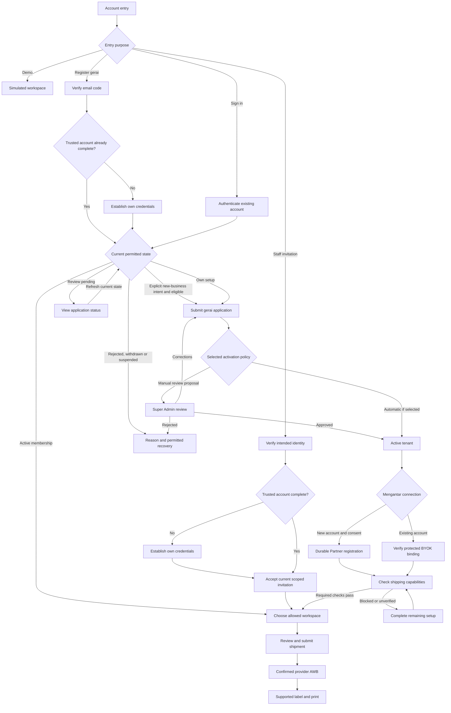

# GeraiExpress — Operator Flows and Screen Contracts

- Status: Proposed behavior handoff with Observed local surfaces. Runtime and data/auth evidence amended 2026-10-29 for Decisions DEC-020 and DEC-021 (ADR-0002, owner): the application runs on the self-hosted Node container with plain PostgreSQL 17 behind PostgREST and the application-owned auth module (T-062, T-064..T-066 built locally; T-067 security review open); screen, permission and recovery contracts are unchanged.
- Owner: Paduka Ongki
- Updated: 2026-11-02
- Sources: CTX-2, CTX-3, CTX-11, CTX-39, CTX-41, CTX-42; existing LegacyReference source routes and their actions.

## UX-1 — Scoped operational journeys and recovery
- Status: Proposed
- Owner: Paduka Ongki
- Source: CTX-2, CTX-3, CTX-11.
- Statement: Each accepted workflow shall expose its permitted primary action, required context, resulting state, and recoverable error path without bypassing server authorization or concealing uncertain provider outcomes.
- Acceptance: A permitted user completes contact reuse → draft → quote → explicit submission → ready label, resumes unknown/unpaid states safely, and receives understandable validation/permission/stale-data feedback; unauthorized direct actions remain denied.
- Constraints: IAM-1, IAM-2, TEN-1, TEN-2, TD-3, UI-1, NFR-4.
- Evidence: Observed local scoped shipping/recovery journeys, with container Playwright e2e recorded by the lead in `STATUS.md` (desktop-1280, mobile-390, tablet-768; 3 single-run flakes passed on solo rerun, T-059). T-053 adds reconcile-only batch attempts, pending/duplicate-click states and confirmations; F2 covers pickup intake/read-back/refusal copy and contact selection. Provider capture and admin closes remain open. The former Worker e2e run is historical; T-067 independent security review of the owned auth remains open.

## Daily shipping flow

1. Sign in, select an authorized tenant/outlet, and show current context. A
   user with no permitted membership sees an access/onboarding state, not an
   arbitrary tenant's data. Changing scope clears old results and pending form
   assumptions that depend on the outlet/provider account.
2. Check outlet readiness and start a draft. Select sender and recipient from
   the contact directory or enter them manually. A contact can have multiple
   saved addresses; show which address was chosen and allow intentional edits.
   Saving new contact details is explicit, not an unexpected side effect of
   merely entering a recipient or obtaining an estimate.
   Prefer one page with stable sections and an explicit final confirmation,
   following the advanced reference; these journey stages do not require a
   separate route or wizard step for each operation.
3. Keep customer sender identity, gerai pickup, destination area, and any
   provider-supported return address visibly distinct. Revalidate destination
   authority and changed contact/address revisions before confirmation. Never
   silently choose one of several ambiguous destination matches.
4. Enter package details and obtain current services. Show provider values,
   account/outlet context, service eligibility, and unavailable options with
   a useful reason. An estimate error preserves the draft for correction.
5. Review sender/recipient/pickup/service/amount, then explicitly confirm the
   sensitive provider action. Disable repeated pending clicks in the UI and
   enforce idempotency on the backend. A mismatch/stale quote returns to review.
6. Track submission honestly. Unknown means reconciliation; unpaid means
   review the verified original batch for payment; issued means provider AWB available. None means
   that delivery or physical printing has occurred.
7. Print the local masked label for an issued shipment (UX-9) and, if needed,
   reprint it from its stored snapshot. The provider PDF label is not a dependency
   (DEC-017); its request, poll and expiry states apply only to the deferred
   provider-PDF path. A missing AWB, unpaid or unknown order has a scoped recovery
   state rather than an empty successful page.

## Screen inventory derived from the reference

Destinations below describe proposed workspaces, not implemented GeraiExpress
URLs. Only accepted features become visible navigation.

| Workspace | Actor/job and required data | Primary / sensitive actions | States and completion |
|---|---|---|---|
| Scope and entry | Authenticated user; memberships, tenant/outlet readiness; host entry points and gerai switcher (UX-11) | Choose authorized context; switch gerai; sign out | Loading/no membership/suspended/denied; completion is a valid workspace |
| Daily overview | Permitted tenant user; current action counts and selected period | Open a filtered action queue; refresh | True empty versus stale/error; timestamp and metric basis visible; PR-14 scope conditional |
| Shipment list | Operator/admin; scoped paginated rows, status/filter/query context | Create/resume/open shipment | Empty/no match/loading/error; view filters preserved in navigation |
| New/edit draft | Operator/admin; outlet, parties, saved addresses, area and package | Save draft; explicit optional save to contacts; obtain quotes/review in the same workspace | Validation/dirty form/pending/stale contact or account; success shows saved draft with no implied provider order |
| Contact directory/detail | Permitted staff; role flags, minimal list DTO, selected detail/addresses | Create/edit/select; administrator archive if accepted | Empty/search no match/archived/conflicting address/stale revision; saving master leaves shipment history unchanged |
| Quote/review | Operator/admin; current draft/quote/account/sender mapping | Select service; explicitly confirm submission | Unsupported/COD unavailable/changed quote/account/permission; completion is durable submission receipt |
| Shipment detail/recovery | Permitted staff; submitted snapshot, order result and events | State-valid reconcile/payment/print actions | Queued/in flight/unknown/unpaid/issued/failed; no automatic unsafe resend |
| Labels/print history | Permitted staff; scoped AWB, masking switch, label size and print history (UX-9) | Preview, print and reprint the local masked label | No AWB/unpaid/unknown/permission missing; print request wording does not claim paper output |
| Outlet/account settings | Tenant administrator; safe binding projection, pickup-area pair, capabilities | Save/replace connection and brand; verify readiness | Incomplete/changed authority/invalid config/unavailable provider; no key echo or silent funding fallback |
| Members | Tenant administrator; current membership and revision | Invite/role/deactivate with safeguards | Pending/conflict/last-admin/denied; success updates effective membership and audit |
| CSV intake | Conditional operator/admin; template, bounded preview and row errors | Preview; select valid rows; create drafts | Ambiguous destination/tampered/expired/partial row failure; no issuance as import side effect |
| Platform tenant administration | Conditional platform role; scoped tenant status/readiness and audit | Provision/suspend/reactivate | Pending/replay/denied/in-flight-effect context; no implicit contact visibility or impersonation |
| Quick tariff / readable reference / receipt / batch handover | Advanced-source candidates only | TD-1 identifies source modules; select the corresponding workflow before exposing it | Local reference never masquerades as AWB; customer receipt does not expose provider cost; handover is separate from delivery |
| Analytics/export/finance/RTS | Later accepted feature only | Defined by its eventual domain contract | Do not copy the old menu; advanced reference removed some of these surfaces, so existence varies by checkout |

## State-valid action contract

| Condition | Allowed next action | Blocked or redirected behavior |
|---|---|---|
| Missing tenant/outlet/readiness | Select authorized scope or follow setup path | No provider mutation, quote with guessed origin, or cross-tenant default |
| Valid local draft | Save/update and obtain quote | No print or unreviewed submission |
| Current available estimate | Review and confirm | Stale draft/account/quote/sender mapping requires revalidation |
| Queued or in flight | View progress, resume status | No create-order retry or replacement merely because navigation timed out |
| Unknown provider outcome | Reconcile through permitted recovery | No blind re-creation, arbitrary failed-status edit, or account switch to bypass uncertainty |
| Existing unpaid order | Authorized payer reviews every payable order in the verified original batch and its total before explicit payment recovery | No single-row charge implication, unknown/foreign batch member, replacement order or blind payment retry; TD-3 governs reconciliation |
| Issued AWB | Print the local masked label (UX-9) and view verified tracking | Contact edits cannot rewrite the submitted sender or a stored label snapshot |
| Label pending/processing (deferred provider PDF path only) | Poll existing job within account limits | No repeated generation just to check status |
| Completed label URL expired (deferred provider PDF path only) | Reauthorize and GET the existing generation for a fresh URL | No POST regeneration merely to renew a download link |
| Label generation failed (deferred provider PDF path only) | Show safe cause, correct it and explicitly request a new generation if eligible | No unbounded POST loop; account Print quota still applies |
| Revoked member/suspended tenant | Denied new work; explicit access/recovery guidance | New privileged work blocked; bounded machine result recording still follows TD-3 |

## Interaction and browser evidence requirements

Preserve unsent values and useful existing data during recoverable errors.
Show field errors near labelled inputs, focus the relevant result/error, announce
pending and completion, and keep all primary controls keyboard reachable.
Confirmation dialogs explain the actual provider/money effect and selected
scope. Contact archiving states its relationship to historical snapshots.

At 390px, 768px, and 1280px, scope and next action remain visible; wide tables
scroll locally rather than making the document overflow. Long names/addresses,
multiple outlets, empty and populated data, backend errors, stale selection,
unknown/unpaid status, and denied actions need rendered-browser evidence.
Static React render tests and a green build do not satisfy that evidence.

Use Bahasa Indonesia for the proposed operator UI and explicit locale/timezone
formatting; final locale, printer/device support, and accessibility acceptance
are owner decisions. Keep internal fixture-only gates out of the production
flow. Show truthful capability/readiness errors instead of implementation jargon.

## UX-2 — Seller onboarding, existing-account connection, and recovery
- Status: Proposed
- Owner: Paduka Ongki
- Source: CTX-16, CTX-17, CTX-19.
- Statement: Provider settings shall guide an authorized tenant administrator through new-seller or existing-account connection, required owner agreement, recoverable progress, and capability-specific readiness without exposing credentials or hiding provider restrictions.
- Acceptance: Browser journeys complete both permitted connection paths and retain non-secret input on correctable errors; timeout/503/null-key/existing-email/rotation-unknown cases show the right recovery; foreign/unauthorized requests remain denied and no provider password/key readback appears.
- Constraints: PR-17, PR-18, PR-19, PR-20, IAM-3, TEN-3, UI-1, UI-2, UI-3, NFR-4.
- Evidence: Screen contract only; no rendered GeraiExpress browser proof.

| Surface/state | Visible information and action | Completion/recovery |
|---|---|---|
| Connection choice | Explain tenant business/account relationship; New Mengantar account or Existing account | Choice does not create an account; show current tenant and owner authority |
| New account form | Active tenant and account-owner authority first; owner name, readable email, Indonesian mobile; account/COD disclosure; links to actual provider Terms/Privacy; affirmative agreement | Validate fields, preserve non-secret values, and show Create Mengantar account action only to permitted roles; no password field |
| Registration pending/unknown | Durable progress reference, current owner email, truthful status | Resume same operation; disable repeat creation and never change external ID for recovery |
| Existing email conflict | Explain that an account already exists without exposing provider account details | Move to BYOK instructions; do not create another account with a fabricated email |
| Existing account form | Owner logs in to Mengantar and creates/copies own key; protected one-time input and account-authority check | Store key privately; clear submitted secret from client form state; no saved-key reveal |
| Connected summary | Owner email, safe seller/account reference, connection mode, independent shipping/sender/PDF/tracking capability states | Configure pickup, request permitted checks, and show Lupa Password instructions; connected does not mean ready for every operation |
| Quota/configuration/provider restriction | Human-readable next action, retry time where appropriate, support path | Background scheduled recovery; no rapid retry button for daily cap or deliberate restriction; technical details only where administrator action requires them |
| Credential management | Explicit effect confirmation: old key stops immediately, webhook secret may change; current account context | Fence dispatch while pending; rotation unknown routes to recovery without a second rotation |
| Webhook unavailable/desynchronized | Tracking via authorized polling; manual Mengantar URL/secret setup and verification guidance for administrator | No automatic Partner webhook setup or blank-secret success state |

The daily operator sees a concise readiness banner with a permitted next action;
Partner secrets, IP-policy internals, and quota configuration belong only in
administrator/operations surfaces where they support a decision. A platform-wide
Partner access issue must not falsely label all tenant seller accounts banned.
Agreement and sensitive effect confirmation are required steps; routine form
navigation and read-only recovery status do not need extra confirmation dialogs.

## UX-3 — Initial demo login and guided sample workspace
- Status: Proposed
- Owner: Paduka Ongki
- Source: CTX-21.
- Statement: The login surface shall make demo access discoverable and open a labelled sample workspace where a reviewer can try the initial shipping workflow without onboarding a real Mengantar account.
- Acceptance: At NFR-4 viewports, a reviewer follows the supplied demo login instructions, sees the demo tenant/outlet and persistent simulation notice, explores seeded contacts/shipments, completes the sample flow, and can reset trial changes or sign out; invalid/expired demo access shows a usable recovery message.
- Constraints: PR-21, IAM-4, UI-1, UI-2, NFR-4. Simulation output must not imply a real AWB, payment, provider PDF acceptance, delivery, or physical print.
- Evidence: Flow specification only; no implemented screen or browser proof.

| Step | Product behavior |
|---|---|
| Login | Provide an obvious demo entry and working access instructions with the first preview; real account registration remains a separate path |
| Sample workspace | Show demo tenant/outlet and a persistent Demo / Simulasi label; preload synthetic sender/recipient contacts and draft/issued/recovery examples |
| Try a shipment | Reuse sample contacts, edit a session-local draft, compare example quotes and confirm a simulated shipment |
| Sample label | Display a conspicuous sample watermark and simulated reference; do not present it as a valid courier shipping label |
| Restricted settings | Explain that provider connection, seller creation, staff invitations and real payments require a real authorized workspace |
| Reset / exit | Reset only the visitor's trial state to seeded examples or sign out; preserve no shared visitor-entered personal data |

## UX-4 — Counter workflow and daily operating context
- Status: Proposed
- Owner: Paduka Ongki
- Source: CTX-2, CTX-3, CTX-14, CTX-22, CTX-23.
- Statement: The initial gerai workspace shall support the complete counter job through scoped contact reuse, parcel/service review, original-order recovery and authorized label access, with setup/governance and optional finance/custody work clearly assigned to their accepted contracts.
- Acceptance: An authorized operator can handle a new sender, a returning sender, a quote correction, a timed-out/unpaid order and a reprint within the selected outlet without losing entered values or creating a second order; another staff member can resume saved permitted work and sees a conflict instead of overwriting a newer draft.
- Constraints: PR-1 through PR-10, PR-12, PR-13, NFR-2, NFR-4, DATA-2. PR-14 is conditional; receipts, customer payments, handover and cancellations require separate acceptance. Existing IAM permissions remain authoritative.
- Evidence: User intent and source-reviewed workflows; actual counter observation/browser proof pending.

| Counter moment | Operator decision and system behavior | Completion / boundary |
|---|---|---|
| Start work | Select authorized outlet; inspect readiness and queued exceptions | Open shipment worklist/new draft; setup issues route to permitted administrator |
| Customer intake | Select returning sender/destination or enter new details; confirm chosen address and intentional contact saving | Valid local draft; no implicit seller or provider-master creation |
| Parcel and service | Enter parcel details, correct ambiguous areas, request quotes and explain available service/amount | Current quote bound to draft/account; never silently replace the selected service or price |
| Review and issuance | Review customer identity, pickup, destination, service and provider amount; explicitly confirm | Durable original operation and truthful progress; provider timeout does not create a new logical shipment |
| Label and customer follow-up | Print supported label when ready; find the original record for tracking/reprint | Original snapshots and permitted private access; no invented delivery/physical-print success |
| Staff change | Resume saved draft/operation with current membership and revision | Shared allowed tenant work; stale editor receives a conflict and retains unsaved input |
| Daily attention | Filter existing unknown/unpaid/failed-label work and inspect last update | Resolve the original operation or escalate; counts do not imply financial cash closure |
| Optional customer payment / parcel handover | Use only an accepted money/custody workflow; otherwise retain clear capability boundaries | No counterfeit receipt, ledger, pickup or cancellation event inferred from label creation |

The operator completes common intake on one page with distinct Sender,
Recipient, Pickup, Parcel and Service/Review sections. Show the next valid
operation rather than a generic analytics dashboard. Owner setup, members and
credentials remain separate administrator tasks. A customer asking for status
does not receive broader portal/login access through the contact directory.

Verify the first counter pilot with long Indonesian names/addresses, repeated
contacts, route ambiguity, insufficient provider funding, interrupted requests,
concurrent edits and reprints on the selected printer/media. Device/volume and
customer-charge policies are explicit open decisions in the PRD, not guessed
behavior or inherited LegacyReference constants.

## UX-5 — Normal customer tariff and private discounted seller price
- Status: Proposed
- Owner: Paduka Ongki
- Source: CTX-24 through CTX-28.
- Statement: Counter review and customer/resi output shall show the normal undiscounted Mengantar tariff and applicable verified customer COD/insurance charges, while administrator pricing surfaces separately show assigned discounts and verified net provider costs.
- Acceptance: Different verified seller discounts preserve the same normal customer tariff; applicable fees/premiums are counted once with an explicit payer; all enabled modes including COD Ongkir retain the retail basis, and operator/customer payloads/output omit private net cost/discount. Changed/unknown amounts preserve the draft or reconcile the original submitted order.
- Constraints: PR-22, PR-23, IAM-5, IAM-6, DATA-5, UI-2, NFR-4. The label is local (DEC-017) and the provider PDF is not a dependency; customer goods and settlement responsibilities remain separate.
- Evidence: Observed T-041/T-053 local discount terms, quote-time cost derivation and nullable provider-percentage storage; cost/detail and assigned-terms settings views are tenant-admin-only, unknown stays "belum diketahui", and operator/print/export projections omit private cost/discount. Worker-reported pricing-display/public-api unit, discount-recording DB and gerai-discount/shipping e2e cover the built surfaces. Insurance and written provider terms remain unproved.

| Surface / mode | Required behavior |
|---|---|
| Non-COD operator/customer | Normal shipping plus selected applicable insurance; no COD fee; distinguish amount due from a recorded payment |
| Full COD operator/customer | Goods collected plus normal retail shipping and the applicable customer components assigned to courier collection; fee inclusion/rounding follows the verified rule |
| COD Ongkir operator/customer | Normal retail shipping and applicable collection components, goods not collected by courier; never substitute discounted shipping cost as its customer basis |
| Insurance selection | Show supported coverage/premium and its payer/collection channel; required/unsupported/unknown states are explicit; no double collection |
| Tenant administrator | Own assigned gerai discount with its status (owner-stated, provider-observed or provider-verified) and the gerai cost estimate derived from it; the account-specific net quote and actual cost basis where available; estimate and actual reconciliation stay distinct. Never the platform remainder or the observed provider percentage (TEN-4, DATA-9) |
| Platform pricing administrator | Scoped audited gerai-discount terms with effective date, source reference and status; the derived platform remainder labelled as an estimate; the observed provider percentage per quote; blocked states (UX-12); no universal discount claim or local-only false activation |
| Changed/unavailable prices | Preserve input and show revalidation/refresh; no fake quote, hardcoded legacy fee, zero-cost assumption or silent account/service switch |
| Confirmed shipment / label | Retail price snapshot and original approved collection; later discounts do not change reprints; actual provider adjustments remain separate history |

Show source/quote time and the chosen service before customer confirmation.
Where customer fees are presented together as shipping, retain their underlying
components so the total stays consistent across review/detail/print. Never use
that presentation to substitute net cost or conceal who collects an insurance
premium. Retail values are permitted operator data; internal settlement values
remain private even when a customer fee numerically matches a provider fee.

The label is a local masked label (DEC-017, UX-9), so there is no provider-PDF
template to inspect for price disclosure. The label shows no private net cost or
discount (PR-34, PR-22). Whether it prints the normal customer tariff or the COD
collection amount is Unknown beyond PR-34's COD collection instruction; select it
with the pilot scan, and never print net cost, invent a custom-price API
parameter or modify authoritative AWB routing. Customer receipts and financial
reporting retain their own accepted scope; they are not automatic replacements
for the requested resi behavior.

## UX-6 — Super Admin workspaces and sensitive-action states
- Status: Proposed
- Owner: Paduka Ongki
- Source: CTX-14, CTX-17, CTX-28, CTX-29, CTX-30.
- Statement: A separately guarded Super Admin workspace shall organize tenant governance, negotiated discounts, integration readiness, operational triage and audit around their decisions, with explicit scope and safe recovery.
- Acceptance: A permitted Super Admin completes tenant lookup/configured review, scoped discount verification and eligible exception reconciliation with truthful pending/audit results; anonymous/tenant/demo/revoked/incomplete-factor cases are denied at direct boundaries, and partial/stale/empty/failed data remains distinguishable at NFR-4 viewports.
- Constraints: PR-15, PR-23 through PR-28, IAM-7, TEN-4, UI-4, NFR-4. Decision (DEC-015): the workspace is served only from the owner host (ARCH-6); proposed `/platform/...` paths below are not implementation requirements.
- Evidence (T-093, 2026-11-04): `/admin/pelanggan` (menu "Data pelanggan") searches one phone (+62 and 0 folded) and shows shipment count, as-recipient/as-sender split and the gerai/cabang used; `/admin/tenant/[id]` adds "Data pelanggan gerai ini" (shipment customer fields, 20 per page). Both appear only with `customer_data_review`, read nothing until a reason is submitted (POST, never in a URL) and audit every read (`customer_data.lookup`, `customer_data.tenant_view`; phone masked plus SHA-256). Read-only; production use waits for counsel (T-048).
- Evidence (T-092, 2026-11-03): `/admin` adds the Ringkasan signals, a searchable/filterable/paged directory and `/admin/tenant/[id]` activity/readiness summary for `platform_monitoring` or `tenant_governance`, aggregates only (DEC-024); Operasi recovery stays out of scope (monitoring only).
- Evidence: Observed local routes use `/admin`, including discount screens and T-053's `/admin/tenant/[id]` masking control, guarded by capability plus `aal2`; F2 adds invoice/export audit labels/filters and hides label/invoice snapshots from the default audit list. Worker-reported platform/gerai-discount/masking-admin e2e cover built governance; platform health and cross-tenant recovery remain unbuilt.

| Workspace / proposed entry | Required data and main action | States / completion |
|---|---|---|
| Super Admin login / `/login/super-admin` | Verify identity, current platform grant and factor challenge | Anonymous/denied/factor-required/expired; completed access loads only granted platform workspace |
| Ringkasan / `/platform` | Work needing attention, defined tenant/usage/queue/provider signals and timestamp | Initial loading/partial/stale/error/true empty; each signal links to its matching filtered worklist |
| Gerai / `/platform/tenant` | Business name/status, minimal owner contact, outlet/member counts, connection readiness | Search/status/pagination and explicit scope; open one tenant's platform detail without entering its customer workspace |
| Detail gerai / `/platform/tenant/[tenantId]` | Lifecycle/history, outlet/readiness summary, seller mode, assigned discount and scoped issues | Missing/denied/conflict/pending; permitted lifecycle confirms reason and effect then displays recorded result |
| Pendaftaran / `/platform/pendaftaran` | Registration/setup/verification and versioned review history under UX-7 | Conditional manual-review policy; approve/request corrections/reject reason, replay/conflict and clear app-versus-provider state |
| Diskon / `/platform/diskon` | Tenant gerai-discount terms, effective version, source and status, observed provider percentage and the derived remainder estimate (UX-12) | Pending/blocked above the observed provider discount/unknown observed value; saving does not claim upstream activation and the normal customer tariff stays fixed |
| Integrasi / `/platform/integrasi` | Environment/origin readiness, safe secret-version status, account capabilities, egress/quotas and BYOK distinctions | Configuration blocked/provider restricted/partial registration/webhook desync; route only to permitted existing recovery/setup |
| Operasi / `/platform/operasi` | Scoped original-operation references, status/attempt history, safe error code and next permitted action | Queued/in-flight/unknown/unpaid/failed/label pending; reconciliation resumes one original operation, never blind re-create/pay |
| Audit / `/platform/audit` | Actor/action/target tenant or global scope/time/reason/outcome/version/correlation | Filtered empty versus denied/load failure; append-only records and safe minimal metadata |
| Akses platform / `/platform/akses` | Approved staff grants, current capability/revision and security state | Conditional role-governance permission, final-admin conflict, revoked access and recovery guidance; no password/factor-secret readback |

List filters preserve meaningful URL state. A persistent Platform / Super Admin
context indicator distinguishes this workspace from a selected tenant detail.
Unknown issue details do not expand into full customer contacts. Label current
snapshots versus selected-period events; display WIB and the latest data time.

Sensitive changes name the tenant/account, action, effect and reason; do not
preselect a destructive result. Confirmation pending blocks duplicate clicks,
while backend idempotency remains authoritative. Denied actions explain the
permitted escalation without revealing another tenant's details. After success,
return focus to the changed object/result; conflict preserves entered reason
and asks the user to review current state. Integration/discount/credential edits
require explicit save/confirmation rather than silent autosave.

Suspending a gerai blocks selected new work, preserves existing resi/history and
records dispatched outcomes. An unpaid issue points to the tenant's authorized
funding/recovery path; it does not let Super Admin spend the seller's funds by
virtue of viewing the issue. Missing provider capability remains pending rather
than a green ready state. No retry control bypasses the original account/version.

Initial preview may use isolated synthetic platform fixtures to verify these
screens; the existing shared operator demo remains unable to enter Super Admin.
Working privileged account/bootstrap and real integrations are supplied only
when implemented through their approved provision/release process.

## UX-7 — Real-account registration through first-resi readiness
- Status: Proposed
- Owner: Paduka Ongki
- Source: CTX-31 through CTX-35; PR-29, PR-30, PR-33.
- Statement: A real applicant shall have a complete resumable path from verified app identity through gerai application/selected activation to explicit seller connection and capability readiness, with each state naming the next permitted action.
- Acceptance: New/returning, interrupted, invalid-code, pending/correction/rejected and new/BYOK provider paths preserve the correct identity/application and never create duplicate tenants/sellers or conceal a blocked first shipment.
- Constraints: PR-15, PR-17 through PR-21, TD-11, DATA-7, IAM-8, TEN-5, UI-5, SEC-5, NFR-4; recommended email-first/manual-review policy requires acceptance.
- Evidence: Proposed journey and diagram; not executed browser/Auth/provider evidence.
- Change history: 2026-10-13 — Added in the registration and documentation-completeness review.

### Registration flow

Diagram owner: UX-7. Review date: 2026-10-13. Status: Proposal. Plain flowchart
syntax is used for host compatibility; no rendered-diagram/browser claim.

Each arrow is a guarded transition, not an automatic API call. Demo never joins
the live path. Staff membership uses UX-8; it never creates another gerai/seller.
Active members enter only the capabilities their role and outlet permit.

### Screen and state contract

Routes are proposed same-origin destinations, not installed pages. Observed
(2026-10-28): the implemented paths are `/daftar`, `/daftar/kata-sandi`, `/daftar/gerai`, `/akses`, `/pilih-gerai` and `/undangan`; the paths below remain proposals. Combine steps
within `/onboarding` when simpler; permission/state checks do not depend on paths.

| Surface / proposed destination | Main job and action | Pending, failure and next screen |
|---|---|---|
| Register / `/daftar` | Explain Register gerai versus staff/demo/sign-in; collect email, actual app notices/required Terms acceptance; request code | Validate inline; generic accepted response; public quota/unavailable state; next email verification, no tenant/provider effect |
| Email code / `/daftar` (step 2) | Show entered email, code input, change-email and rate-limited resend; verify through the application-owned auth module (`verifyEmailCode` / `public.auth_verify_otp`) | Wrong/expired/consumed code and delivery uncertainty preserve email; never claim tenant approval; success resolves current identity |
| New account completion / `/daftar/kata-sandi` | Initial/partial app identity explicitly sets/replaces its password (`setPassword` / `public.auth_set_password`) after inbox proof; previously completed app identity keeps its credentials | Password policy/confirmation error preserves safe fields only; failed update can resume; explicit recovery for returning users |
| Gerai setup / `/onboarding/gerai` | Owner/business/contact/first-outlet fields and applicant-authority declaration; save/submit current revision | Invalid/conflict/network/duplicate submission; after response loss load own application rather than create anew; success opens status/setup |
| Application status / `/onboarding/status` | Current submitted revision, selected policy, safe reason/history and who acts next | Submitted/changes requested/approved/rejected/withdrawn; correct and resubmit only permitted states; no promised review SLA |
| Super Admin review / `/platform/pendaftaran` | UX-6 purpose-bound verified owner/business projection and current revision | Approve/request corrections/reject with reason; stale/concurrent decision reloads; success is local tenant decision, not seller creation |
| Seller connection / `/onboarding/mengantar` | Active tenant administrator chooses new or existing seller; UX-2 exact owner/consent/key flow | Email conflict goes BYOK; timeout/503/quota resumes original external ID; missing real owner/policy remains blocked |
| Readiness / `/onboarding/kesiapan` | Show pickup, sender, quote/pricing, allowed modes, PDF and tracking with distinct status/reason | Required unavailable capability blocks that operation; optional webhook does not block verified polling; role-valid next setup action |
| First shipment / permitted tenant workspace | UX-1 intake/current quote/review/submission/label | Unknown/unpaid/label-pending recover original operation; no new seller or order caused by back/refresh/login |

### Review and exception paths

Decision (DEC-007, 2026-10-14): manual Super Admin approval during the pilot, with one
visible worklist and safe reasons; this is not an accepted requirement that every
future gerai needs manual approval. If automatic activation is selected later, omit
the waiting screen and record the current policy outcome. In either mode, owner email
verification and valid data are prerequisites, and provider connection remains an
explicit later action.

Corrections keep the same application/tenant ID and create a new submitted
revision. Rejection explains the permitted next step under selected resubmission
policy; no fabricated new email or provider account is suggested. Withdrawal and
subsequent reapplication are available only if that policy is accepted. Changing
business/pickup details after approval follows normal settings authorization.

For an unknown app submission result, reload its own idempotent command receipt.
For unknown provider creation, UX-2/TD-7 recover the original external ID. These
are different recovery mechanisms. A successful email send, verified session,
approved tenant and connected seller each have a different completion message.

### First-resi readiness checklist

| Capability | Required before enabling the related action |
|---|---|
| Identity and scope | Current active tenant/member/outlet; administrator authority for setup; demo transport isolated |
| Account binding | Correct actual seller/account/environment and private current key; no shared default funding fallback |
| Pickup and sender | Verified pickup-area mapping and a drop-off or pickup choice (UX-10); the printed sender comes from the masking switch (UX-9); no provider dropshipper mapping (DEC-017) |
| Customer/seller prices | Verified normal tariff and private net cost; activated applicable discount; no unverified local discount advertised as upstream |
| Collection and insurance | Current supported mode and authoritative fee/inclusion/payer rules; unselected customer-goods settlement remains blocked |
| Order and funds | Current quote/draft/account revision, allowed service and authoritative funding/payment conditions; checks do not themselves debit funds |
| Label | Authoritative AWB; the local masked label renders a barcode that decodes to the AWB (UX-9); no provider PDF is required (DEC-017) |
| Tracking | Verified scoped polling baseline; webhook remains optional until its independent secret/capture proof succeeds |

Readiness is per capability and action. Local setup/drafts need no live order;
customer sender, collection and label requirements cannot be bypassed merely to
show a global ready badge. The reviewer sees which check is synthetic versus real.

## UX-8 — Staff entry, login routing and account recovery
- Status: Proposed
- Owner: Paduka Ongki
- Source: CTX-31, CTX-33, CTX-34; PR-31, PR-32.
- Statement: Staff invitation, returning-user login and recovery shall resolve current identity and permitted scope without accidental gerai/seller creation, credential overwrite or cross-tenant disclosure.
- Acceptance: Invited new/existing users accept only valid current intended scope, account switches/recovery return to a permitted destination, and no-membership/multi-membership/pending/suspended states have a clear usable next action at NFR-4 sizes.
- Constraints: IAM-2, IAM-8, TEN-5, DATA-7, SEC-5, UI-5, PR-20, DEC-021; the application-owned auth module (`src/lib/auth/**`) and current membership remain authoritative.
- Evidence: Observed in `src/lib/auth-actions.ts`, `src/lib/registration-actions.ts`, `src/modules/members/actions.ts`, `tests/db/invitations.test.ts` and `tests/e2e/{registration,members,auth-demo}.spec.ts` (T-065, T-066; T-067 review open).
- Change history: 2026-10-13 — Added in the registration and documentation-completeness review. 2026-10-29 — Updated for DEC-021 (ADR-0002): application-owned auth replaces Supabase Auth.

| Entry/state | Main action and result | Recovery / authority limit |
|---|---|---|
| Staff invitation / `/undangan` | Verify intended email or sign in; after proof show business, role and outlet scope; explicitly accept | Wrong signed-in identity offers safe account switch; invalid/expired/revoked invitation offers request-new-invite guidance without foreign details |
| New staff identity | 6-digit email-code verification and password setup (`src/lib/auth/**`), then same invitation acceptance | No gerai application or Mengantar creation; role comes from current allowed invitation, not signup input |
| Existing staff identity | Keep credentials/memberships, accept explicit new scope | Already member resolves existing role or controlled conflict; no silent promotion or duplicate membership |
| Sign-in / `/masuk` | Application-owned password login (`signInWithPassword`); resolve verified current identity/membership/application | Invalid credentials are generic; no membership opens own onboarding/invitation guidance; multi-membership opens chooser; no assumed first tenant |
| Forgot password / `/lupa-password` (scheduled, PR-32) | Request recovery code with generic accepted feedback | Show resend/expiry guidance without confirming email existence; this recovers GeraiExpress only |
| Set/reset password / `/atur-ulang-password` (scheduled, PR-32) | Require valid recovery session and explicit new password | Expired/used/missing session returns to fresh recovery; no app-role change, seller ownership change or password readback |
| Auth callback (not used) | Code-only OTP flow (`src/lib/auth-mail.ts`) uses no redirect link or PKCE callback route (ADR-0002 obligation 9) | GET never accepts an invitation or provisions a tenant |
| Session expiry during setup | Authenticate again and reload own saved application/current invitation | Preserve bounded non-secret edits where safe; no replay of provider/money commands; current server state wins |
| Suspended/revoked access | Explain restriction, permitted support path or switch to another current membership | No tenant operation/provider effect; do not erase existing in-flight result/history |
| App email change (not built) | Future verified email-change flow; refresh verified identity | Pending new email cannot accept matching invites until verified; existing seller email remains unchanged; owner transfer separate |
| Mengantar dashboard access | Explain native Mengantar Lupa Password to confirmed provider email | No GeraiExpress form accepts or resets Mengantar password; provider verification/bank/COD restrictions remain independent |

Emails and status views identify the actual application/business and purpose,
without full customer data. Show TTL/resend availability from the configured
auth limits (10-minute code validity, 30-second resend cooldown). No signup-generated account or notification is presented as a
working demo credential. The first preview still supplies PR-21's actual demo
access separately from these real-user journeys.
Added 2026-10-28: DEC-013 schedules own password recovery (PR-32) with the production
mail gate, so the forgot-password and reset rows above are scheduled, not built.
Observed: no recovery screens exist; sign-in is `/masuk`, not `/login`; the closed
registration state and invitation sign-in links work without app-sent mail.

## UX-9 — Masking switch and local masked label
- Status: Decision (DEC-017, PR-34; misuse DEC-018); local label and Super Admin masking control built (T-044, T-053); activation responsibility statement and courier acceptance remain open
- Owner: Paduka Ongki
- Source: CTX-39, DEC-017; PR-34, PR-6; TASKS T-044.
- Statement: At print time the operator shall choose whether to mask the sender with the switch "Gunakan masking pengirim", see exactly what the label will show before printing, and print a local label of 10x15 cm (default) or 10x10 cm that carries the AWB as a Code128 barcode.
- Acceptance: At 390, 768 and 1280 px a permitted user opens the print view of a real issued shipment, toggles the switch and sees the preview change, prints, and finds the print in the history; with the switch on, printing is blocked with field errors until the sender name, phone and city are entered (Decision, DEC-018; PR-34); for a tenant with masking disabled the switch is shown disabled with the Bahasa reason below and the preview shows the gerai identity; a barcode decode returns the AWB; an unavailable shipment shows its cause; a demo shipment shows the sample watermark.
- Constraints: PR-34, PR-6, DATA-10, UI-6, NFR-4, PRIV-1, DEC-017.
- Evidence: Observed local stored-snapshot label, per-print off-default masking switch, required sender fields, sizes, print history, disabled-state reason and tenant WhatsApp setting/prompt (T-044). T-053 supplies `/admin/tenant/[id]` with capability/aal2 read/change, reason, confirmation and audit; F2 fixes invalid-form locking. Lead-executed container Playwright e2e across desktop-1280, mobile-390 and tablet-768 is recorded in `STATUS.md` (earlier Worker runs are historical). Only Chromium print-to-PDF is recorded; activation statement and courier acceptance remain T-048.

| Surface / state | Contract |
|---|---|
| Entry | From the shipment detail of an issued shipment with an authoritative AWB. Unpaid, unknown, failed or no-AWB shipments show the recovery state, not a label (PR-6). |
| Switch | A real switch labelled "Gunakan masking pengirim" with a visible on/off text. Off: the preview shows the gerai name, WhatsApp number and pickup address as sender. On: the preview shows the operator-entered sender name, phone and city. Decision (owner design direction C6, 2026-10-29): the on/off choice and the label size are remembered for the browser tab session per gerai and user (sessionStorage, UI preference only; the sender fields are never stored) and apply to a shipment that has no stored label yet. The thermal label and the A4 invoice never share one print job: the "Resi + invoice" view prints "Keduanya" as two consecutive print dialogs, label first. |
| Off state data | The gerai name comes from the tenant and the pickup address from the outlet. Decision (PR-34, owner-selected "like the legacy project", 2026-10-28): the gerai WhatsApp number is the tenant-level `contact_whatsapp`, edited only by a tenant administrator in settings; if it is empty the print is blocked with the prompt "Nomor WhatsApp gerai belum diisi. Minta administrator gerai mengisinya di Pengaturan." and is never printed blank; an operator sees the prompt without an edit control. |
| Settings field | In `/pengaturan` a tenant administrator sees the field "Nomor WhatsApp gerai" with helper text showing the expected form (for example 081234567890); an operator sees it read-only. A leading `+62` or `62` is accepted and shown back as `0` plus the national number (Proposal, PR-34). An invalid value is refused near the input with "Nomor WhatsApp gerai tidak valid. Gunakan nomor Indonesia berawalan 0, misalnya 081234567890." (the rule is `^0[2-9][0-9]{7,11}$`); a successful save confirms with "Nomor WhatsApp gerai disimpan." and the change is audited; the value is saved by an audited command, never by the browser writing the column. |
| On state fields | Three labelled required fields (sender name, phone, city) with Bahasa field errors near the input; non-secret values preserved on error; maximum lengths Unknown and chosen to fit the label. |
| Size | 10x15 cm default; 10x10 cm option; the preview matches the chosen size. |
| Preview | The preview is the print output; an on-screen "Masking aktif" indicator is not printed. Recipient, courier and service, weight and COD collection instruction are printed (Proposal, PR-34). |
| What stays visible | The shipment detail always shows the real sender and the real pickup address for returns (DEC-017). The Mengantar pickup name is never printed as the default sender. |
| Print and reprint | Print appends a history row; reprint uses the stored snapshot, not current settings; changing the switch creates a new snapshot (DATA-10). The wording says the print request was issued, never that paper was produced. |
| Masking disabled for the tenant | Proposal mechanics for the DEC-018 policy (PR-34, DATA-10): when the Super Admin has set the tenant's `masking_allowed` flag to false, the switch is rendered disabled and off, never hidden, with the visible reason "Masking pengirim dinonaktifkan untuk gerai ini oleh administrator platform. Label dicetak dengan identitas gerai. Hubungi administrator gerai untuk informasi lebih lanjut." The disabled state is announced to assistive technology with the reason as the control's description; the size choice and printing with the gerai identity stay available. The database refuses a masked snapshot for such a tenant independently of this screen (DATA-10). |
| Responsibility statement at activation | Decision for the requirement (DEC-018); wording Unknown until counsel (T-048): when a tenant is activated its administrator accepts a statement that the tenant is responsible for the accuracy of the sender data and of the goods shipped; the acceptance (actor, time, statement version) is stored and shown to that administrator in settings. Proposal for the draft text, pending counsel: "Gerai bertanggung jawab atas kebenaran data pengirim dan barang yang dikirim, termasuk saat masking pengirim digunakan." |
| True-identity retention note | Decision (DEC-018); shown to tenant administrators only, beside the masking explanation in settings and in the print view help text (not on the printout): "Identitas asli gerai dan alamat pickup tetap tersimpan pada setiap label, juga saat masking aktif, dan disimpan selama masa retensi audit." No period is stated because the retention period is Unknown and stays for counsel (T-048). The shipment detail always shows the real pickup address (row "What stays visible"). |
| Super Admin control | Proposal mechanics: on the gerai detail in the platform workspace (UX-6) a Super Admin can disable or re-allow masking for one tenant and can suspend the tenant; both actions need a reason, a confirmation dialog naming the tenant and the effect, and write an audit event. A Mengantar or courier notice about a masked parcel is the trigger for the platform review that may lead to either action (Decision, DEC-018). |
| Acceptance gate (PR-46, Proposed, T-084) | Per courier, a masking acceptance record (DATA-10 amendment) states `verified` or `unverified` with its evidence reference. For an unverified courier the switch shows "Belum terverifikasi untuk <kurir>" and printing with masking on needs an explicit acknowledgement checkbox recorded in the print history. With masking on, the print view help text (not the printout) always states where a return goes for that courier and route (pickup address, or configured return address for Java-to-Java where supported), never the printed sender. Development is not blocked (DEC-023); recorded `verified` waits for the courier test and the Mengantar sync. |
| Misuse | Decision (owner-delegated default, DEC-018): the policy is per-shipment choice, off by default, all three sender fields required, true identity retained, tenant responsibility accepted at activation, Super Admin tenant-level disable and suspension (PR-34). Unknown: whether couriers accept a locally printed label (pilot scan, PR-34, PR-6); the screen does not claim courier acceptance. |

## UX-10 — Pickup choice and slot selection
- Status: Decision (pickup is a launch requirement: CTX-39, PR-5); Proposal (screen details); built in part (T-043): the provider slot list is not built
- Owner: Paduka Ongki
- Source: CTX-39, DEC-014; PR-5; TASKS T-043, T-034.
- Statement: For each shipment the gerai shall choose drop-off or pickup; a pickup choice shall show the available provider time slots, reserve the chosen slot before the order is created, and keep reservation, order and recovery states distinct and truthful.
- Acceptance: At 390, 768 and 1280 px an operator chooses pickup, selects a slot, confirms, and sees reservation then order progress; a lost reservation or create response leads to reconciliation with no second reservation or order; changing the pickup address or outlet after quoting asks for a new quote and slot; drop-off behaves as today.
- Constraints: PR-5, TD-3, DEC-010, UX-1, UX-13, NFR-4. The provider time endpoints' request and response shapes are Unknown until a sandbox capture is recorded (PR-5); the reservation validity window is Unknown.
- Evidence: Observed pickup intake/date/hour/vehicle/note and confirmation handover, frozen origin and separate reservation/order states. F2 adds pickup-intake e2e and courier-filter unit tests, makes final-state refusal copy win over phases and excludes sibling time ids with one date per read-back row. Worker-reported corrected intake/detail cases pass on 390/1280. `GET /time` is reachability/read-back, not a provider-listed availability screen; that Proposal remains unmet. T-043 is reopened only for the supervised capture in T-048 item (6); release, time-zone/slot representation and reservation ownership remain Unknown; ambiguous-reservation admin exit is T-056.

| Surface / state | Contract |
|---|---|
| Choice | A labelled two-option control in the review section: drop-off (default, existing behavior) or pickup. The choice is part of the draft and of the confirmed snapshot; the pickup identity frozen at confirmation is the one dispatched (T-034). |
| Slot list | Pickup shows the provider's available slots with date and time range, grouped by day. Empty list: an explicit "no slot available" message with the choices to pick drop-off or try later; never an empty selector. Loading and provider-error states preserve the draft. |
| Selection | A slot is selected, not yet reserved. A reservation is not an order; the confirmation dialog states that the slot will be reserved and the order created. |
| Progress | Distinct states: slot selected, reserving, reserved, creating order, issued, and failed. A reservation without an order is shown as such. |
| Unknown outcome | A lost reservation or create response shows the unknown state with a reconcile action that reuses the original operation; no button re-sends a reservation or order (DEC-010). |
| Invalidation | A change to outlet, pickup address or quote after slot selection clears the slot and asks for a new quote. Expiry of an unused reservation is Unknown until the sandbox capture. |
| Visibility | The shipment detail shows the chosen type, slot and the real pickup address; with masking on the label does not print the pickup address (UX-9). |

## UX-11 — Entry points, host chooser, gerai switcher and Bahasa error pages
- Status: Decision (hosts, 404 behavior, entry points, chooser, identities and per-host error pages: CTX-41 items 1, 4, 8, 13, 14 and 16, accepted; items 11 to 17 accepted by the owner on 2026-10-28, DEC-015); Proposal (switcher and review P2 findings); built in part (T-042, T-051): the per-host variants and the unsaved-input confirmation are not built
- Owner: Paduka Ongki
- Source: DEC-015; CTX-41; PR-36; review P2 UX findings (switcher, English error pages); TASKS T-042.
- Statement: Each host shall have its own entry point, its own Bahasa Indonesia not-found and error pages, and the app host shall let a user who belongs to several gerai see and switch the current gerai at any time.
- Acceptance: An anonymous visitor to `/` on each host reaches that host's sign-in (owner and app) or the public page (apex); another host's path answers a Bahasa 404 with no redirect and no hint of the other host; a multi-membership user switches gerai from the shell, old results and pending form assumptions are cleared, and a single-membership user sees no switch control; every error page is in Bahasa Indonesia with no stack or secret.
- Constraints: PR-36, TEN-6, ARCH-6, UX-1, UX-8, UI-5, NFR-4. CTX-41 items 11 to 17 are accepted (2026-10-28), so the entry behavior below is a Decision; the switcher design stays a Proposal.
- Evidence: Observed (2026-10-29, local): `/` redirects by session state and host (`src/app/page.tsx`: the app host to `/masuk` or the queue, chooser or `/akses`; the owner host to platform sign-in or `/admin`; the apex serves marketing); the wrong-host and unknown-host answer is a plain Bahasa 404 body from `src/proxy.ts` (renamed from `src/middleware.ts` in T-066) without a home link; `not-found.tsx`, `(workspace)/not-found.tsx`, `error.tsx` and `global-error.tsx` are Bahasa and dialog and sheet close labels read "Tutup"; the shell has "Ganti gerai" for a multi-membership user and `/pilih-gerai` marks the current gerai (`src/lib/workspace-switch.ts`; `tests/e2e/workspace-states.spec.ts` and `hosts.spec.ts`). Not built: a persistent host context label, per-host error page variants and a confirmation when a form has unsaved input before switching.

| Surface / state | Contract |
|---|---|
| Apex `/` | Public marketing; the sign-in call to action points to the app host. The owner host is not linked from public pages (Proposal). |
| App host `/` | Anonymous: redirect to sign-in. Signed in: shipment queue, or the chooser when several memberships need a selection, or the no-membership state. |
| Owner host `/` | Anonymous: redirect to platform sign-in with the second-factor step. Signed in with a grant: platform overview (Decision, CTX-41 item 13). |
| Wrong-host path | 404 in Bahasa Indonesia (Decision, CTX-41 item 4). The page offers only that host's own home link and does not name the other host. Observed: built as a plain-text Bahasa body ("Halaman tidak ditemukan") with no link and no name of another host; the home link is not built. |
| Identity on both hosts | A person who is both a platform administrator and a tenant member signs in separately on each host; the app shell shows no platform link and platform pages show no tenant context (Decision, CTX-41 item 14). |
| Gerai chooser | Lives on the app host only; lists only the user's active memberships by display name; selection sets the validated selector, never authority. |
| Gerai switcher | A persistent shell control showing the current gerai name and, for a multi-membership user, the other own memberships; switching confirms when a form has unsaved input, clears old data and returns to the shipment queue. Observed (T-051): "Ganti gerai" in the shell opens `/pilih-gerai` for a multi-membership user and a single-membership user sees no control; the unsaved-input confirmation is not built. |
| Not-found and error pages | Per host, in Bahasa Indonesia: a clear title, one sentence of cause, a primary action (home, retry), a persistent host context label, no technical detail, no cross-origin call. Dialog close controls read "Tutup". Health route per host (Decision, CTX-41 item 16). Observed (T-051, T-042): Bahasa pages with a link back and no technical detail, "Tutup" labels, `/healthz` on every host; no host context label. |

## UX-12 — Super Admin gerai-discount assignment screen
- Status: Decision (DEC-016, PR-23; variance/rounding DEC-018); terms/ceiling/admin and tenant views built (T-041, T-053); stated-provider-value/drift/template-activation proposals not built
- Owner: Paduka Ongki
- Source: DEC-012, DEC-016; CTX-42; PR-23; DATA-9; TASKS T-041.
- Statement: A Super Admin shall assign, review and supersede a gerai's discount terms per tenant on one screen that shows the stated provider discount, the gerai discount, the status of each, the effective date, the source reference, the observed provider percentage, the variance between the assigned and the observed discount, and the derived remainder estimate, and shall be unable to type the remainder or to save a gerai discount above the observed provider discount.
- Acceptance: At NFR-4 viewports a permitted Super Admin creates a version for one tenant with effective date, source reference and status; the remainder is read-only and labelled as an estimate while the provider value is not provider-verified; the variance panel shows the assigned and observed percentages and their difference with the statement that the difference is neither collected nor subsidized; a value above the observed provider discount is refused with the Bahasa explanation below; an unknown observed value shows "tidak diketahui", never 0%; the version history lists earlier versions unchanged; saving writes an audit event and changes no past quote.
- Constraints: PR-23, DATA-9, TEN-4, IAM-7, UX-6, UX-13, UI-4. Observed: the screen is guarded by the existing capability `integration_operations` with `aal2`; a dedicated pricing capability would need its own migration and stays an owner decision (IAM-7 owns capability policy).
- Evidence: Observed `/admin/diskon` template/overview and per-tenant history/form/confirmation/stale handling with per-courier observations and read-only estimated variance. T-053 records observed provider bps per quote, preserving NULL/zero, and supplies assigned discount/status/effective date in settings plus cost estimates on real shipment detail for tenant admins only. This observed-quote column is not the separate proposed stated-provider-value field; stated-value drift and template-copy-at-activation are not built (template only prefills). Worker-reported gerai-discount e2e and discount-recording DB cover built paths on 390/1280; no provider-verified commercial claim follows.

| Surface / state | Contract |
|---|---|
| Placement | Under the platform workspace on the owner host, reached from the gerai detail and from a "Diskon" navigation item (Proposal; path naming is not a requirement, see UX-6). |
| Current terms card | Tenant name and slug for identification only; stated provider discount, gerai discount (percent with two decimals, stored as basis points), a status badge per value, effective date, source reference and last actor. While a value is owner-stated the card says it is the owner's value and not yet verified by Mengantar (DEC-012). |
| Derived remainder | Read-only "Perkiraan sisa platform" with the word estimate; shown as unknown when the provider value is unknown; negative or invalid results block saving. |
| Observed provider discount | Latest observed percentage per tenant with its quote date and a drift marker when it differs from the stated provider value; unknown is shown as unknown. |
| Variance panel | Read-only "Selisih diskon" for the tenant: assigned gerai discount, latest provider-observed discount, and their difference in percentage points, with the note "Selisih ini tidak ditagihkan dan tidak ditanggung GeraiExpress; debit Mengantar mengikuti tarif akun seller gerai." Shown as "tidak diketahui" when the observed value is unknown. Decision (DEC-018, BILL-3). |
| Form | Per-tenant assignment (DEC-018): tenant (fixed by the gerai detail the screen was opened from), "Diskon gerai" as a percent with up to two decimals stored as integer basis points, optional stated provider discount, status (`owner_stated`, `provider_observed`, `provider_verified`), effective date, "Referensi sumber" (source reference, required), and a reason for the change. Proposal: effective date is today or later, so no past quote is retroactively affected; `provider_verified` is selectable only with a source reference naming the written Mengantar confirmation. Inputs keep their values on error. |
| Blocked above observed | Bahasa message, with the numbers filled in: "Diskon gerai {x}% melebihi diskon Mengantar yang teramati ({y}%). GeraiExpress tidak menanggung selisihnya, sehingga nilai ini tidak dapat disimpan. Turunkan diskon gerai menjadi {y}% atau lebih rendah." No override. When no observed value exists the discount is held as pending (PR-23 proposal) and the screen says "Diskon Mengantar belum teramati; diskon gerai ditahan sebagai menunggu." |
| Confirmation | A dialog names the tenant, old and new values and the effect: applies to quotes after the effective date, changes neither the Mengantar bill nor the sender's price. A reason is required. |
| Pending and result | UX-13 pending state; success returns focus to the new version row and shows the audit reference; a stale-version conflict reloads the current version and keeps the entered reason. |
| History | Append-only version list with actor, time, values, status and source; nothing is editable in place. |
| Template | A platform default template is a separate section. Unknown: how it applies; Proposal: it is copied as the first version of a tenant at activation, so later template edits never change existing tenants. |
| Tenant view | The tenant administrator sees only its own gerai discount, status and the derived gerai cost estimate in settings and review (UX-5); never the remainder, the variance or the provider percentage. No percentage appears on public pages (PR-35). |

## UX-13 — Pending, duplicate-click and unknown-outcome states for money actions
- Status: Proposed contract; pending/duplicate-click states, batch/key confirmations and reconcile-only attempts built locally (T-051, T-039, T-041, T-053, wave F); full viewport/final-build evidence remains separate
- Owner: Paduka Ongki
- Source: review section 3 P2 (no pending or duplicate-click state or confirmation on "Bayar batch", "Kirim sekarang", "Hapus kunci"); DEC-010; UX-1; TASKS T-033.
- Statement: Every money or provider-effect action shall confirm its effect, disable itself while pending without changing its label or width, announce progress, and, after a timeout or reload, show the original operation's current state instead of offering the same action again.
- Acceptance: A double click or a double submit on each action below produces one request and one operation (end-to-end test at 390, 768 and 1280 px); an unknown outcome shows a reconcile-only state; focus returns to the result; the confirmation names the amount or scope where one exists.
- Constraints: UX-1, UI-3, TD-3, DEC-010, NFR-2, NFR-4; backend idempotency stays authoritative and the UI only supplements it.
- Evidence: Observed `SubmitButton` covers shipment-detail dispatch, payment check, reconciliation, label and recovery forms with pending labels/fixed-width layout; T-053 adds batch scope/amount and key-removal confirmations, hides payment for sent/unknown attempts and retains read-only payment checking. Lead-executed container Playwright e2e across desktop-1280, mobile-390 and tablet-768 is recorded in `STATUS.md` (earlier Worker runs are historical). F2 permits invalid forms to be corrected/resubmitted without a premature lock. Backend idempotency remains authoritative; unknown-payment/ambiguous-pickup closes remain T-056.

| Action | Confirmation content | Pending and unknown behavior |
|---|---|---|
| Konfirmasi shipment | Courier, service, normal tariff, COD amount if any, drop-off or pickup (UX-10) | Disabled while pending; a lost response shows the unknown state with reconcile, never a second confirm |
| Kirim sekarang (dispatch a queued order) | That the order will be sent to Mengantar now | Disabled while pending; unknown goes to reconciliation by the original reference |
| Bayar batch | Every payable order of the verified original batch and the total (UX-1 state table) | Disabled while pending; an ambiguous result blocks a second payment until reconciled (review P0-3, T-033) |
| Hapus kunci | That shipping for the gerai stops until a new key is stored and that the key cannot be read back | Disabled while pending; shows the resulting connection state |
| Register or recover Partner seller | The owner and agreement context (UX-2) | Resume the same operation; no repeat creation |
| Reserve pickup slot | Slot and that the order follows (UX-10) | Reservation and order states stay distinct |
| Catat pembayaran (UX-17) | Method, amount, change for cash, and that a COD shipping charge is collected by the courier | Disabled while pending; a lost response reloads the shipment's payment record; never a second record |
| Batalkan catatan pembayaran (UX-17) | Amount, method, staff and the reason | Disabled while pending; reload shows voided or active, never two voids |
| Tutup kas / Buka ulang kas (UX-17) | Outlet, period, totals per method, counted cash and variance; reopen reason | Disabled while pending; reload shows the period state; a second close is refused |
| Tutup kasus (UX-20) | Case type, outcome, decided amount and deciding party | Disabled while pending; reload shows the case state |
| Save discount terms | Tenant, old and new values, effect and reason (UX-12) | Disabled while pending; stale-version conflict keeps the reason |

## UX-14 — Counter day: from a confirmed shipment to a printed resi
- Status: Proposed (owner direction 2026-10-29: perfect the gerai flow for creating a shipment and printing the resi); not built; tasks T-070, T-071.
- Owner: Paduka Ongki
- Source: owner direction; geraicuan counter ergonomics (inspected reference: shipment creation then immediate label print, queue with pinned selection bar); UX-4, UX-9, UX-13; UI-7.
- Statement: After a shipment is confirmed the operator shall always see where it stands and the one next action, never a bare detail page: issued → print the label; awaiting payment or uncertain → the truthful state with its recovery; failed → why and how to retry. An operator who prints many labels in one sitting shall be able to select issued shipments in the list and print their labels in one queue without repeating the masking and size choices.
- Acceptance: (1) The confirmation lands on the detail page with a result banner and a primary "Cetak label" for an issued shipment, a secondary "Buat pengiriman lagi" that starts a draft in one click, and the AWB copyable; an uncertain or unpaid outcome never offers print or a second create-from-same-draft action. (2) Keyboard path: from the last intake field to the printed label is reachable without a pointer at 1280 px; at 390 px the primary action is within thumb reach (sticky action area) and nothing overlaps focus (WCAG 2.4.11). (3) Batch print (T-071): selecting issued, non-simulated shipments on one list page opens one print queue of one label per page at the chosen size, with the masking choice applied to all and shown before printing; shipments without a stored label are excluded with a named reason, never silently skipped; each printed label records its own print history; the thermal queue never contains an A4 sheet (UX-9). (4) Nothing here changes what a label contains or when a resi exists; the provider outcome stays authoritative (DEC-010).
- Constraints: UX-1, UX-9, UX-13, UI-6, UI-7, DEC-010, DEC-017; no private cost or discount on any printed output (UX-5).
- Evidence: Observed (T-069): detail page has "Langkah berikutnya" with "Cetak label" and "Cetak resi + invoice"; list rows have a single "Cetak resi" link; the print surface has Label and Resi + invoice tabs; label masking and size are remembered per tab session. Not observed: any batch print, any post-confirm banner that names the next action beyond the existing `?terbit` flash.

| Moment | Operator sees | Primary action | Never offered |
|---|---|---|---|
| Issued (real) | "Resi terbit" banner, AWB with copy | Cetak label | Confirm again |
| Issued (demo/simulated) | Same, labelled "contoh" | Lihat contoh label | A real print claim |
| Awaiting payment | Unpaid state, who can pay | Periksa pembayaran | Print, new shipment from this draft |
| Unknown | Uncertain state, reconcile | Periksa status | Print, retry, new order |
| Failed, nothing created | Reason | Ubah & coba lagi | Print |

## UX-15 — Interaction quality bar for the redesigned surfaces
- Status: Proposed; tasks T-072, T-073, T-074.
- Owner: Engineering owner
- Source: UI-7 review findings (native selects kept in the intake form and list filters, switch and select sizes, keyboard order checked at 1280 only); WCAG 2.2 SC 2.4.11, 2.5.7, 2.5.8, 1.4.10.
- Statement: Controls shall behave consistently across surfaces: one select component, one combobox pattern for area search, one confirmation grammar for destructive and money actions, and every changed route shall meet the keyboard, focus, reflow and target-size checks below.
- Acceptance: (1) The intake form, list filters and pickup fields use the shared select (or a documented native exception with its reason), and e2e uses a shared helper instead of `selectOption` on native elements; (2) the area picker is a keyboard-operable combobox (arrow keys, Enter, Escape, `aria-activedescendant`, announced result count, loading, empty and error states); (3) at 320 px reflow no route needs two-dimensional scrolling except data tables inside a labelled scroll region; (4) at 200% text zoom no label, status or action is clipped on the intake form, detail, label and invoice screens; (5) Tab order follows reading order on every changed route at 390, 768 and 1280 px, focus is never fully covered by a sticky bar, and Escape closes every dialog and sheet and returns focus to its invoker; (6) client JavaScript added by the redesign is measured (route first-load JS before and after for `/pengiriman`, `/pengiriman/[id]` and `/`) and recorded, with any route that grew more than 20% explained.
- Constraints: UI-2, UI-3, UI-7, NFR-3, NFR-4, native-first (no new dependency without a recorded reason).
- Evidence: Observed (T-069): native `<select>` in `intake-form`, `pickup-fields`, list filters and the platform audit filter; radio-list area picker with arrow-down from the search box; focus-order check run at 1280 only; no JavaScript size comparison recorded.

## UX-16 — Dashboard: the gerai dashboard and the app header
- Status: Proposed (owner feedback 2026-10-29: the product felt too simple and had no dashboard page); tasks T-078, T-079; PR-14 (daily overview) moves from Deferred into scope.
- Owner: Paduka Ongki
- Source: owner feedback; geraicuan dashboard (inspected reference: header with one primary action, filter row, stat strip, daily trend, recent shipments); admin-dashboard rules (overview first, then detail; exception tier first; honest charts); UX-4, UX-5, UX-14, UI-7.
- Statement: A signed-in gerai user shall land on a Dashboard that answers, in order: what needs me now, how is today going, how have the last days gone, and where do I start the next task. Every number shall come from the gerai's own shipments in its own timezone (WIB), and every chart shall have a text alternative and no invented figure.
- Acceptance: (1) the Dashboard at `/` is the landing page after sign-in, invitation acceptance and gerai switching, the first navigation item ("Dashboard", active only on `/`), and keeps the current scope (gerai and outlet) visible. (2) Order of regions: header with the date in WIB and the one primary action "Buat pengiriman"; "Perlu tindakan" (unknown, failed, awaiting payment, queued, in flight) as a list that links to each shipment, with an empty state that says nothing needs action; a stat strip (today created, today issued, awaiting payment, open drafts) where each count links to the matching filtered list and each "today" count shows the change against yesterday as a signed number; a daily trend chart for the last 7, 14 or 30 days (chosen by a link control that keeps the choice in the URL), drawn as stacked bars of issued versus other shipments, with a data table behind a disclosure and an `aria-label` summary; a status composition bar and a courier ranking for the same period with counts and shares that sum to the shown total; a "Terbaru" list of the last five shipments; quick actions (Buat pengiriman, Cetak label massal, Tambah kontak) and, for tenant administrators only, an incomplete-setup callout (provider connection, WhatsApp, pickup address) that links to the setting. (3) Money: only "ongkir pelanggan" (the customer charge) is summed, labelled as such and never as income or profit; no provider net cost, discount, or COD collection amount appears (UX-5, PR-22); COD is a count. (4) Honesty: a demo workspace labels every figure "contoh"; a period with no shipments shows zero bars and an empty-state sentence, never a placeholder trend; counts are computed from rows the user may read, bounded (at most 5,000 rows per period) with a visible "terbatas" note when the bound is reached. (5) Charts are server-rendered SVG/CSS (no chart library, no client JavaScript added for them); contrast and non-colour cues follow admin-dashboard §6 (pattern or label as well as colour). (6) At 390 px the order is the same single column with the stat strip as two columns; at 768 px two columns; at 1280 px the attention list and today's strip sit beside each other above the trend.
- App header (T-079): from 768 px a persistent top bar with the page title or breadcrumb, a global search that opens the shipment list filtered by reference, name or resi (`/pengiriman?q=`), the "Buat pengiriman" action, the count of items needing action as a badge on its link, and an account menu (gerai switcher when the user has several gerai, "Atur ulang demo" in a demo, sign out). The sidebar keeps grouped navigation with a count badge on Pengiriman. The platform workspace gets the same header with its own scope chip and no gerai actions.
- Constraints: UX-1, UX-5, UX-13, UI-7, NFR-3 (route budget in ARCHITECTURE.md), PR-22; light theme only; no new dependency without a recorded reason.
- Evidence: Observed (2026-10-29): the landing page after sign-in is the shipment list; the list has a three-count stat strip and an attention list; there is no route that shows a time series, a status or courier breakdown, or recent activity; the desktop layout has no top bar.

## UX-17 — Counter money: payment record, receipt, day close and pilot report
- Status: Proposed (development contract for PR-38, PR-39 and PR-45; DEC-023 allows development before the Mengantar sync); not built; tasks T-082, T-083, T-087.
- Owner: Paduka Ongki
- Source: PR-38, PR-39, PR-45; gap analysis J5, J6, J13; lane C INDOPAKET "counter charged more than app quote" reviews; BI QRIS MDR rule (no surcharge to the consumer); UX-5, UX-13, UX-14, UX-16.
- Statement: After a shipment is confirmed, the operator shall record how the customer paid in one step from the detail page, print or share a receipt whose amounts equal the accepted quote, close the outlet's day with a cash count, and the tenant administrator shall see a pilot report of the measures in PR-45.
- Acceptance: (1) On a confirmed shipment (queued, in flight, unknown, issued) whose customer charge is known, the detail page shows "Catat pembayaran" next to the existing next action; the dialog offers Tunai, QRIS, Transfer and Lainnya, prefills the counter-payable amount from the confirmation snapshot, and for Tunai accepts the amount received and shows the change ("Kembalian"); saving shows "Pelanggan: sudah bayar (Lunas) · <method> · <staff> · <time WIB>". The counter state ("Pelanggan: belum bayar / sudah bayar") is shown separately from the Mengantar order payment state (UX-1, UX-14); a counter "Lunas" never hides or replaces the provider unpaid state. For a COD shipment the shipping charge is collected by the courier from the recipient: the dialog shows it as "Ditagih kurir (COD)", never prefills or counts it as counter cash, and offers no counter payment for the shipping charge (DEC-003, counted once); an extra counter charge on a COD shipment needs its own accepted requirement. A shipment whose charge is unknown shows "Tarif belum pasti" and no payment action. (2) An amount different from the customer charge requires a short reason and is shown to the tenant administrator as a difference, never silently corrected. (3) A second record is refused; "Batalkan catatan" exists only for the tenant administrator, requires a reason and keeps the voided record visible. (4) "Cetak struk" prints a 58 mm or 80 mm receipt (browser print, no hardware dependency) and "Kirim struk via WhatsApp" opens a prefilled `wa.me` message. The field list below is a Proposal pending the owner's receipt-content decision (PRD open row); the exclusions are fixed by DEC-003/DEC-016: both show the gerai name and WhatsApp, reference, AWB, courier and service, customer charge, COD collection instruction when COD, payment method, staff first name and time, and the insurance choice when PR-42 exists; never net cost, gerai discount or platform remainder. (5) "Tutup kas" in a new `/kas` page (app host) lists the open period's records by method and staff for any outlet of the tenant (memberships are tenant-wide, DEC-008), asks for counted cash, shows expected, counted and the cash-count variance of the period being closed, and closes the period; per-record charge differences stay visible to tenant administrators only; a closed period is read-only and reopening is an administrator action with a reason. (6) A tenant administrator sees "Laporan pilot" on `/kas` with the PR-45 measures per outlet and day and a CSV export; the earnings column is the normal tariff minus the gerai-facing cost from the assigned discount at quote time (DEC-018), with COD fee and insurance excluded, never the provider-observed net cost or percentage; an operator does not see it. (7) Demo workspaces label every amount "contoh". (8) Works at 390, 768 and 1280 px; all dialogs keyboard-operable; money actions follow UX-13 (pending, duplicate-click and unknown states).
- Constraints: PR-22, UX-5, UX-13, UI-6, UI-7, IAM-1, DATA-11, NFR-3, NFR-4. No payment gateway, no QRIS generation and no surcharge; GeraiExpress records payments, it does not process them.
- Evidence: Not built.

| Surface | Primary action | States |
|---|---|---|
| Shipment detail | Catat pembayaran | Pelanggan: belum bayar · sudah bayar (Lunas) · Ditagih kurir (COD) · Selisih (admin) · Dibatalkan (admin); shown apart from the Mengantar payment state |
| Payment dialog | Simpan | Validation near input; pending; duplicate refused with the existing record shown |
| Receipt print view | Cetak struk / Kirim via WhatsApp | 58 mm and 80 mm widths; the preview is the print output |
| `/kas` | Tutup kas | Periode terbuka · Ditutup · Dibuka ulang (admin) |
| `/kas` pilot report (admin) | Unduh CSV | Data timestamp shown; unknown cost shown as "tidak diketahui", never 0 |

## UX-18 — Share resi and public tracking page
- Status: Proposed (development contract for PR-40); depends on T-045 for live status; not built; task T-085.
- Owner: Paduka Ongki
- Source: PR-40, PR-12; gap analysis J9, J10 and section 1 (tracking-page privacy benchmark); lane C section 3; SEC-8, DATA-12.
- Statement: The operator shall send the resi to the sender in one action, and anyone holding the link shall see shipment progress without exposing personal data.
- Acceptance: (1) The issued-shipment banner and detail page show "Kirim resi ke pelanggan"; it opens `wa.me/<sender phone normalized to 62…>` with a prefilled Bahasa message containing gerai name, courier and service, AWB and the tracking link; no message is sent by the server. A missing sender phone shows "Salin pesan" instead. (2) The link has the form `<SITE_ORIGIN>/lacak/<token>` (production `https://geraiexpress.com`; built from per-environment configuration, never request headers; apex only, PR-36 amendment) with an unguessable token (DATA-12); it never contains the AWB or reference. (3) The page shows: gerai name only when masking is off (masked = the latest label snapshot has masking on; a shipment with no label snapshot yet hides the gerai name and sender initials), courier and service, AWB, current status in Bahasa, status timeline (time WIB, status, hub city when provided), destination city, and sender and recipient as initials (masked shipment: initials of the printed sender). It never shows full names, phone numbers, street address, COD or goods value, item description, price, driver details or proof-of-delivery images. (4) Before T-045 events exist the page shows "Status belum tersedia" plus the courier's own tracking link when known, never an invented status. (5) A revoked, expired or unknown token answers 404 with the Bahasa not-found page; `noindex`; rate limited per client (SEC-8). (6) A tenant administrator can revoke a link from the shipment detail; the shipment shows whether a link was shared. (7) Works at 390 px first; no client JavaScript required to read the page.
- Constraints: PR-40, PR-12, PR-34, PR-36, SEC-8, DATA-12, PRIV-1, NFR-3. `/lacak/*` is served only on the apex as a non-marketing route that reads and sets no cookie and sends `X-Robots-Tag: noindex`; it answers 404 on the app, owner and hooks hosts (PR-36 amendment, SEC-8).
- Evidence: Not built.

## UX-19 — Intake: content declaration and billable weight
- Status: PR-43 regular-service weight presentation is accepted for the T-080 integration slice (owner, 2026-11-03); content declaration remains T-081 and route-specific cargo support remains open. See STATUS.md for verification.
- Owner: Paduka Ongki
- Source: PR-41, PR-43; Permenkomdigi 8/2025 Art 22 (prohibited items, context); Mengantar help 5387484 (volumetric rule); gap analysis J2, J3; UX-4, UX-15.
- Statement: During intake the operator shall record the measured parcel and the sender's content declaration, and see the billable weight each courier will charge before choosing a service.
- Acceptance: (1) The parcel section asks for weight (grams or kg with unit shown) and optional length, width and height in cm; values are validated at the backend (existing bounds: weight 1–50,000 g, each side 1–200 cm). (2) When all three dimensions are present, each quote row shows "Berat aktual", "Berat volume" and "Berat ditagih" using the per-courier rule from provider configuration (DATA-14), and the quote is requested with the billable weight; without dimensions the row says "Tanpa ukuran: berat volume tidak dihitung". (3) The rule shown carries its source and date for administrators ("Aturan Mengantar, diperbarui <date>"). (4) Content description is required (existing 200-character field) and a checkbox "Pengirim menyatakan isi paket bukan barang terlarang" with an expandable list of the prohibited categories is required before confirmation; the confirm button explains what is missing. (5) The confirmation snapshot stores measured values, billable weight per chosen courier, rule version, declaration text version, staff and time. (6) A later provider weight correction (from PR-12 events or reconciliation) is shown on the detail page beside the measured values; nothing is overwritten. (7) Keyboard order follows the physical sequence: timbang, ukur, isi, centang.
- Constraints: PR-4, PR-7, PR-41, PR-43, DATA-13, DATA-14, UX-4, UX-15, NFR-4. The prohibited-items wording is a Proposal until the Mengantar sync (DEC-023); the checkbox mechanism is not blocked.
- Evidence: The regular slice shows measured/volumetric/billable grams per quote, admin-only source/date links, named weight exclusions and the courier reweigh/seller-balance warning. Confirmation freezes the chosen weight and measured dimensions; dimensions are not sent to the provider's dimension-less estimate endpoint. Legacy NULL quote weights are presented as unknown, never zero. Nullable provider-weight presentation does not claim T-045 ingestion. Content-declaration acceptance is not implemented by this slice; see STATUS.md and the T-080 review report.

## UX-20 — Returns and claim cases
- Status: Proposed (development contract for PR-44); depends on T-045 for return events; not built; task T-086.
- Owner: Paduka Ongki
- Source: PR-44, PR-12; Mengantar help 8140017 and 5596208 (claim windows, 14-day decision, no claims API); gap analysis J11, J12; UX-1, UX-16.
- Statement: A gerai shall see every returning or problem shipment, open a case for loss, damage, delay or return, and track it to an outcome against the courier's filing deadline.
- Acceptance: (1) A return status shows "Retur" on the list, detail and dashboard attention list, with the provider's return destination rule in words (UX-9 return note). (2) "Buka kasus" on the detail page offers Hilang, Rusak, Terlambat, Retur, Lainnya; requires a description; accepts evidence as references (file names or links; uploads are a later option) and the Mengantar ticket number when known. (3) The case shows the filing deadline for that courier and case type from provider configuration with source and date, its age, and a warning at 80% of the window; windows stated in hours or calendar days are computed exactly; windows in working days exclude Saturdays and Sundays only, until a holiday calendar is configured (Proposal), and the screen says so; with no rule the deadline shows "Tenggat tidak diketahui". (4) Closing requires an outcome (Diganti, Ditolak, Retur diterima, Lainnya) and the decided amount when compensated, recorded as decided by the courier or Mengantar. (5) A list `/kasus` filters open and closed cases; operators may open and update; only a tenant administrator closes. (6) Never shows a promised compensation: the case screen states "Keputusan ganti rugi ada pada kurir atau Mengantar" and no case text, button or message contains "dijamin", "pasti diganti" or an amount before an outcome is recorded (copy test).
- Constraints: PR-44, PR-12, DATA-15, IAM-1, TEN-1, UX-13.
- Evidence: Not built.
