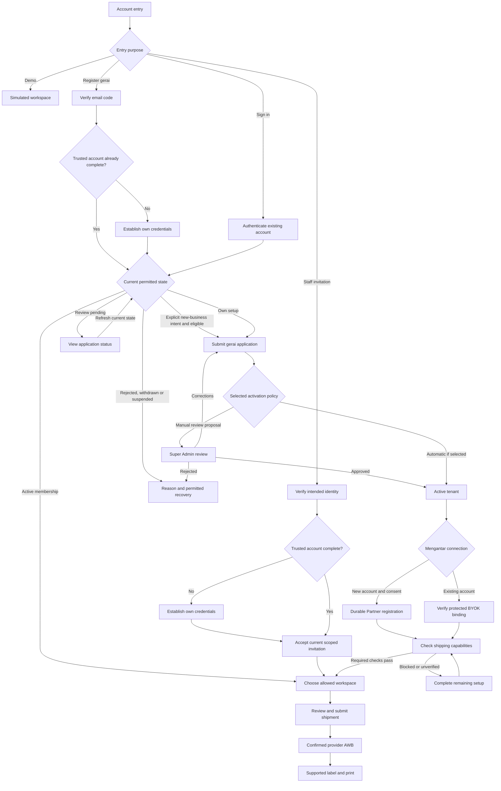

# GeraiExpress — Operator Flows and Screen Contracts

- Status: Proposed behavior handoff; permissions and release scope are unresolved where marked.
- Owner: Paduka Ongki
- Updated: 2026-10-13
- Sources: CTX-2, CTX-3, CTX-11; existing LegacyReference source routes and their actions.

## UX-1 — Scoped operational journeys and recovery
- Status: Proposed
- Owner: Paduka Ongki
- Source: CTX-2, CTX-3, CTX-11.
- Statement: Each accepted workflow shall expose its permitted primary action, required context, resulting state, and recoverable error path without bypassing server authorization or concealing uncertain provider outcomes.
- Acceptance: A permitted user completes contact reuse → draft → quote → explicit submission → ready label, resumes unknown/unpaid states safely, and receives understandable validation/permission/stale-data feedback; unauthorized direct actions remain denied.
- Constraints: IAM-1, IAM-2, TEN-1, TEN-2, TD-3, UI-1, NFR-4.
- Evidence: Reference flow source observed; GeraiExpress browser journeys pending.

## Daily shipping flow

1. Sign in, select an authorized tenant/outlet, and show current context. A
   user with no permitted membership sees an access/onboarding state, not an
   arbitrary tenant's data. Changing scope clears old results and pending form
   assumptions that depend on the outlet/provider account.
2. Check outlet readiness and start a draft. Select sender and recipient from
   the contact directory or enter them manually. A contact can have multiple
   saved addresses; show which address was chosen and allow intentional edits.
   Saving new contact details is explicit, not an unexpected side effect of
   merely entering a recipient or obtaining an estimate.
   Prefer one page with stable sections and an explicit final confirmation,
   following the advanced reference; these journey stages do not require a
   separate route or wizard step for each operation.
3. Keep customer sender identity, gerai pickup, destination area, and any
   provider-supported return address visibly distinct. Revalidate destination
   authority and changed contact/address revisions before confirmation. Never
   silently choose one of several ambiguous destination matches.
4. Enter package details and obtain current services. Show provider values,
   account/outlet context, service eligibility, and unavailable options with
   a useful reason. An estimate error preserves the draft for correction.
5. Review sender/recipient/pickup/service/amount, then explicitly confirm the
   sensitive provider action. Disable repeated pending clicks in the UI and
   enforce idempotency on the backend. A mismatch/stale quote returns to review.
6. Track submission honestly. Unknown means reconciliation; unpaid means
   review the verified original batch for payment; issued means provider AWB available. None means
   that delivery or physical printing has occurred.
7. Request the supported provider label, show its generation state, then allow
   authorized download/print/reprint. Expired download and missing label
   permission have scoped recovery paths rather than an empty successful page.

## Screen inventory derived from the reference

Destinations below describe proposed workspaces, not implemented GeraiExpress
URLs. Only accepted features become visible navigation.

| Workspace | Actor/job and required data | Primary / sensitive actions | States and completion |
|---|---|---|---|
| Scope and entry | Authenticated user; memberships, tenant/outlet readiness | Choose authorized context; sign out | Loading/no membership/suspended/denied; completion is a valid workspace |
| Daily overview | Permitted tenant user; current action counts and selected period | Open a filtered action queue; refresh | True empty versus stale/error; timestamp and metric basis visible; PR-14 scope conditional |
| Shipment list | Operator/admin; scoped paginated rows, status/filter/query context | Create/resume/open shipment | Empty/no match/loading/error; view filters preserved in navigation |
| New/edit draft | Operator/admin; outlet, parties, saved addresses, area and package | Save draft; explicit optional save to contacts; obtain quotes/review in the same workspace | Validation/dirty form/pending/stale contact or account; success shows saved draft with no implied provider order |
| Contact directory/detail | Permitted staff; role flags, minimal list DTO, selected detail/addresses | Create/edit/select; administrator archive if accepted | Empty/search no match/archived/conflicting address/stale revision; saving master leaves shipment history unchanged |
| Quote/review | Operator/admin; current draft/quote/account/sender mapping | Select service; explicitly confirm submission | Unsupported/COD unavailable/changed quote/account/permission; completion is durable submission receipt |
| Shipment detail/recovery | Permitted staff; submitted snapshot, order result and events | State-valid reconcile/payment/print actions | Queued/in flight/unknown/unpaid/issued/failed; no automatic unsafe resend |
| Labels/print history | Permitted staff; scoped AWB, generation/format and attempt history | Request/download/print/reprint | No AWB/unpaid/permission missing/pending/failed/expired; print request wording does not claim paper output |
| Outlet/account settings | Tenant administrator; safe binding projection, pickup-area pair, capabilities | Save/replace connection and brand; verify readiness | Incomplete/changed authority/invalid config/unavailable provider; no key echo or silent funding fallback |
| Members | Tenant administrator; current membership and revision | Invite/role/deactivate with safeguards | Pending/conflict/last-admin/denied; success updates effective membership and audit |
| CSV intake | Conditional operator/admin; template, bounded preview and row errors | Preview; select valid rows; create drafts | Ambiguous destination/tampered/expired/partial row failure; no issuance as import side effect |
| Platform tenant administration | Conditional platform role; scoped tenant status/readiness and audit | Provision/suspend/reactivate | Pending/replay/denied/in-flight-effect context; no implicit contact visibility or impersonation |
| Quick tariff / readable reference / receipt / batch handover | Advanced-source candidates only | TD-1 identifies source modules; select the corresponding workflow before exposing it | Local reference never masquerades as AWB; customer receipt does not expose provider cost; handover is separate from delivery |
| Analytics/export/finance/RTS | Later accepted feature only | Defined by its eventual domain contract | Do not copy the old menu; advanced reference removed some of these surfaces, so existence varies by checkout |

## State-valid action contract

| Condition | Allowed next action | Blocked or redirected behavior |
|---|---|---|
| Missing tenant/outlet/readiness | Select authorized scope or follow setup path | No provider mutation, quote with guessed origin, or cross-tenant default |
| Valid local draft | Save/update and obtain quote | No print or unreviewed submission |
| Current available estimate | Review and confirm | Stale draft/account/quote/sender mapping requires revalidation |
| Queued or in flight | View progress, resume status | No create-order retry or replacement merely because navigation timed out |
| Unknown provider outcome | Reconcile through permitted recovery | No blind re-creation, arbitrary failed-status edit, or account switch to bypass uncertainty |
| Existing unpaid order | Authorized payer reviews every payable order in the verified original batch and its total before explicit payment recovery | No single-row charge implication, unknown/foreign batch member, replacement order or blind payment retry; TD-3 governs reconciliation |
| Issued AWB | Generate supported label and view verified tracking | Contact edits cannot rewrite the submitted sender |
| Label pending/processing | Poll existing job within account limits | No repeated generation just to check status |
| Completed label URL expired | Reauthorize and GET the existing generation for a fresh URL | No POST regeneration merely to renew a download link |
| Label generation failed | Show safe cause, correct it and explicitly request a new generation if eligible | No unbounded POST loop; account Print quota still applies |
| Revoked member/suspended tenant | Denied new work; explicit access/recovery guidance | New privileged work blocked; bounded machine result recording still follows TD-3 |

## Interaction and browser evidence requirements

Preserve unsent values and useful existing data during recoverable errors.
Show field errors near labelled inputs, focus the relevant result/error, announce
pending and completion, and keep all primary controls keyboard reachable.
Confirmation dialogs explain the actual provider/money effect and selected
scope. Contact archiving states its relationship to historical snapshots.

At 390px, 768px, and 1280px, scope and next action remain visible; wide tables
scroll locally rather than making the document overflow. Long names/addresses,
multiple outlets, empty and populated data, backend errors, stale selection,
unknown/unpaid status, and denied actions need rendered-browser evidence.
Static React render tests and a green build do not satisfy that evidence.

Use Bahasa Indonesia for the proposed operator UI and explicit locale/timezone
formatting; final locale, printer/device support, and accessibility acceptance
are owner decisions. Keep internal fixture-only gates out of the production
flow. Show truthful capability/readiness errors instead of implementation jargon.

## UX-2 — Seller onboarding, existing-account connection, and recovery
- Status: Proposed
- Owner: Paduka Ongki
- Source: CTX-16, CTX-17, CTX-19.
- Statement: Provider settings shall guide an authorized tenant administrator through new-seller or existing-account connection, required owner agreement, recoverable progress, and capability-specific readiness without exposing credentials or hiding provider restrictions.
- Acceptance: Browser journeys complete both permitted connection paths and retain non-secret input on correctable errors; timeout/503/null-key/existing-email/rotation-unknown cases show the right recovery; foreign/unauthorized requests remain denied and no provider password/key readback appears.
- Constraints: PR-17, PR-18, PR-19, PR-20, IAM-3, TEN-3, UI-1, UI-2, UI-3, NFR-4.
- Evidence: Screen contract only; no rendered GeraiExpress browser proof.

| Surface/state | Visible information and action | Completion/recovery |
|---|---|---|
| Connection choice | Explain tenant business/account relationship; New Mengantar account or Existing account | Choice does not create an account; show current tenant and owner authority |
| New account form | Active tenant and account-owner authority first; owner name, readable email, Indonesian mobile; account/COD disclosure; links to actual provider Terms/Privacy; affirmative agreement | Validate fields, preserve non-secret values, and show Create Mengantar account action only to permitted roles; no password field |
| Registration pending/unknown | Durable progress reference, current owner email, truthful status | Resume same operation; disable repeat creation and never change external ID for recovery |
| Existing email conflict | Explain that an account already exists without exposing provider account details | Move to BYOK instructions; do not create another account with a fabricated email |
| Existing account form | Owner logs in to Mengantar and creates/copies own key; protected one-time input and account-authority check | Store key privately; clear submitted secret from client form state; no saved-key reveal |
| Connected summary | Owner email, safe seller/account reference, connection mode, independent shipping/sender/PDF/tracking capability states | Configure pickup, request permitted checks, and show Lupa Password instructions; connected does not mean ready for every operation |
| Quota/configuration/provider restriction | Human-readable next action, retry time where appropriate, support path | Background scheduled recovery; no rapid retry button for daily cap or deliberate restriction; technical details only where administrator action requires them |
| Credential management | Explicit effect confirmation: old key stops immediately, webhook secret may change; current account context | Fence dispatch while pending; rotation unknown routes to recovery without a second rotation |
| Webhook unavailable/desynchronized | Tracking via authorized polling; manual Mengantar URL/secret setup and verification guidance for administrator | No automatic Partner webhook setup or blank-secret success state |

The daily operator sees a concise readiness banner with a permitted next action;
Partner secrets, IP-policy internals, and quota configuration belong only in
administrator/operations surfaces where they support a decision. A platform-wide
Partner access issue must not falsely label all tenant seller accounts banned.
Agreement and sensitive effect confirmation are required steps; routine form
navigation and read-only recovery status do not need extra confirmation dialogs.

## UX-3 — Initial demo login and guided sample workspace
- Status: Proposed
- Owner: Paduka Ongki
- Source: CTX-21.
- Statement: The login surface shall make demo access discoverable and open a labelled sample workspace where a reviewer can try the initial shipping workflow without onboarding a real Mengantar account.
- Acceptance: At NFR-4 viewports, a reviewer follows the supplied demo login instructions, sees the demo tenant/outlet and persistent simulation notice, explores seeded contacts/shipments, completes the sample flow, and can reset trial changes or sign out; invalid/expired demo access shows a usable recovery message.
- Constraints: PR-21, IAM-4, UI-1, UI-2, NFR-4. Simulation output must not imply a real AWB, payment, provider PDF acceptance, delivery, or physical print.
- Evidence: Flow specification only; no implemented screen or browser proof.

| Step | Product behavior |
|---|---|
| Login | Provide an obvious demo entry and working access instructions with the first preview; real account registration remains a separate path |
| Sample workspace | Show demo tenant/outlet and a persistent Demo / Simulasi label; preload synthetic sender/recipient contacts and draft/issued/recovery examples |
| Try a shipment | Reuse sample contacts, edit a session-local draft, compare example quotes and confirm a simulated shipment |
| Sample label | Display a conspicuous sample watermark and simulated reference; do not present it as a valid courier shipping label |
| Restricted settings | Explain that provider connection, seller creation, staff invitations and real payments require a real authorized workspace |
| Reset / exit | Reset only the visitor's trial state to seeded examples or sign out; preserve no shared visitor-entered personal data |

## UX-4 — Counter workflow and daily operating context
- Status: Proposed
- Owner: Paduka Ongki
- Source: CTX-2, CTX-3, CTX-14, CTX-22, CTX-23.
- Statement: The initial gerai workspace shall support the complete counter job through scoped contact reuse, parcel/service review, original-order recovery and authorized label access, with setup/governance and optional finance/custody work clearly assigned to their accepted contracts.
- Acceptance: An authorized operator can handle a new sender, a returning sender, a quote correction, a timed-out/unpaid order and a reprint within the selected outlet without losing entered values or creating a second order; another staff member can resume saved permitted work and sees a conflict instead of overwriting a newer draft.
- Constraints: PR-1 through PR-10, PR-12, PR-13, NFR-2, NFR-4, DATA-2. PR-14 is conditional; receipts, customer payments, handover and cancellations require separate acceptance. Existing IAM permissions remain authoritative.
- Evidence: User intent and source-reviewed workflows; actual counter observation/browser proof pending.

| Counter moment | Operator decision and system behavior | Completion / boundary |
|---|---|---|
| Start work | Select authorized outlet; inspect readiness and queued exceptions | Open shipment worklist/new draft; setup issues route to permitted administrator |
| Customer intake | Select returning sender/destination or enter new details; confirm chosen address and intentional contact saving | Valid local draft; no implicit seller or provider-master creation |
| Parcel and service | Enter parcel details, correct ambiguous areas, request quotes and explain available service/amount | Current quote bound to draft/account; never silently replace the selected service or price |
| Review and issuance | Review customer identity, pickup, destination, service and provider amount; explicitly confirm | Durable original operation and truthful progress; provider timeout does not create a new logical shipment |
| Label and customer follow-up | Print supported label when ready; find the original record for tracking/reprint | Original snapshots and permitted private access; no invented delivery/physical-print success |
| Staff change | Resume saved draft/operation with current membership and revision | Shared allowed tenant work; stale editor receives a conflict and retains unsaved input |
| Daily attention | Filter existing unknown/unpaid/failed-label work and inspect last update | Resolve the original operation or escalate; counts do not imply financial cash closure |
| Optional customer payment / parcel handover | Use only an accepted money/custody workflow; otherwise retain clear capability boundaries | No counterfeit receipt, ledger, pickup or cancellation event inferred from label creation |

The operator completes common intake on one page with distinct Sender,
Recipient, Pickup, Parcel and Service/Review sections. Show the next valid
operation rather than a generic analytics dashboard. Owner setup, members and
credentials remain separate administrator tasks. A customer asking for status
does not receive broader portal/login access through the contact directory.

Verify the first counter pilot with long Indonesian names/addresses, repeated
contacts, route ambiguity, insufficient provider funding, interrupted requests,
concurrent edits and reprints on the selected printer/media. Device/volume and
customer-charge policies are explicit open decisions in the PRD, not guessed
behavior or inherited LegacyReference constants.

## UX-5 — Normal customer tariff and private discounted seller price
- Status: Proposed
- Owner: Paduka Ongki
- Source: CTX-24 through CTX-28.
- Statement: Counter review and customer/resi output shall show the normal undiscounted Mengantar tariff and applicable verified customer COD/insurance charges, while administrator pricing surfaces separately show assigned discounts and verified net provider costs.
- Acceptance: Different verified seller discounts preserve the same normal customer tariff; applicable fees/premiums are counted once with an explicit payer; all enabled modes including COD Ongkir retain the retail basis, and operator/customer payloads/output omit private net cost/discount. Changed/unknown amounts preserve the draft or reconcile the original submitted order.
- Constraints: PR-22, PR-23, IAM-5, IAM-6, DATA-5, UI-2, NFR-4. Provider PDF normal-price output must be verified; customer goods and settlement responsibilities remain separate.
- Evidence: Selected product policy and source/static-render study; no GeraiExpress browser/provider price proof exists.

| Surface / mode | Required behavior |
|---|---|
| Non-COD operator/customer | Normal shipping plus selected applicable insurance; no COD fee; distinguish amount due from a recorded payment |
| Full COD operator/customer | Goods collected plus normal retail shipping and the applicable customer components assigned to courier collection; fee inclusion/rounding follows the verified rule |
| COD Ongkir operator/customer | Normal retail shipping and applicable collection components, goods not collected by courier; never substitute discounted shipping cost as its customer basis |
| Insurance selection | Show supported coverage/premium and its payer/collection channel; required/unsupported/unknown states are explicit; no double collection |
| Tenant administrator | Own assigned terms, activation status, account-specific net quote and actual cost basis where available; estimate and actual reconciliation stay distinct |
| Platform pricing administrator | Scoped audited discount assignment/effective version and provider activation/mismatch states; no universal discount claim or local-only false activation |
| Changed/unavailable prices | Preserve input and show revalidation/refresh; no fake quote, hardcoded legacy fee, zero-cost assumption or silent account/service switch |
| Confirmed shipment / label | Retail price snapshot and original approved collection; later discounts do not change reprints; actual provider adjustments remain separate history |

Show source/quote time and the chosen service before customer confirmation.
Where customer fees are presented together as shipping, retain their underlying
components so the total stays consistent across review/detail/print. Never use
that presentation to substitute net cost or conceal who collects an insurance
premium. Retail values are permitted operator data; internal settlement values
remain private even when a customer fee numerically matches a provider fee.

Inspect actual provider PDF fields/templates for normal customer tariff and
private-net disclosure. If the provider output cannot satisfy this requirement,
label readiness must explain the capability gap for resolution; do not silently
print net cost, invent a custom-price API parameter or modify authoritative AWB
routing. Customer receipts and financial reporting retain their own accepted
scope; they are not automatic replacements for the requested resi behavior.

## UX-6 — Super Admin workspaces and sensitive-action states
- Status: Proposed
- Owner: Paduka Ongki
- Source: CTX-14, CTX-17, CTX-28, CTX-29, CTX-30.
- Statement: A separately guarded Super Admin workspace shall organize tenant governance, negotiated discounts, integration readiness, operational triage and audit around their decisions, with explicit scope and safe recovery.
- Acceptance: A permitted Super Admin completes tenant lookup/configured review, scoped discount verification and eligible exception reconciliation with truthful pending/audit results; anonymous/tenant/demo/revoked/incomplete-factor cases are denied at direct boundaries, and partial/stale/empty/failed data remains distinguishable at NFR-4 viewports.
- Constraints: PR-15, PR-23 through PR-28, IAM-7, TEN-4, UI-4, NFR-4. Routes below are proposals, not implemented pages or separate hostnames.
- Evidence: Reference screens/source and current contracts; no GeraiExpress browser proof.

| Workspace / proposed entry | Required data and main action | States / completion |
|---|---|---|
| Super Admin login / `/login/super-admin` | Verify identity, current platform grant and factor challenge | Anonymous/denied/factor-required/expired; completed access loads only granted platform workspace |
| Ringkasan / `/platform` | Work needing attention, defined tenant/usage/queue/provider signals and timestamp | Initial loading/partial/stale/error/true empty; each signal links to its matching filtered worklist |
| Gerai / `/platform/tenant` | Business name/status, minimal owner contact, outlet/member counts, connection readiness | Search/status/pagination and explicit scope; open one tenant's platform detail without entering its customer workspace |
| Detail gerai / `/platform/tenant/[tenantId]` | Lifecycle/history, outlet/readiness summary, seller mode, assigned discount and scoped issues | Missing/denied/conflict/pending; permitted lifecycle confirms reason and effect then displays recorded result |
| Pendaftaran / `/platform/pendaftaran` | Registration/setup/verification and versioned review history under UX-7 | Conditional manual-review policy; approve/request corrections/reject reason, replay/conflict and clear app-versus-provider state |
| Diskon / `/platform/diskon` | Tenant/seller/service terms, effective version and provider activation/net quote evidence | Pending/verified-active/mismatch/expired; save does not claim upstream activation and normal customer tariff stays fixed |
| Integrasi / `/platform/integrasi` | Environment/origin readiness, safe secret-version status, account capabilities, egress/quotas and BYOK distinctions | Configuration blocked/provider restricted/partial registration/webhook desync; route only to permitted existing recovery/setup |
| Operasi / `/platform/operasi` | Scoped original-operation references, status/attempt history, safe error code and next permitted action | Queued/in-flight/unknown/unpaid/failed/label pending; reconciliation resumes one original operation, never blind re-create/pay |
| Audit / `/platform/audit` | Actor/action/target tenant or global scope/time/reason/outcome/version/correlation | Filtered empty versus denied/load failure; append-only records and safe minimal metadata |
| Akses platform / `/platform/akses` | Approved staff grants, current capability/revision and security state | Conditional role-governance permission, final-admin conflict, revoked access and recovery guidance; no password/factor-secret readback |

List filters preserve meaningful URL state. A persistent Platform / Super Admin
context indicator distinguishes this workspace from a selected tenant detail.
Unknown issue details do not expand into full customer contacts. Label current
snapshots versus selected-period events; display WIB and the latest data time.

Sensitive changes name the tenant/account, action, effect and reason; do not
preselect a destructive result. Confirmation pending blocks duplicate clicks,
while backend idempotency remains authoritative. Denied actions explain the
permitted escalation without revealing another tenant's details. After success,
return focus to the changed object/result; conflict preserves entered reason
and asks the user to review current state. Integration/discount/credential edits
require explicit save/confirmation rather than silent autosave.

Suspending a gerai blocks selected new work, preserves existing resi/history and
records dispatched outcomes. An unpaid issue points to the tenant's authorized
funding/recovery path; it does not let Super Admin spend the seller's funds by
virtue of viewing the issue. Missing provider capability remains pending rather
than a green ready state. No retry control bypasses the original account/version.

Initial preview may use isolated synthetic platform fixtures to verify these
screens; the existing shared operator demo remains unable to enter Super Admin.
Working privileged account/bootstrap and real integrations are supplied only
when implemented through their approved provision/release process.

## UX-7 — Real-account registration through first-resi readiness
- Status: Proposed
- Owner: Paduka Ongki
- Source: CTX-31 through CTX-35; PR-29, PR-30, PR-33.
- Statement: A real applicant shall have a complete resumable path from verified app identity through gerai application/selected activation to explicit seller connection and capability readiness, with each state naming the next permitted action.
- Acceptance: New/returning, interrupted, invalid-code, pending/correction/rejected and new/BYOK provider paths preserve the correct identity/application and never create duplicate tenants/sellers or conceal a blocked first shipment.
- Constraints: PR-15, PR-17 through PR-21, TD-11, DATA-7, IAM-8, TEN-5, UI-5, SEC-5, NFR-4; recommended email-first/manual-review policy requires acceptance.
- Evidence: Proposed journey and diagram; not executed browser/Auth/provider evidence.
- Change history: 2026-10-13 — Added in the registration and documentation-completeness review.

### Registration flow

Diagram owner: UX-7. Review date: 2026-10-13. Status: Proposal. Plain flowchart
syntax is used for host compatibility; no rendered-diagram/browser claim.

Each arrow is a guarded transition, not an automatic API call. Demo never joins
the live path. Staff membership uses UX-8; it never creates another gerai/seller.
Active members enter only the capabilities their role and outlet permit.

### Screen and state contract

Routes are proposed same-origin destinations, not installed pages. Combine steps
within `/onboarding` when simpler; permission/state checks do not depend on paths.

| Surface / proposed destination | Main job and action | Pending, failure and next screen |
|---|---|---|
| Register / `/daftar` | Explain Register gerai versus staff/demo/sign-in; collect email, actual app notices/required Terms acceptance; request code | Validate inline; generic accepted response; public quota/unavailable state; next email verification, no tenant/provider effect |
| Email code / `/verifikasi-email` | Show entered email, code input, change-email and rate-limited resend; verify natively | Wrong/expired/consumed code and delivery uncertainty preserve email; never claim tenant approval; success resolves current identity |
| New account completion / `/onboarding` | Initial/partial app identity explicitly sets/replaces its password after inbox proof; previously completed app identity keeps its credentials | Password policy/confirmation error preserves safe fields only; failed update can resume; explicit recovery for returning users |
| Gerai setup / `/onboarding/gerai` | Owner/business/contact/first-outlet fields and applicant-authority declaration; save/submit current revision | Invalid/conflict/network/duplicate submission; after response loss load own application rather than create anew; success opens status/setup |
| Application status / `/onboarding/status` | Current submitted revision, selected policy, safe reason/history and who acts next | Submitted/changes requested/approved/rejected/withdrawn; correct and resubmit only permitted states; no promised review SLA |
| Super Admin review / `/platform/pendaftaran` | UX-6 purpose-bound verified owner/business projection and current revision | Approve/request corrections/reject with reason; stale/concurrent decision reloads; success is local tenant decision, not seller creation |
| Seller connection / `/onboarding/mengantar` | Active tenant administrator chooses new or existing seller; UX-2 exact owner/consent/key flow | Email conflict goes BYOK; timeout/503/quota resumes original external ID; missing real owner/policy remains blocked |
| Readiness / `/onboarding/kesiapan` | Show pickup, sender, quote/pricing, allowed modes, PDF and tracking with distinct status/reason | Required unavailable capability blocks that operation; optional webhook does not block verified polling; role-valid next setup action |
| First shipment / permitted tenant workspace | UX-1 intake/current quote/review/submission/label | Unknown/unpaid/label-pending recover original operation; no new seller or order caused by back/refresh/login |

### Review and exception paths

Recommend manual review for the first pilot, with one visible worklist and safe
reasons; this is not an accepted requirement that every future gerai needs manual
approval. If automatic activation is selected, omit the waiting screen and record
the current policy outcome. In either mode, owner email verification and valid
data are prerequisites, and provider connection remains an explicit later action.

Corrections keep the same application/tenant ID and create a new submitted
revision. Rejection explains the permitted next step under selected resubmission
policy; no fabricated new email or provider account is suggested. Withdrawal and
subsequent reapplication are available only if that policy is accepted. Changing
business/pickup details after approval follows normal settings authorization.

For an unknown app submission result, reload its own idempotent command receipt.
For unknown provider creation, UX-2/TD-7 recover the original external ID. These
are different recovery mechanisms. A successful email send, verified session,
approved tenant and connected seller each have a different completion message.

### First-resi readiness checklist

| Capability | Required before enabling the related action |
|---|---|
| Identity and scope | Current active tenant/member/outlet; administrator authority for setup; demo transport isolated |
| Account binding | Correct actual seller/account/environment and private current key; no shared default funding fallback |
| Pickup and customer sender | Verified pickup-area mapping; supported dropshipper mapping and required permission for custom sender |
| Customer/seller prices | Verified normal tariff and private net cost; activated applicable discount; no unverified local discount advertised as upstream |
| Collection and insurance | Current supported mode and authoritative fee/inclusion/payer rules; unselected customer-goods settlement remains blocked |
| Order and funds | Current quote/draft/account revision, allowed service and authoritative funding/payment conditions; checks do not themselves debit funds |
| Label | Authoritative AWB and permitted provider PDF; actual customer-price/branding/scan output verified before claiming required custom resi support |
| Tracking | Verified scoped polling baseline; webhook remains optional until its independent secret/capture proof succeeds |

Readiness is per capability and action. Local setup/drafts need no live order;
customer sender, collection and label requirements cannot be bypassed merely to
show a global ready badge. The reviewer sees which check is synthetic versus real.

## UX-8 — Staff entry, login routing and account recovery
- Status: Proposed
- Owner: Paduka Ongki
- Source: CTX-31, CTX-33, CTX-34; PR-31, PR-32.
- Statement: Staff invitation, returning-user login and recovery shall resolve current identity and permitted scope without accidental gerai/seller creation, credential overwrite or cross-tenant disclosure.
- Acceptance: Invited new/existing users accept only valid current intended scope, account switches/recovery return to a permitted destination, and no-membership/multi-membership/pending/suspended states have a clear usable next action at NFR-4 sizes.
- Constraints: IAM-2, IAM-8, TEN-5, DATA-7, SEC-5, UI-5, PR-20; native Auth and current membership remain authoritative.
- Evidence: Screen/recovery proposal only; no account, invitation or browser session created.
- Change history: 2026-10-13 — Added in the registration and documentation-completeness review.

| Entry/state | Main action and result | Recovery / authority limit |
|---|---|---|
| Staff invitation / `/undangan/[inviteId]` | Verify intended email or sign in; after proof show business, role and outlet scope; explicitly accept | Wrong signed-in identity offers safe account switch; invalid/expired/revoked invitation offers request-new-invite guidance without foreign details |
| New staff identity | Native email verification/account completion, then same invitation acceptance | No gerai application or Mengantar creation; role comes from current allowed invitation, not signup input |
| Existing staff identity | Keep credentials/memberships, accept explicit new scope | Already member resolves existing role or controlled conflict; no silent promotion or duplicate membership |
| Sign-in / `/login` | Native password login; resolve verified current identity/membership/application | Invalid credentials are generic; no membership opens own onboarding/invitation guidance; multi-membership opens chooser; no assumed first tenant |
| Forgot password / `/lupa-password` | Request native recovery with generic accepted feedback | Show resend/expiry guidance without confirming email existence; this recovers GeraiExpress only |
| Set/reset password / `/atur-ulang-password` | Require valid native recovery/authentication and explicit new password | Expired/used/missing session returns to fresh recovery; no app-role change, seller ownership change or password readback |
| Auth callback / `/auth/callback`, if used | Complete supported native exchange and safe same-origin return | Invalid/missing verifier, reused code or unsafe destination fails safely; GET never accepts invitation or provisions a tenant |
| Session expiry during setup | Authenticate again and reload own saved application/current invitation | Preserve bounded non-secret edits where safe; no replay of provider/money commands; current server state wins |
| Suspended/revoked access | Explain restriction, permitted support path or switch to another current membership | No tenant operation/provider effect; do not erase existing in-flight result/history |
| App email change | Native secure-email-change flow; refresh verified identity | Pending new email cannot accept matching invites until verified; existing seller email remains unchanged; owner transfer separate |
| Mengantar dashboard access | Explain native Mengantar Lupa Password to confirmed provider email | No GeraiExpress form accepts or resets Mengantar password; provider verification/bank/COD restrictions remain independent |

Emails and status views identify the actual application/business and purpose,
without full customer data. Show TTL/resend availability from selected native
configuration. No signup-generated account or notification is presented as a
working demo credential. The first preview still supplies PR-21's actual demo
access separately from these proposed real-user journeys.
